# Contributing to Yukta

Thank you for helping. Bug reports, plugins, docs, tests and examples are all welcome, and a small first pull request is a good one.

| I want to... | Do this |
|---|---|
| Ask a question or float an idea | [Discussions](https://github.com/infenia/yukta/discussions) |
| Report a bug | [Bug report](https://github.com/infenia/yukta/issues/new?template=bug_report.yml) |
| Propose a feature | [Feature request](https://github.com/infenia/yukta/issues/new?template=feature_request.yml) |
| Find something to work on | [Good first issues](https://github.com/infenia/yukta/issues?q=is%3Aissue+is%3Aopen+label%3A%22good+first+issue%22) and [help wanted](https://github.com/infenia/yukta/issues?q=is%3Aissue+is%3Aopen+label%3A%22help+wanted%22) |
| Report a vulnerability | Privately, see [`SECURITY.md`](SECURITY.md). Not an issue. |

By taking part you agree to the [Code of Conduct](CODE_OF_CONDUCT.md).

## Set up

You need **JDK 25** and Git. The UI (`ui/`) also needs Node and pnpm, and the CLI (`cli/`) needs Go; you can skip both if you only change Java.

```bash
git clone https://github.com/<you>/yukta && cd yukta   # your fork
./gradlew bootRun                                      # server and UI at http://localhost:9858
```

Then run only what covers your change while you work, and the full gate once before you push:

```bash
./gradlew :core:test --tests '*WorkflowOrchestratorTest'   # one test class
./gradlew :core:check                                      # one module: tests + static analysis
./gradlew spotlessApply                                    # format (also adds license headers)
./gradlew check                                            # everything, before the PR
```

<picture>
  <source media="(prefers-color-scheme: dark)" srcset="docs/images/diagrams/module-map.dark.svg">
  
</picture>

The module table is in the [README](README.md#develop). Each module has a `CLAUDE.md` with its build commands and architecture notes; they are written for AI assistants and read just as well by people.

## Pull requests

1. **Fork** and branch from `main`.
2. **Make the change**, with tests for new behaviour and docs for anything a user would notice.
3. **Run** `./gradlew spotlessApply` and `./gradlew check`.
4. **Open the pull request.**
   - Title it as a [Conventional Commit](https://www.conventionalcommits.org/), for example `feat(core): add retry budget`. A check enforces it, because the title becomes the squash commit on `main` and groups the release notes.
   - Link the issue it resolves with `Fixes #123`.
   - Say what changed and how you tested it.
5. **Sign the CLA** when the bot asks (first pull request only, see [below](#license-and-contributor-license-agreement)).

Commit types: `feat`, `fix`, `docs`, `style`, `refactor`, `test`, `chore`.

### What CI runs on your PR

CI builds the modules your PR changes **plus every module that depends on them**, with the
full set of gates (tests, Checkstyle, PMD, SpotBugs, OpenGrep, JaCoCo). A change to the build
itself (`build-logic/`, `gradle/`, `config/`, `.github/workflows/`, ...) builds everything, and a
docs-only PR builds nothing. The `Detect Changed Modules` job summary shows the plan.

* Want the whole build anyway (e.g. an interface change used through reflection)? Add the
  `ci:full` label and re-run CI.
* `CI Gate` is the one required check.
* `main` and a nightly run build everything; a failing nightly opens a `ci-nightly` issue.

Details: [.github/WORKFLOWS.md](.github/WORKFLOWS.md).

## Coding standards

* **Java 25**, formatted to the **Google Java Style Guide** by Spotless (2-space indent, 100 columns). Do not format by hand; run `spotlessApply`.
* **Checkstyle, PMD and SpotBugs** run in `check`, on main and test code.
* Javadoc on new public methods.
* Small, focused methods. Records for data carriers; Lombok (`@Slf4j`, `@RequiredArgsConstructor`, `@Builder`) instead of hand-written boilerplate.

## Reporting bugs and suggesting features

* Search the [issue tracker](https://github.com/infenia/yukta/issues) first; add to an existing
  issue rather than opening a duplicate.
* A bug report asks for what happened, steps to reproduce, the module, the severity, the version
  and your environment.
* For a feature, describe the problem or use case first, then the solution you have in mind.

## How work is tracked

Every bug, risk, improvement and plan is a GitHub issue on the
[Yukta Roadmap project](https://github.com/orgs/infenia/projects). The documentation site holds
product documentation only. In short:

* The issue **type** (Bug, Feature, Task, Epic) says what an issue is; area labels (`core`, `web`,
  `plugins`, ...) say where it is.
* New issues start in **Triage**. A maintainer sets the module and priority and moves them to the
  backlog.
* Larger work is an **Epic** with sub-issues; its design text is in `design/`.
* Link your PR to its issue with `Fixes #<n>`; the project then moves the issue to *In review*,
  and to *Done* when the PR merges.

Fields, views and triage rules: [.github/PROJECT.md](.github/PROJECT.md). How decisions are made: [`GOVERNANCE.md`](GOVERNANCE.md).

## License and Contributor License Agreement

Contributions are licensed under the licence of the directory they change: **Apache License 2.0**
everywhere, **AGPL-3.0-only** inside `plus/`. See [`LICENSING.md`](LICENSING.md).

Before your first pull request can be merged you must sign the Contributor License Agreement
([individual](CLA.md) or, for an employer, [corporate](CLA-corporate.md)). The CLA bot comments on
your pull request with the one line to reply. The agreement lets Infenia also offer the Work under
commercial licences. Infenia employees and bots are exempt.
