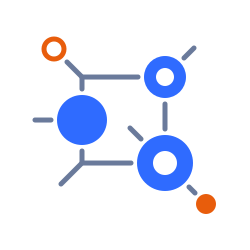

<div align="center">
  
  <h1>Yukta</h1>
  <p><strong>A reactive, DAG-based workflow orchestration server.</strong><br />
  Define a workflow once as JSON. Run it from a script, a CI pipeline, a web UI or an AI agent.</p>

  <p>
    <a href="#quick-start">Quick start</a> ·
    <a href="examples/README.md">Examples</a> ·
    <a href="#plugins">Plugins</a> ·
    <a href="#mcp-server">MCP</a> ·
    <a href="#rest-api">REST API</a> ·
    <a href="CONTRIBUTING.md">Contributing</a>
  </p>
</div>

[](https://github.com/infenia/yukta/actions/workflows/ci.yml)
[](https://github.com/infenia/yukta/actions/workflows/codeql.yml)
[](https://codecov.io/gh/infenia/yukta)
[](https://www.bestpractices.dev/projects/15487)
[](https://scorecard.dev/viewer/?uri=github.com/infenia/yukta)
[](https://api.reuse.software/info/github.com/infenia/yukta)
[](LICENSING.md)
[](#project-status)
[](https://github.com/infenia/yukta/releases)

---

## Why Yukta

Most workflow engines make you pick: a heavy platform you have to operate, or a script you cannot observe. Yukta is a small server that sits between the two.

- **Workflows are data.** A workflow is a JSON graph of nodes and edges. There is no DSL to learn, and a graph is easy for people, tools and AI agents to generate and review.
- **One definition, many callers.** Start the same workflow from REST, the web UI, the Go CLI or an [MCP](https://modelcontextprotocol.io/) client such as Claude.
- **Reactive end to end.** Built on Spring WebFlux and Project Reactor. Nodes are non-blocking streams, and I/O runs on virtual threads.
- **Observable and controllable.** Live DAG view, SSE log and status streams, and run controls: pause, resume, stop, restart, skip, retry, step and breakpoints.
- **Extensible.** Plugins are Spring beans implementing a small interface from `plugin-api`. Adding one does not touch `core`.
- **Safe to start with.** It binds to loopback by default, and an API key guards `/api/**` and `/mcp` when you expose it.

## Project status

> **Yukta is in alpha (`0.1.0-alpha.2`).** The engine, plugins, REST API and MCP server run and are covered by tests. The first release ships a native Linux (amd64) server, a Docker image and the client; expect breaking changes to the workflow JSON schema and the APIs before v0.1.0.

| Area | Status | Notes |
|------|--------|-------|
| DAG engine (`core`) | Working | Reactive compiler, validator and executor |
| REST API (`web`) | Working | 12 controllers, 46 operations, Swagger UI |
| MCP server (`mcp`) | Working | 17 tools, 2 prompts, 3 resources at `/mcp` |
| Plugins | Working | 37 built-in triggers, processors and terminals |
| Rule supervisor, control planes | Working, opt-in | Declarative rules, or a model, deciding on control-bus events |
| Web UI (`ui`) | Working | React 19 + Vite + Tailwind CSS 4 |
| Go CLI (`cli`) | In progress | See [`cli/README.md`](cli/README.md) |
| Native image (GraalVM) | Released (Linux amd64) | `./gradlew nativeCompile`; ARM, macOS and Windows not yet |
| Releases and downloads | Alpha | `0.1.0-alpha.2`: Linux amd64 archive, `.deb`, `.rpm`, install script, `ghcr.io/infenia/yukta` image |
| User-facing docs | Partial | [`examples/`](examples/README.md) plus per-module `CLAUDE.md` guides |

**Path to beta:** more platforms (ARM Linux, macOS, Windows) · `CHANGELOG.md` · user-facing docs · stable workflow schema and REST/MCP contracts.

---

## Quick start

The quickest way is the one-command installer (installs the server `yukta` and the client `yukta-cli`, no Java needed): `curl -fsSL https://github.com/infenia/yukta/releases/download/v0.1.0-alpha.2/install.sh | sh` on Linux (the alpha installs the client only on macOS). Or use Docker: `docker run --rm -p 127.0.0.1:8080:8080 -e YUKTA_API_KEY=change-me ghcr.io/infenia/yukta:0.1.0-alpha.2` (add `-H "X-API-Key: change-me"` to the `curl` commands below). To run from source instead you need **JDK 25** and `curl`:

```bash
git clone https://github.com/infenia/yukta.git
cd yukta
./gradlew bootRun
```

Then open the web UI at <http://localhost:8080/> or the API docs at <http://localhost:8080/swagger-ui.html>.

Create a session with one workflow, start it and read the result:

```bash
# 1. Create a session containing a workflow
curl -X POST http://localhost:8080/api/sessions -H "Content-Type: application/json" -d '{
  "sessionId": "demo",
  "name": "Quick demo",
  "description": "Quick demo",
  "initiator": "me",
  "projectPath": "/tmp/demo",
  "workflows": {
    "hello": {
      "workflowId": "hello",
      "description": "Echo a greeting",
      "nodes": [
        { "nodeId": "start", "type": "CONSTANT_SOURCE", "config": {} },
        { "nodeId": "echo",  "type": "PROCESS_EXECUTOR", "config": { "command": ["echo", "Hello from Yukta!"] } },
        { "nodeId": "done",  "type": "CONSOLE_TERMINAL", "config": {} }
      ],
      "edges": [
        { "source": "start", "target": "echo" },
        { "source": "echo",  "target": "done" }
      ]
    }
  }
}'

# 2. Start it (returns 202 with data.executionId)
curl -X POST http://localhost:8080/api/workflow/start -H "Content-Type: application/json" \
  -d '{ "sessionId": "demo", "workflowId": "hello" }'

# 3. Check the status, or follow it live over SSE
curl http://localhost:8080/api/executions/{executionId}
curl -N http://localhost:8080/api/executions/{executionId}/status/stream
```

Sessions are held in memory, so apply them again after a restart.

### More examples

[`examples/`](examples/README.md) has ten ready-to-run workflows, each with a config, a trigger and a test script:

| Use case | Shape |
|----------|-------|
| CI pipeline that stops on failure | build → test → report, routed by exit code |
| Quality gate | `BRANCH` on coverage and lint numbers |
| Data pipeline | split → filter → map → load |
| HTTP health check with an alert path | `HTTP_REQUEST` routed by status |
| Fan-out notifications | `RECIPIENT_LIST` to several channels |
| Retry until ready | `LOOP_PREDICATE` |
| LLM chat agent with memory | `SESSION_MEMORY` + `LLM_CALL` |
| Drive Yukta from an AI agent | MCP `tools/call` |

Run them all against a local server with `examples/run-all.sh`.

---

## How it works

A **session** groups workflows. A **workflow** is a DAG of nodes and edges. Each node is a plugin instance with its own `config`. A run is an **execution** that you can watch, pause, stop and restart.

```
 Transport      REST API (web) · MCP server (mcp) · Web UI (ui) · CLI (cli)
                                    │
 Orchestration  core: DAG validator → compiler → reactive executor (Project Reactor)
                                    │
 Plugins        plugin-api + plugins: Trigger → Processor → Terminal
                ExecutionSupervisor (control bus)
```

Every workflow needs at least one **trigger** (no inbound edges) and at least one **terminal** (no outbound edges), with **processors** in between. The orchestrator checks reachability, cycles and entry points before it runs anything.

Processors can expose named output ports (for example `success` and `failure`, or one port per `BRANCH` case), so one node can route messages down different paths.

---

## Plugins

37 built-in plugins. Type strings are used exactly as written below; their case and separators are not consistent yet.

**Triggers** start a workflow

| Type | Description |
|------|-------------|
| `API_TRIGGER` | Passes the payload from the start request into the workflow |
| `CONSTANT_SOURCE` | Emits predefined variables at startup (none = one empty message) |
| `SCHEDULE_TRIGGER` | Emits on a fixed interval or a cron schedule |

**Processors** transform, route and call out

| Type | Description |
|------|-------------|
| `PROCESS_EXECUTOR` | Runs an OS process; routes by exit code |
| `HTTP_REQUEST` | Makes an HTTP request; routes by status |
| `SQL_QUERY` | Runs a parameterized JDBC statement |
| `FILE_READ` / `FILE_WRITE` | Reads or writes text files in a sandbox directory |
| `LLM_CALL` | Calls an LLM (OpenAI-compatible, Anthropic, Ollama) |
| `MCP_TOOL_CALL` | Calls a tool on a remote MCP server; the "act" step of an agent loop |
| `MCP_LIST_TOOLS` | Lists the tools of an MCP server so an `LLM_CALL` node can offer them to the model (`tools` option) |
| `SESSION_MEMORY` | Per-session chat memory for LLM workflows |
| `FILTER` | Passes messages matching a predicate |
| `VALIDATE` | Checks required fields and types; failures go to `invalid` |
| `BRANCH` | Routes by exact match or expression |
| `SPLITTER` | Splits one message into many |
| `AGGREGATE` | Batches messages into a single list |
| `RECIPIENT_LIST` | Fans one message out to several recipients |
| `MAPPER` | Transforms payloads with SpEL projection, Handlebars or GraalVM JS |
| `CONTENT_FILTER` | Removes redundant or sensitive fields |
| `LOOP_PREDICATE` / `LOOP_STREAM` | Repeats a target plugin until a condition holds, or streams every result |
| `DELAY` | Delays messages by a fixed time, in order |
| `SUB_WORKFLOW` | Runs another workflow of the same session per message and emits its results |
| `WAIT_FOR_SIGNAL` | Holds a message until a named signal (approval, decision) arrives or a timeout passes |
| `KV_STORE` | Shared in-memory key-value state |
| `CLASSIFY` / `GATE` / `SCORE` | Model decisions: pick a label, pass or reject on yes/no, rate on a scale (optional `decision` plugin) |
| `ASK` | Several questions about a message in one model call; answers go to the metadata |
| `ANOMALY` / `DEDUPE` | Compare a message with the last few: `normal`/`anomalous`, `unique`/`duplicate` |

**Terminals** end a branch

| Type | Description |
|------|-------------|
| `CONSOLE_TERMINAL` | Logs the payload |
| `NOTIFY_TERMINAL` | Sends a JSON webhook notification (Slack-compatible) |

**Supervisors** observe and gate control-bus commands. `plugins/supervisors/rule-supervisor` runs declarative rules from a JSON file; enable it with `yukta.supervisor.rules.file`. **Control planes** (`plugins/control-planes`) decide one command per event: `rule-control-plane` (the same rules), `model-control-plane` (a small model; `yukta.control-plane.model.name`) and `rules-first-control-plane` (rules first, model only when no rule fired).

### Write your own

Implement `TriggerPlugin`, `ProcessorPlugin` or `TerminalPlugin` from `plugin-api` and register it as a Spring bean. See [`plugin-api/CLAUDE.md`](plugin-api/CLAUDE.md) and [`plugins/CLAUDE.md`](plugins/CLAUDE.md), or ask the MCP tool `get_plugin_creation_guide` for a template. `GET /api/plugins/{type}` shows the configuration schema of any installed plugin.

---

## MCP server

Yukta runs an MCP server in the same process, always on at `http://localhost:8080/mcp` (streamable HTTP; `/sse` is an alias). Point any MCP client at it so an agent can create sessions, start workflows and read logs.

```bash
claude mcp add --transport http yukta http://localhost:8080/mcp
```

- **17 tools:** `list_sessions`, `get_session_details`, `create_session`, `get_session_creation_instructions`, `get_workflow_details`, `start_workflow`, `get_workflow_status`, `get_workflow_history`, `control_workflow`, `control_node`, `set_node_breakpoint`, `signal_node`, `get_execution_logs`, `list_plugins`, `get_plugin_details`, `get_plugin_creation_guide`, `get_control_bus_status`
- **2 prompts:** `debug-workflow`, `create-session-config`
- **3 resources:** `yukta://overview`, `yukta://architecture`, `yukta://sessions/{sessionId}/executions/{executionId}/logs`

MCP uses the REST keys (`yukta.api-key`, `yukta.api-keys`) plus the optional `yukta.mcp.api-key`, sent as `Authorization: Bearer <key>` (or `X-API-Key`); each tool call needs the key's role (`VIEWER` reads, `OPERATOR` also starts and controls, `ADMIN` everything) and, for a session-limited key, its own `sessionId`. It is open only on loopback with no key.

---

## REST API

Base path `/api`. Interactive docs are at `/swagger-ui.html`.

| Area | Base path | Handles |
|------|-----------|---------|
| Sessions | `/api/sessions` | Apply session config, list sessions (paged), read workflow definitions |
| Workflow details | `/api/sessions/{sessionId}/workflows/{workflowId}` | Workflow graph and its executions |
| Workflow | `/api/workflow` | Start a workflow, stop its runs, session history |
| Executions | `/api/executions` | Status (poll or SSE), stop, restart, pause, resume, per-node control, breakpoints |
| Logs | `/api/sessions/{sessionId}/executions/{executionId}/logs` | Execution log stream (SSE) |
| Control bus | `/api/control` | Live node introspection, heartbeats, node commands |
| Events | `/api/events` | Live event stream (SSE) |
| Plugins | `/api/plugins` | List plugins and their schemas |
| Validation and versions | `/api/sessions/validate`, `/api/sessions/{sessionId}/workflows/{workflowId}` | Validate a session config; list and roll back workflow versions |
| Supervisors | `/api/supervisors` | Status of the installed supervisors |

List endpoints take `?limit=&cursor=` and return the next page in the `X-Next-Cursor` header. The older `/api/workflow/{sid}/{eid}/…` paths still work as deprecated aliases.

### Security

The server listens on `127.0.0.1` by default. To expose it, set `YUKTA_SERVER_ADDRESS=0.0.0.0` **and** `yukta.api-key` (the server refuses to start on another address without a key; the Docker image needs `-e YUKTA_API_KEY=<key>`); clients then send `Authorization: Bearer <key>` (or `X-API-Key`) on every `/api/**` call. For several people or agents use `yukta.api-keys[i].name/key/role` with `VIEWER` (read), `OPERATOR` (also start and control executions) or `ADMIN` (everything); control commands are then audited as `key:<name>`. `PROCESS_EXECUTOR` refuses every command until you set `yukta.process.allowed-commands` or, for trusted authors only, `yukta.process.allow-any=true`. Some plugins run processes, scripts and SQL, so treat workflow authorship as a trusted operation. Report vulnerabilities as described in [`SECURITY.md`](SECURITY.md).

---

## Web UI and CLI

- **Web UI:** a React 19 + Vite + Tailwind CSS 4 app served at `/`. Browse sessions, watch a live DAG view of a run, see execution history, use the control console and build workflows with a form-based editor.
- **CLI:** a Go + Cobra client for a remote Yukta server, in [`cli/`](cli/README.md).

## Building from source

```bash
./gradlew bootRun          # run the server
./gradlew nativeCompile    # optional GraalVM native image (needs a GraalVM JDK)
./gradlew check            # tests + Checkstyle + PMD + SpotBugs + JaCoCo (+ OpenGrep if installed); with Yukta: yk check
./gradlew spotlessApply    # format before committing; with Yukta: yk gradle spotlessApply
```
These plain Gradle commands work anywhere; in Claude Code the build, test and check ones go through `yk`.

**Developing Yukta with Yukta.** Contributors (and Claude Code, which is held to it by hooks) run builds,
tests and checks through `examples/11-dogfood/yk`. Each Gradle call becomes a Yukta workflow on a local dev
server that is always built from `origin/main` and listens on **`http://127.0.0.1:9858`** (web UI, REST and
MCP; `YUKTA_DEV_PORT` overrides). `yk check` is the staged, self-healing quality gate; see
[`examples/11-dogfood/README.md`](examples/11-dogfood/README.md).

**Persistence.** By default sessions, workflow definitions and the execution log live in memory;
`yukta.session.store-type=file` and `yukta.execution-log.dir` keep them on disk in the Plus build (`-Pyukta.edition=plus`, AGPL-3.0-only; see [`LICENSING.md`](LICENSING.md)). For PostgreSQL build
with `./gradlew bootJar -Pyukta.persistence=postgres` and run with `SPRING_PROFILES_ACTIVE=prod,postgres`,
`SPRING_R2DBC_URL=r2dbc:postgresql://host:5432/yukta` (run time, reactive) and
`SPRING_FLYWAY_URL=jdbc:postgresql://host:5432/yukta` (schema migrations only, since Flyway has no
R2DBC support), with the matching `*_USERNAME`/`*_PASSWORD` (`SPRING_FLYWAY_USER`/`SPRING_FLYWAY_PASSWORD`).
Tests of this module need Docker.

Built with Java 25, Spring Boot 4.1 (WebFlux), Gradle 9.8, Project Reactor, Spring AI MCP, GraalVM, React 19 and Go.

### Repository layout

| Module | Purpose |
|--------|---------|
| `boot` | Spring Boot entry point, native image config |
| `core` | DAG orchestration engine, plugin registry |
| `plus/persistence-postgres` | Optional (AGPL, Plus) PostgreSQL stores (R2DBC + Flyway) for sessions, workflows and the execution log |
| `plugin-api` | Plugin interfaces and store abstractions |
| `plugins` | Built-in processors, triggers, terminals, supervisors |
| `web` | REST controllers |
| `mcp` | MCP server |
| `messaging` | Shared messaging abstractions |
| `ui` | React frontend |
| `cli` | Go command-line client |
| `build-logic` | Gradle conventions: Java, quality gates, JaCoCo |
| `examples` | Ready-to-run workflows and test scripts |

Each module has its own `CLAUDE.md` with build commands and architecture notes.

---

## Contributing

Contributions are welcome: bug reports, plugins, docs and tests.

1. Read [`CONTRIBUTING.md`](CONTRIBUTING.md) and the [Code of Conduct](CODE_OF_CONDUCT.md).
2. Branch from `main`, run `./gradlew spotlessApply`, and make sure `./gradlew check` passes.
3. Use [Conventional Commits](https://www.conventionalcommits.org/) and open a pull request.

Open an [issue](https://github.com/infenia/yukta/issues/new/choose) for bugs and feature requests.

## License

Apache License 2.0 for the Community edition. The `plus/` directory (single-node durable storage on disk) is AGPL-3.0-only, with a commercial licence available. See [`LICENSING.md`](LICENSING.md) and [`LICENSE`](LICENSE). The repository follows the [REUSE](https://reuse.software/) specification.

---

Developed by **[Infenia Private Limited](https://infenia.com)**. *Yukta* (युक्त) is Sanskrit for "united" or "joined."
