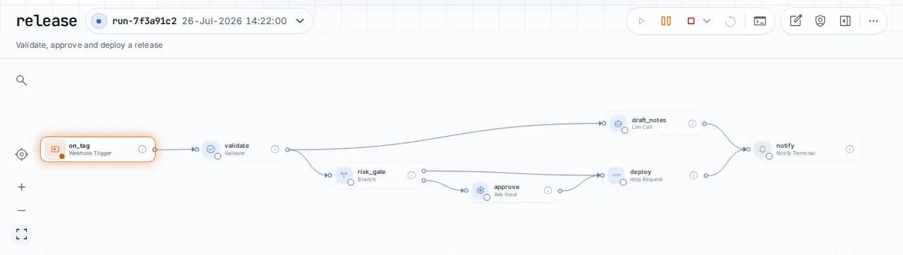
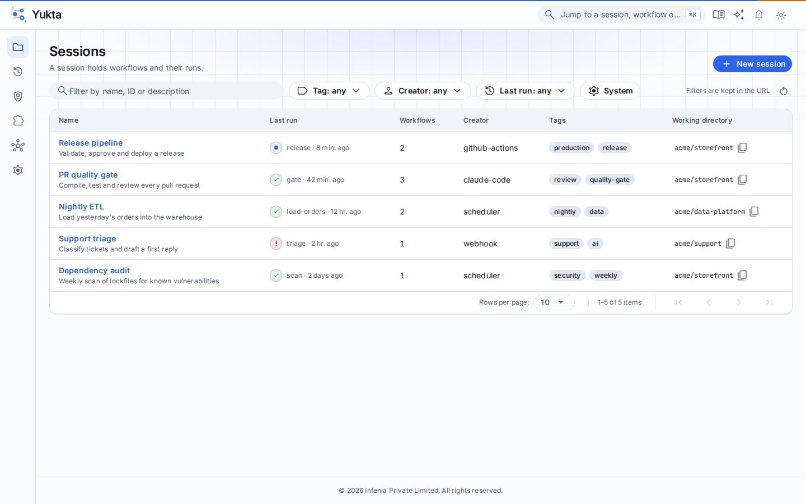
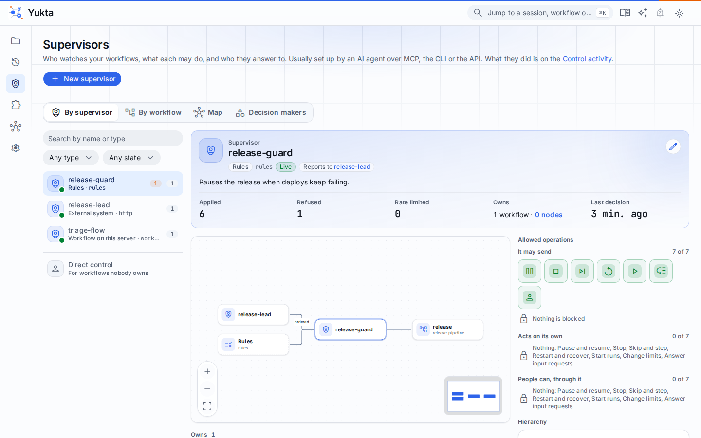
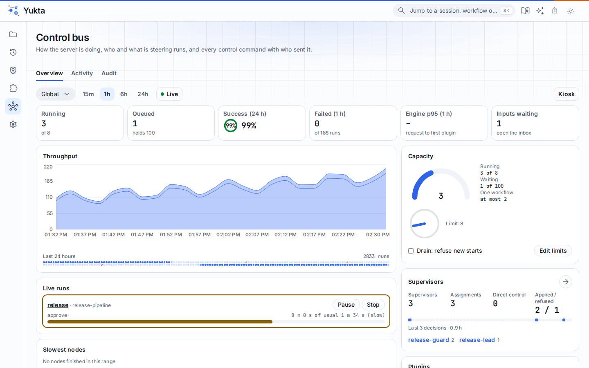
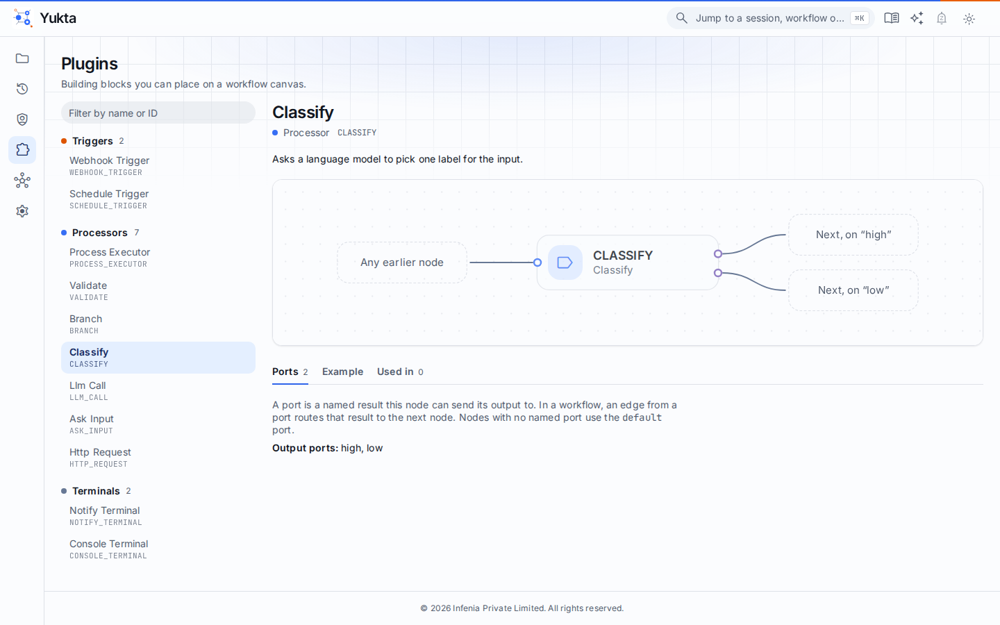
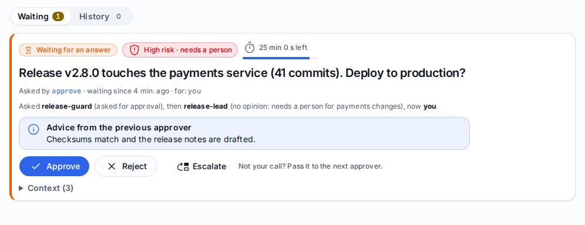

<h1 align="center"> Yukta</h1>

<p align="center"><b>Workflows you can trust and control.</b></p>

<p align="center">Write a job down once as a flowchart. Yukta runs every step as written, whether it's a script, a rule or an AI model, and lets you pause it, steer it or put someone in charge while it runs.</p>

<p align="center">
  <a href="https://yukta.infenia.com/"><b>Docs</b></a> ·
  <a href="#install"><b>Install</b></a> ·
  <a href="#quickstart"><b>Quickstart</b></a> ·
  <a href="examples/README.md"><b>Examples</b></a> ·
  <a href="https://github.com/infenia/yukta/discussions"><b>Discussions</b></a> ·
  <a href="#contributing"><b>Contributing</b></a>
</p>

<p align="center">
  <a href="https://github.com/infenia/yukta/actions/workflows/ci.yml"></a>
  <a href="https://github.com/infenia/yukta/actions/workflows/codeql.yml"></a>
  <a href="https://codecov.io/gh/infenia/yukta"></a>
  <a href="https://scorecard.dev/viewer/?uri=github.com/infenia/yukta"></a>
  <a href="https://github.com/infenia/yukta/releases"></a>
  <a href="LICENSING.md"></a>
  <a href="https://github.com/infenia/yukta/stargazers"></a>
</p>

<picture>
  <source media="(prefers-color-scheme: dark)" srcset="docs/images/readme-run.dark.webp">
  
</picture>

<p align="center"><i>A release run from start to finish. Rules check it, the AI drafts the notes, a person approves, and only then does it ship.</i></p>

## Why it exists

Every team has a right way to get things done: check the order, get a sign-off, then ship. That way usually lives in a wiki page, a checklist or someone's head, and over time steps get skipped. Someone is in a hurry, a script fails without saying so, or an AI assistant decides a step isn't needed today. Nobody notices until something breaks, and then nobody can say what actually happened.

**Yukta turns the way you work into a flowchart that actually runs.** Each step happens in order, every time. You can see where any job stands, and who or what did each part. When AI does part of the work, it does only that part, and your rules still decide the rest.

That was the starting point. Today Yukta also lets you put someone in charge of a running job, whether a set of rules, an AI agent or a person, who can pause it, step in or approve the risky part. You can also describe a workflow in plain words and have an AI assistant build it, run it and watch it for you.

## What makes it different

- **Steps run as written.** A workflow is a flowchart: boxes for steps, arrows between them. It can branch, wait, retry or hand off to another workflow, but it can never loop forever. [How it works →](https://yukta.infenia.com/concepts/how-it-works)
- **AI and rules side by side.** A step can be a script, a web call, a database query, a fixed rule or an AI model. Use AI where judgement helps, and rules where the answer must always be the same. [Why →](https://yukta.infenia.com/concepts/ai-and-deterministic-work)
- **Someone is always in charge.** Give any run an owner, whether a set of rules, an AI agent, another workflow or a program. The owner watches the run and can step in. [Supervisors →](https://yukta.infenia.com/concepts/supervisors)
- **Set it up by asking.** Tell an assistant such as Claude Code what you want, and it builds the workflow, runs it and watches it, with only the permissions you give it. [AI-assisted configuration →](https://yukta.infenia.com/concepts/ai-assisted-configuration)

<picture>
  <source media="(prefers-color-scheme: dark)" srcset="docs/images/readme-flow.dark.svg">
  
</picture>

<p align="center"><i>One workflow, two kinds of step. The AI step (blue) suggests, a rule checks it, and a person or supervisor (orange) makes the risky call.</i></p>

## Install

> [!NOTE]
> **Alpha.** The workflow format and the APIs may change before 1.0. By default, Yukta keeps its data in memory, so it is lost when the server stops. See [Releases](https://yukta.infenia.com/reference/releases).

Yukta installs as a single program. Pick your system:

**Linux and macOS**

```bash
curl -fsSL https://github.com/infenia/yukta/releases/download/v0.1.0-alpha.4/install.sh | sh
```

**Windows** (PowerShell): download `yukta-<version>-windows-amd64.zip` from the [release page](https://github.com/infenia/yukta/releases), then:

```powershell
Expand-Archive yukta-<version>-windows-amd64.zip .
```

**Docker** (any OS)

```bash
docker pull ghcr.io/infenia/yukta:0.1.0-alpha.4
```

> [!IMPORTANT]
> Installing does not start the server. Start it with the command in [Quickstart, step 1](#quickstart): a bare `yukta` or `docker run` leaves out the settings the examples need.

**AI agents.** At the end, the install script offers to connect the agents on your machine (Claude Code, Codex, Cursor, VS Code and others). To do it later, run `yukta-cli agents install`.

<details>
<summary><b>More options</b>: supported platforms, uninstall, checksums and other packages</summary>

<br>

**Supported platforms.** The server is one native binary on the platforms below, plus a multi-architecture Docker image. The commands above point at the latest release.

| | `amd64` | `arm64` |
|---|:---:|:---:|
| 🐧 **Linux** | ✅ native | ✅ native |
| 🍎 **macOS** | ✅ native (Intel; runs on Apple silicon through Rosetta 2) | client only |
| 🪟 **Windows** | ✅ native | not yet |
| 🐳 **Docker image** | ✅ | ✅ |

**AI agents without prompts.** Pass `--agents auto` to the install script (`$env:YUKTA_AGENTS = 'auto'` on Windows) to connect every supported agent it finds: Claude Code, Codex, Antigravity, Cursor, VS Code, Windsurf and OpenCode.

**Uninstall** (Linux and macOS; stop the server first). Windows: delete the unzipped folder. Docker: `docker rmi` the image. It also disconnects the AI agents set up by `yukta-cli agents install`.

```bash
curl -fsSL https://github.com/infenia/yukta/releases/download/v0.1.0-alpha.4/install.sh | sh -s -- --uninstall
```

**Checksums, signing and other packages.** The macOS and Windows builds are not signed or notarized, so Gatekeeper and SmartScreen warn on a browser download; the install script avoids the macOS warning. Every release file is checksummed and signed. Debian, RPM, source: [Install](https://yukta.infenia.com/get-started/install) and [Deploy](https://yukta.infenia.com/guides/operate/deploy).

**Problems.** If a platform fails, [open an issue](https://github.com/infenia/yukta/issues/new/choose) with your OS and architecture.

</details>

## Quickstart

Three steps, a few minutes. The install put ready-made examples in `~/.local/share/yukta/examples` (`/usr/local/share/yukta/examples` when installed as root); their scripts need `curl` and `jq`.

**1. Start the server.** Out of the box, Yukta won't run commands on your machine or load plugins that reach the outside world. These settings allow what the examples need:

```bash
export YUKTA_PLUGINS_ENABLED=all
export YUKTA_PROCESS_ALLOWED_COMMANDS=sh,echo,shuf,python3,git,uv,bun,node,npm
export YUKTA_VARIABLES_ALLOWED=java.io.tmpdir
export YUKTA_AI_PRESETS_DIR=$HOME/.local/share/yukta/examples/3-paid-tools/16-agent-console/agent-harnesses
yukta start     # runs the server in the background (daemon mode)
yukta status    # is it running?
yukta stop      # stop it when you are done
```

Start it with `yukta start`, not a bare `yukta`: the foreground console mode still has bugs.

<details>
<summary><b>Windows</b> (PowerShell)</summary>

<br>

The examples are in the unzipped folder, next to `yukta.exe`. Run this from the folder you unzipped into, and run the example scripts from Git Bash:

```powershell
$env:YUKTA_PLUGINS_ENABLED = 'all'
$env:YUKTA_PROCESS_ALLOWED_COMMANDS = 'sh,echo,shuf,python3,git,uv,bun,node,npm,npm.cmd'
$env:YUKTA_VARIABLES_ALLOWED = 'java.io.tmpdir'
$env:YUKTA_AI_PRESETS_DIR = "$PWD\yukta-<version>-windows-amd64\examples\3-paid-tools\16-agent-console\agent-harnesses"
.\yukta-<version>-windows-amd64\yukta.exe start    # daemon mode
.\yukta-<version>-windows-amd64\yukta.exe status   # is it running?
.\yukta-<version>-windows-amd64\yukta.exe stop     # stop it
```

</details>

<details>
<summary><b>Docker</b> (any OS)</summary>

<br>

The image carries only `sh` and `echo`, so run the examples that need nothing else here; the ones that need `git`, `python3`, `shuf`, `uv`, `bun` or `node` (11, 12, 14, 17, 18 and 19) need the native server above. The examples keep their files in `/tmp/yukta-examples`, so the container shares that folder with your machine and runs as you. Without the installer, get the example scripts first (on macOS leave out `--wildcards`):

```bash
curl -fsSL https://codeload.github.com/infenia/yukta/tar.gz/refs/tags/v0.1.0-alpha.4 | tar -xz --strip-components=1 --wildcards '*/examples'
mkdir -p /tmp/yukta-examples
docker run --rm -p 127.0.0.1:9858:9858 --user "$(id -u):$(id -g)" --workdir /tmp -e HOME=/tmp \
  -v /tmp/yukta-examples:/tmp/yukta-examples \
  -e YUKTA_API_KEYS_0_NAME=admin \
  -e YUKTA_API_KEYS_0_KEY=change-me-to-a-long-random-secret \
  -e YUKTA_API_KEYS_0_ROLE=ADMIN \
  -e YUKTA_PLUGINS_ENABLED=all -e YUKTA_PROCESS_ALLOWED_COMMANDS=sh,echo \
  ghcr.io/infenia/yukta:0.1.0-alpha.4
export YUKTA_API_KEY=change-me-to-a-long-random-secret   # the scripts send it to the server
```

Then use `./examples` wherever the steps below say `~/.local/share/yukta/examples`.

</details>

Check that it's up:

```bash
curl http://localhost:9858/actuator/health
# {"groups":["liveness","readiness"],"status":"UP"}
```

**2. Run your first workflow.** Open <http://localhost:9858>, choose **New session** and pick the **Hello world** template: a small flowchart that greets you and says whether a digit is odd or even. Most examples are there as templates.

Or from a second terminal, where the script saves the same workflow, runs it three times and checks each result:

```bash
~/.local/share/yukta/examples/1-standalone/01-hello-world/run.sh
# expected: three runs with status SUCCESS, e.g. "Hello, Yukta! Digit 5 is odd."
```

`~/.local/share/yukta/examples/run-all.sh` runs them all and prints a summary; [`examples/`](examples/README.md) says what each one needs.

**3. Connect an AI assistant:**

```bash
claude mcp add --transport http yukta http://localhost:9858/mcp
```

<details>
<summary><b>Other assistants</b>: Codex, Gemini CLI, Cursor, VS Code, any MCP client</summary>

<br>

`/mcp` is plain streamable HTTP, so any MCP client can use it. When the server has API keys, send `Authorization: Bearer <key>` and give the assistant the lowest role that does its job ([roles](https://yukta.infenia.com/guides/ai/connect-an-assistant)).

```bash
# Gemini CLI
gemini mcp add --transport http yukta http://localhost:9858/mcp

# OpenAI Codex CLI
codex mcp add yukta --url http://localhost:9858/mcp
```

```jsonc
// Cursor: ~/.cursor/mcp.json
{ "mcpServers": { "yukta": { "url": "http://localhost:9858/mcp" } } }

// VS Code (GitHub Copilot): .vscode/mcp.json
{ "servers": { "yukta": { "type": "http", "url": "http://localhost:9858/mcp" } } }
```

Key names differ between clients (`url`, `httpUrl`, `type`); use the one yours documents for a streamable HTTP server. The [`yukta-workflows` skill](skills/yukta-workflows/SKILL.md) teaches an agent the tools, and [Connect an AI assistant](https://yukta.infenia.com/guides/ai/connect-an-assistant) has the full guide.

</details>

**Next:** [Your first workflow](https://yukta.infenia.com/learn/your-first-workflow) builds one by hand, step by step. [Let an assistant build a workflow](https://yukta.infenia.com/learn/let-an-assistant-build-a-workflow) does the same by asking.

## Set it up by asking

Once an AI assistant is connected ([Quickstart, step 3](#quickstart)), tell it what you want in plain words:

> Build a workflow that checks a release ticket, asks a model to draft the release notes, and waits for my approval before deploying.
>
> Pause the release if three deploys fail in a row. Try it first without letting it act.
>
> Show me what that rule would have done on yesterday's failed run.

<p align="center">
<picture>
  <source media="(prefers-color-scheme: dark)" srcset="docs/images/diagrams/guide-configure-with-an-assistant.dark.svg">
  
</picture>
</p>

The assistant drafts each change, shows it to you, and applies it only when you say yes. You also decide how far it can go: with a read-only key it can look but not change anything. [Configure Yukta by asking →](https://yukta.infenia.com/guides/ai/configure-with-an-assistant)

## How it works

<picture>
  <source media="(prefers-color-scheme: dark)" srcset="docs/images/diagrams/architecture.dark.svg">
  
</picture>

However a run starts, from a script, the web UI, the command line or an AI assistant, it comes in through the same front door and follows the same limits. Whoever is in charge of a run never changes it behind your back: they send requests, and each request is put in order and recorded, so you can always see who did what. More in [How it works](https://yukta.infenia.com/concepts/how-it-works).

## See it

| | |
|:---:|:---:|
| <picture><source media="(prefers-color-scheme: dark)" srcset="docs/images/ui/sessions-list.dark.png"></picture> | <picture><source media="(prefers-color-scheme: dark)" srcset="docs/images/ui/supervisors-page.dark.png"></picture> |
| **Sessions.** Your workflows, grouped, and how each one last ran. | **Supervisors.** Who is in charge of each run, and what they decided. |
| <picture><source media="(prefers-color-scheme: dark)" srcset="docs/images/ui/control-overview.dark.png"></picture> | <picture><source media="(prefers-color-scheme: dark)" srcset="docs/images/ui/plugin-catalogue.dark.png"></picture> |
| **Control bus.** How runs are doing right now, and every request to pause, stop or change one. | **Plugins.** The building blocks you put on the canvas: scripts, web calls, AI models and more. |

<picture>
  <source media="(prefers-color-scheme: dark)" srcset="docs/images/ui/inputs-panel.dark.png">
  
</picture>

<p align="center"><i>An approval waiting for a person. Those in charge were asked first, and their advice comes with the question.</i></p>

## Find your way

| I want to... | Go to |
|---|---|
| **Learn** by doing | [Tutorials](https://yukta.infenia.com/learn/your-first-workflow): build a first workflow, mix rules and AI, let an assistant build one, put someone in charge, ask for an approval |
| **Get a task done** | [Guides](https://yukta.infenia.com/guides/build/define-a-workflow): build, work with AI, supervise, deploy and run in production |
| **Look something up** | [Reference](https://yukta.infenia.com/reference/workflow-json) and the [API](https://yukta.infenia.com/api/overview): plugins, the workflow format, MCP tools, CLI, settings |
| **Understand** the ideas | [Concepts](https://yukta.infenia.com/concepts/how-it-works): how it works, who is in charge, who decides |
| Start from something **ready-made** | [`examples/`](examples/README.md): 19 examples, from hello world to a CI pipeline |

## Honest limits

- **It's alpha.** The workflow format and the APIs can still change before 1.0. The macOS and Windows builds are new and not signed yet, so downloading them in a browser triggers a warning.
- **Nothing is saved by default.** One server keeps everything in memory, so stopping it loses your sessions and run history. Saving to disk or PostgreSQL, running several servers together, and remote workers are in the [Plus build](LICENSING.md).
- **Workflows can run real commands.** A workflow can start programs and scripts and query databases, so only let people you trust write them. Out of the box the server listens only on your own machine and refuses outside connections without an API key. See [Secure the server](https://yukta.infenia.com/guides/operate/secure-the-server) and [`SECURITY.md`](SECURITY.md).

## Develop

Built with Java 25, Spring Boot 4.1 (WebFlux), Project Reactor, Spring AI MCP, GraalVM, React 19 and Go. You need a JDK 25; the Gradle wrapper comes with the repository.

```bash
./gradlew bootRun          # run the server
./gradlew nativeCompile    # optional native image (needs a GraalVM JDK, for example Liberica NIK)
./gradlew check            # tests + Checkstyle + PMD + SpotBugs + JaCoCo
./gradlew spotlessApply    # format before committing
```

<details>
<summary><b>Modules</b></summary>

<br>

| Module | Purpose |
|--------|---------|
| `core` | The engine that runs workflows, and the plugin registry |
| `plugin-api` | What a plugin implements, and the store interfaces |
| `plugins` | The built-in triggers, steps, endings and supervisor engines |
| `web` / `mcp` | The REST API / the MCP server for AI assistants |
| `ui` / `cli` | The React web UI / the Go command-line client |
| `boot` | The Spring Boot entry point and the native-image setup |
| `architecture`, `e2e`, `test-support` | Architecture rules (ArchUnit), tests against a running server, shared test helpers |
| `plus/` | Optional (AGPL): PostgreSQL storage, high availability, remote workers |
| `claude-mods` | The Claude Code plugin |
| `messaging`, `build-logic`, `examples` | Shared messaging, Gradle conventions, the runnable examples |

Each module has its own `CLAUDE.md` with build commands and architecture notes.

</details>

<details>
<summary><b>Persistence</b></summary>

<br>

Sessions, workflows and the execution log live in memory by default. File storage is in the Plus build (`-Pyukta.edition=plus`, AGPL-3.0-only); PostgreSQL is `./gradlew bootJar -Pyukta.persistence=postgres`. See [Persistence](https://yukta.infenia.com/guides/operate/persist-sessions).

</details>

<details>
<summary><b>Developing Yukta with Yukta</b></summary>

<br>

Contributors (and Claude Code, held to it by hooks) run builds, tests and checks through `yk` from [yukta-dogfood](https://github.com/infenia/yukta-dogfood) (`scripts/dogfood-setup.sh`): each Gradle call becomes a Yukta workflow on a local dev server built from `origin/main` at `http://127.0.0.1:9858`, and `yk check` is the staged, self-healing quality gate. See the [yukta-dogfood README](https://github.com/infenia/yukta-dogfood#readme).

</details>

## Contributing

Contributions are welcome: bug reports, plugins, docs and tests. New here? Start with a [good first issue](https://github.com/infenia/yukta/issues?q=is%3Aissue+is%3Aopen+label%3A%22good+first+issue%22).

1. Read [`CONTRIBUTING.md`](CONTRIBUTING.md) and the [Code of Conduct](CODE_OF_CONDUCT.md).
2. Branch from `main`, format with `./gradlew spotlessApply`, and make sure `./gradlew check` passes.
3. Use [Conventional Commits](https://www.conventionalcommits.org/) and open a pull request.

Ask questions in [Discussions](https://github.com/infenia/yukta/discussions); report bugs and request features as [issues](https://github.com/infenia/yukta/issues/new/choose); report vulnerabilities [privately](SECURITY.md). Project rules are in [`GOVERNANCE.md`](GOVERNANCE.md).

## License

| Edition | License | Where | What you get |
|---|---|---|---|
| **Community** | [Apache-2.0](LICENSE) | Everything outside `plus/` | The whole engine, UI, CLI, MCP server and plugins. This is the default build, the installers and the Docker image. |
| **Plus** | [AGPL-3.0-only](LICENSE-AGPL), or a commercial license | `plus/` | Durable storage (disk, PostgreSQL), high availability, remote workers. |

Community never depends on Plus, so using Yukta as installed needs nothing beyond Apache-2.0. Details in [`LICENSING.md`](LICENSING.md). The repository follows the [REUSE](https://reuse.software/) specification.

---

<p align="center">
If Yukta is useful to you, a ⭐ helps other people find it.<br>
Developed by <b><a href="https://infenia.com">Infenia Private Limited</a></b>. <i>Yukta</i> (युक्त) is Sanskrit for "united" or "joined."
</p>
