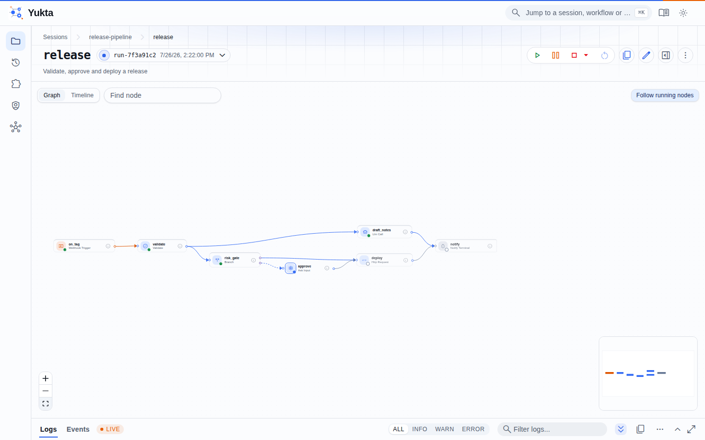
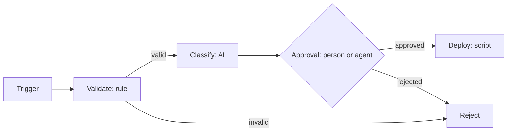

# Yukta

**Describe a multi-step job once as a flowchart. Yukta runs every step as written, whether it is a script, a rule or an AI model, and lets you pause, steer or hand control to a supervisor while it runs.**

Yukta is a reactive, DAG-based workflow orchestration server. You start the same workflow from a script, the web UI, a CLI or an AI assistant.

[Docs](https://yukta.infenia.com/) ·
[Install](#install) ·
[30-second win](#try-it-in-two-minutes) ·
[Examples](examples/README.md) ·
[Contributing](#contributing)

[](https://github.com/infenia/yukta/actions/workflows/ci.yml)
[](https://github.com/infenia/yukta/actions/workflows/codeql.yml)
[](https://codecov.io/gh/infenia/yukta)
[](https://scorecard.dev/viewer/?uri=github.com/infenia/yukta)
[](https://github.com/infenia/yukta/releases)
[](LICENSING.md)


<picture>
  <source media="(prefers-color-scheme: dark)" srcset="docs/images/ui/workflow-canvas.dark.png">
  
</picture>

*A release workflow mid-run. Notice that the AI step is one box among rule-based steps, and that the run waits at an approval until someone answers.*

## Why it exists

You know how the work should go: build, test, review, approve, deploy. Written down in a wiki, a prompt or a script, the process quietly stops being followed. A check gets skipped, an agent decides a step is not needed this time, and nobody can say what state the work is in. Yukta keeps the process in a server, as a graph, and enforces it.

## What makes it different

- **Workflows are flowcharts (DAGs).** Steps, arrows and named outcomes, with branches, joins, retries and sub-workflows. No cycles, so no accidental loops. [How it works](https://yukta.infenia.com/concepts/how-it-works)
- **AI and deterministic work in one graph.** Scripts, HTTP, SQL and rules sit beside model calls and agent loops. Use AI where judgement helps; use rules where the answer must always be the same. [Why](https://yukta.infenia.com/concepts/ai-and-deterministic-work)
- **Supervisors.** Every part of a run can have an owner (rules, an AI agent, another workflow or a program) that watches, steps in, and decides who may steer. [Supervisors](https://yukta.infenia.com/concepts/supervisors)
- **AI-assisted setup over MCP.** An assistant such as Claude Code can write the workflow, start it, watch it and steer it, within the role you give it. [AI-assisted configuration](https://yukta.infenia.com/concepts/ai-assisted-configuration)



*Figure 1: One workflow, two kinds of step. The AI step proposes; a rule gates it; a person or supervisor decides the risky part.*

## Install

> **Alpha.** The engine, plugins, REST API, MCP server, web UI and CLI run and are covered by tests. Expect breaking changes to the workflow JSON and the APIs before 1.0. The native server is Linux amd64 only for now; on macOS and Windows run it with Docker. Sessions live in memory by default. See [Releases](https://yukta.infenia.com/reference/releases).

| Platform | Command |
|----------|---------|
| Linux (server + CLI) | `curl -fsSL https://github.com/infenia/yukta/releases/download/v0.1.0-alpha.3/install.sh \| sh` |
| Any (Docker) | `docker run --rm -p 127.0.0.1:9858:9858 -e YUKTA_API_KEYS_0_NAME=admin -e YUKTA_API_KEYS_0_KEY=change-me-to-a-long-random-secret -e YUKTA_API_KEYS_0_ROLE=ADMIN ghcr.io/infenia/yukta:0.1.0-alpha.3` |
| Windows (CLI) | `irm https://github.com/infenia/yukta/releases/latest/download/install.ps1 \| iex` |
| macOS (CLI) | download `yukta-cli-darwin-arm64` or `-amd64` from the [release](https://github.com/infenia/yukta/releases/tag/v0.1.0-alpha.3) |
| Debian / RPM, source | [Deploy guide](https://yukta.infenia.com/guides/operate/deploy) |

Tested on Linux amd64. If another platform fails, please [open an issue](https://github.com/infenia/yukta/issues/new/choose) with your OS and architecture.

## Try it in two minutes

Start the server (`yukta`), then in another terminal:

```bash
curl http://localhost:9858/actuator/health
```

```json
{"groups":["liveness","readiness"],"status":"UP"}
```

Then follow [Your first workflow](https://yukta.infenia.com/learn/your-first-workflow): save a small flowchart, start it, and read each step's result. In a container, add `-H "X-API-Key: <key>"` to each request.

Connect an AI assistant in one line:

```bash
claude mcp add --transport http yukta http://localhost:9858/mcp
```

Then follow [Let an assistant build a workflow](https://yukta.infenia.com/learn/let-an-assistant-build-a-workflow).

## Configure it by asking

Connect an assistant once, then describe what you want in plain words:

> Build a workflow that validates a release ticket, asks a model to draft the notes, and waits for my approval before deploying.
>
> Add a supervisor that pauses the release when three deploys fail in a row. Start it in dry run.
>
> Replay that supervisor on yesterday's failed run and show me what it would have done.

The assistant writes the workflow and the supervisor over MCP, assigns it and checks the result. You review each change before it applies, and a role on your API key limits what it may do. See [Configure Yukta by asking](https://yukta.infenia.com/guides/ai/configure-with-an-assistant).

## Find your way

| I want to... | Go to |
|---|---|
| **Learn** by doing | [Tutorials](https://yukta.infenia.com/learn/your-first-workflow): first workflow, rules plus AI, an assistant as author, a supervisor, an approval |
| **Do** a task | [Guides](https://yukta.infenia.com/guides/build/define-a-workflow): build, work with AI, supervise, deploy and operate |
| **Look up** a fact | [Reference](https://yukta.infenia.com/reference/workflow-json) and the [API](https://yukta.infenia.com/api/overview): plugins, JSON, MCP tools, CLI, configuration |
| **Understand** why | [Concepts](https://yukta.infenia.com/concepts/how-it-works): the mental model, supervisors, who decides |
| Start from something **ready-made** | [`examples/`](examples/README.md): 17 runnable workflows |

## Honest limits

- Alpha: APIs and the workflow JSON can change before 1.0.
- One server by default. High availability, durable stores and remote workers are in the [Plus build](LICENSING.md).
- Workflows can run processes, scripts and SQL. Treat authorship as a trusted operation; the server binds to loopback and refuses to listen elsewhere without an API key. See [Secure the server](https://yukta.infenia.com/guides/operate/secure-the-server) and [`SECURITY.md`](SECURITY.md).

## Develop

Built with Java 25, Spring Boot 4.1 (WebFlux), Gradle 9.8, Project Reactor, Spring AI MCP, GraalVM, React 19 and Go.

```bash
./gradlew bootRun          # run the server
./gradlew nativeCompile    # optional GraalVM native image (needs a GraalVM JDK)
./gradlew check            # tests + Checkstyle + PMD + SpotBugs + JaCoCo
./gradlew spotlessApply    # format before committing
```

**Developing Yukta with Yukta.** Contributors (and Claude Code, held to it by hooks) run builds, tests and checks through `examples/dogfood/yk`: each Gradle call becomes a Yukta workflow on a local dev server built from `origin/main` at `http://127.0.0.1:9858`, and `yk check` is the staged, self-healing quality gate. See [`examples/dogfood/README.md`](examples/dogfood/README.md).

**Persistence.** Sessions, workflows and the execution log live in memory by default. File storage is in the Plus build (`-Pyukta.edition=plus`, AGPL-3.0-only); PostgreSQL is `./gradlew bootJar -Pyukta.persistence=postgres`. See [Persistence](https://yukta.infenia.com/guides/operate/persist-sessions).

| Module | Purpose |
|--------|---------|
| `core` | DAG orchestration engine, plugin registry |
| `plugin-api` | Plugin interfaces and store abstractions |
| `plugins` | Built-in triggers, processors, terminals and supervisor engines |
| `web` / `mcp` | REST controllers / MCP server |
| `ui` / `cli` | React frontend / Go command-line client |
| `boot` | Spring Boot entry point, native image config |
| `plus/persistence-postgres` | Optional (AGPL) PostgreSQL stores |
| `claude-mods` | Claude Code plugin |
| `messaging`, `build-logic`, `examples` | Shared messaging, Gradle conventions, runnable workflows |

Each module has its own `CLAUDE.md` with build commands and architecture notes.

## Contributing

Contributions are welcome: bug reports, plugins, docs and tests.

1. Read [`CONTRIBUTING.md`](CONTRIBUTING.md) and the [Code of Conduct](CODE_OF_CONDUCT.md).
2. Branch from `main`, format with `spotlessApply`, and make sure `check` passes.
3. Use [Conventional Commits](https://www.conventionalcommits.org/) and open a pull request.

Ask questions in [Discussions](https://github.com/infenia/yukta/discussions); report bugs and request features as [issues](https://github.com/infenia/yukta/issues/new/choose). Project rules are in [`GOVERNANCE.md`](GOVERNANCE.md).

## License

Apache License 2.0 for the Community edition. The `plus/` directory (durable storage) is AGPL-3.0-only, with a commercial licence available. See [`LICENSING.md`](LICENSING.md) and [`LICENSE`](LICENSE). The repository follows the [REUSE](https://reuse.software/) specification.

---

Developed by **[Infenia Private Limited](https://infenia.com)**. *Yukta* (युक्त) is Sanskrit for "united" or "joined."
