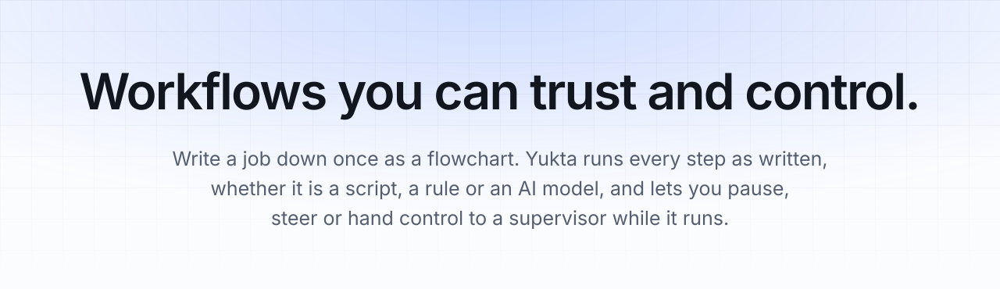
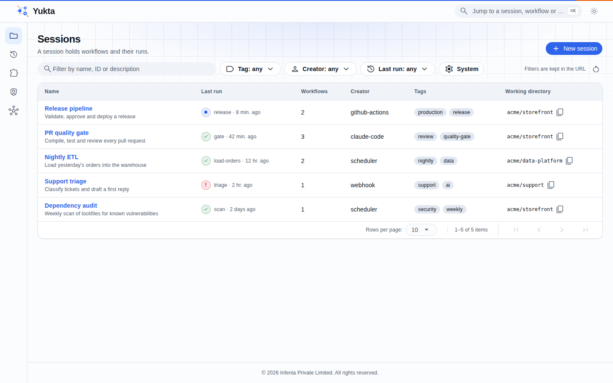
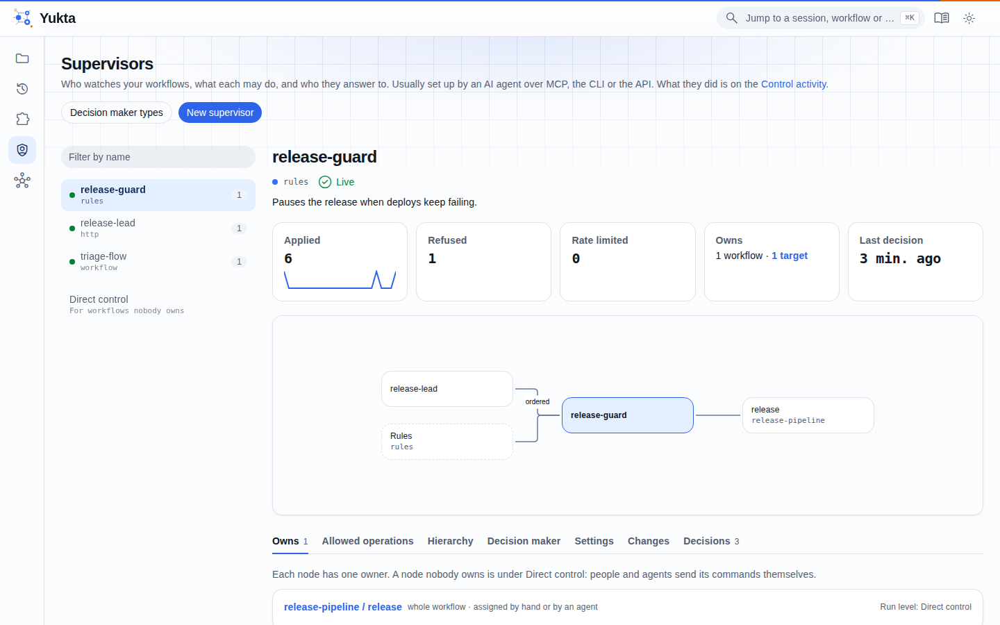
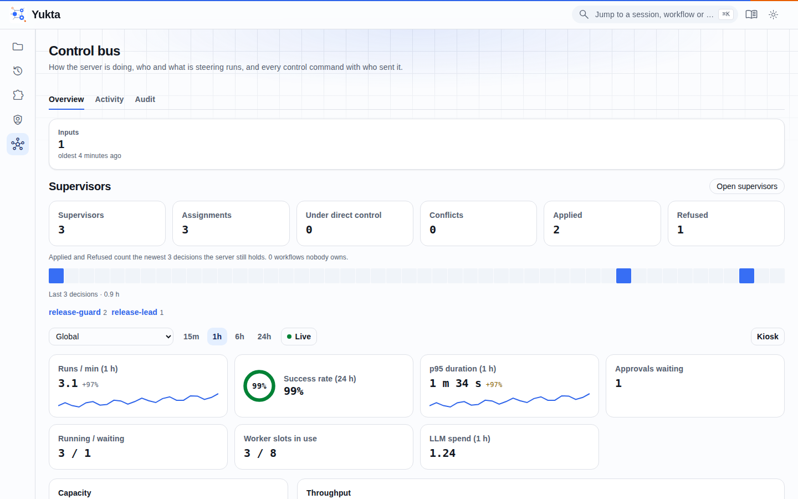
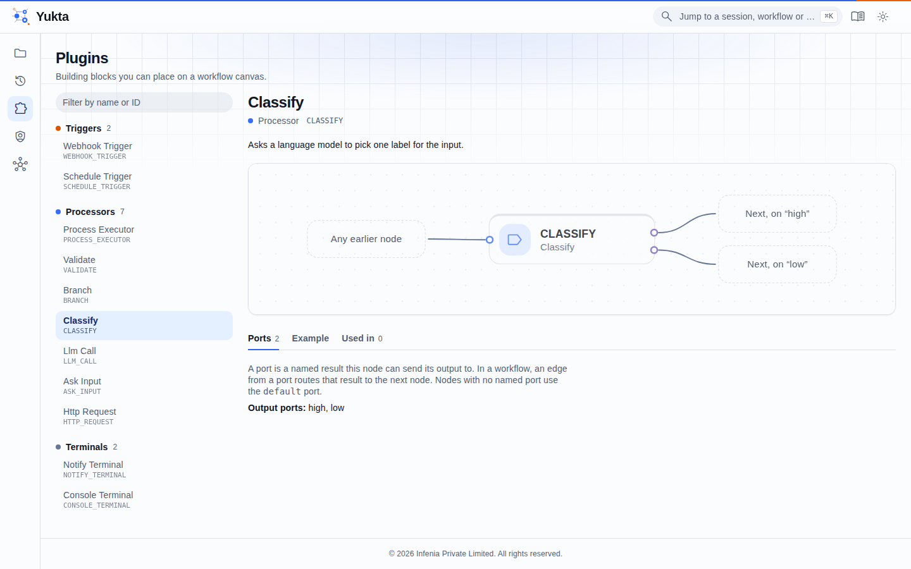
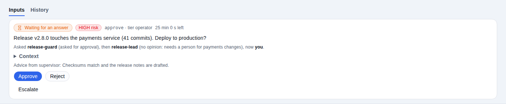

<picture>
  <source media="(prefers-color-scheme: dark)" srcset="docs/images/readme-hero.dark.svg">
  
</picture>

<h1 align="center"> Yukta</h1>

<p align="center"><b>A workflow engine for people, scripts and AI agents.</b><br>Start the same workflow from a script, the web UI, a CLI or an AI assistant.</p>

<p align="center">
  <a href="https://yukta.infenia.com/"><b>Docs</b></a> ·
  <a href="#install"><b>Install</b></a> ·
  <a href="#quickstart"><b>Quickstart</b></a> ·
  <a href="examples/README.md"><b>Examples</b></a> ·
  <a href="https://github.com/infenia/yukta/discussions"><b>Discussions</b></a> ·
  <a href="#contributing"><b>Contributing</b></a>
</p>

<p align="center">
  <a href="https://github.com/infenia/yukta/actions/workflows/ci.yml"></a>
  <a href="https://github.com/infenia/yukta/actions/workflows/codeql.yml"></a>
  <a href="https://codecov.io/gh/infenia/yukta"></a>
  <a href="https://scorecard.dev/viewer/?uri=github.com/infenia/yukta"></a>
  <a href="https://github.com/infenia/yukta/releases"></a>
  <a href="LICENSING.md"></a>
  <a href="https://github.com/infenia/yukta/stargazers"></a>
</p>

<picture>
  <source media="(prefers-color-scheme: dark)" srcset="docs/images/ui/workflow-canvas.dark.png">
  
</picture>

<p align="center"><i>A release workflow mid-run. The AI step is one box among rule-based steps, and the run waits at an approval until someone answers.</i></p>

## Why it exists

You know how the work should go: build, test, review, approve, deploy. Written down in a wiki, a prompt or a script, the process quietly stops being followed. A check gets skipped, an agent decides a step is not needed this time, and nobody can say what state the work is in.

**Yukta keeps the process in a server, as a graph, and enforces it.**

## What makes it different

| | |
|---|---|
| 🔀 **Workflows are flowcharts (DAGs)** | Steps, arrows and named outcomes, with branches, joins, retries and sub-workflows. No cycles, so no accidental loops. [How it works →](https://yukta.infenia.com/concepts/how-it-works) |
| 🤖 **AI and deterministic work in one graph** | Scripts, HTTP, SQL and rules sit beside model calls and agent loops. Use AI where judgement helps; use rules where the answer must always be the same. [Why →](https://yukta.infenia.com/concepts/ai-and-deterministic-work) |
| 🛡️ **Supervisors** | Every part of a run can have an owner (rules, an AI agent, another workflow or a program) that watches, steps in, and decides who may steer. [Supervisors →](https://yukta.infenia.com/concepts/supervisors) |
| 💬 **AI-assisted setup over MCP** | An assistant such as Claude Code can write the workflow, start it, watch it and steer it, within the role you give it. [AI-assisted configuration →](https://yukta.infenia.com/concepts/ai-assisted-configuration) |

<picture>
  <source media="(prefers-color-scheme: dark)" srcset="docs/images/readme-flow.dark.svg">
  
</picture>

<p align="center"><i>One workflow, two kinds of step. The AI step (blue) proposes; a rule gates it; a person or supervisor (orange) decides the risky part.</i></p>

## Install

> [!NOTE]
> **Alpha.** Expect breaking changes to the workflow JSON and the APIs before 1.0. Sessions live in memory by default. See [Releases](https://yukta.infenia.com/reference/releases).

From `0.1.0-alpha.4` on (earlier releases: see the note below the commands), the server is one native binary with no JVM to install, on the platforms below, plus a multi-architecture Docker image. The commands point at the latest release.

| | `amd64` | `arm64` |
|---|:---:|:---:|
| 🐧 **Linux** | ✅ native | ✅ native |
| 🍎 **macOS** | ✅ native (Intel; runs on Apple silicon through Rosetta 2) | client only |
| 🪟 **Windows** | ✅ native | not yet |
| 🐳 **Docker image** | ✅ | ✅ |

**Linux and macOS**

```bash
curl -fsSL https://github.com/infenia/yukta/releases/download/v0.1.0-alpha.3/install.sh | sh
```

**Windows** (PowerShell): download `yukta-<version>-windows-amd64.zip` from the [release page](https://github.com/infenia/yukta/releases), then:

```powershell
Expand-Archive yukta-<version>-windows-amd64.zip .
.\yukta-<version>-windows-amd64\yukta.exe
```

**Docker** (any OS)

```bash
docker run --rm -p 127.0.0.1:9858:9858 \
  -e YUKTA_API_KEYS_0_NAME=admin \
  -e YUKTA_API_KEYS_0_KEY=change-me-to-a-long-random-secret \
  -e YUKTA_API_KEYS_0_ROLE=ADMIN \
  ghcr.io/infenia/yukta:0.1.0-alpha.3
```

Releases `0.1.0-alpha.3` and earlier ship a native server for Linux `amd64` only; on any other system use Docker for the server (the `yukta-cli` client is native everywhere).

<details>
<summary><b>Checksums, signing, Debian, RPM, source</b></summary>

<br>

The macOS and Windows builds are not signed or notarized, so Gatekeeper and SmartScreen warn on a browser download; the install script avoids the macOS warning. Every release file is checksummed and signed. Debian, RPM, source: [Install](https://yukta.infenia.com/get-started/install) and [Deploy](https://yukta.infenia.com/guides/operate/deploy).

</details>

If a platform fails, [open an issue](https://github.com/infenia/yukta/issues/new/choose) with your OS and architecture.

## Quickstart

**1. Start the server and check it is up.**

```bash
YUKTA_PROCESS_ALLOWED_COMMANDS=sh,echo yukta
```

```bash
curl http://localhost:9858/actuator/health
# {"groups":["liveness","readiness"],"status":"UP"}
```

**2. Run your first workflow** (needs `curl` and `jq`). It saves a three-step flowchart, starts it and checks the result:

```bash
git clone --depth 1 https://github.com/infenia/yukta
./yukta/examples/01-hello-world/run.sh
# expected: status SUCCESS and the log line stdout=Hello from Yukta!
```

Yukta refuses to run operating-system commands unless you allow them, which is what `YUKTA_PROCESS_ALLOWED_COMMANDS=sh,echo` does for the examples. In a container, pass it with `-e` and set `YUKTA_API_KEY` to your key before `run.sh`.

**3. Connect an AI assistant** in one line:

```bash
claude mcp add --transport http yukta http://localhost:9858/mcp
```

<details>
<summary><b>Other assistants</b>: Codex, Gemini CLI, Cursor, VS Code, any MCP client</summary>

<br>

`/mcp` is plain streamable HTTP, so any MCP client can use it. When the server has API keys, send `Authorization: Bearer <key>` and give the assistant the lowest role that does its job ([roles](https://yukta.infenia.com/guides/ai/connect-an-assistant)).

```bash
# Gemini CLI
gemini mcp add --transport http yukta http://localhost:9858/mcp

# OpenAI Codex CLI
codex mcp add yukta --url http://localhost:9858/mcp
```

```jsonc
// Cursor: ~/.cursor/mcp.json
{ "mcpServers": { "yukta": { "url": "http://localhost:9858/mcp" } } }

// VS Code (GitHub Copilot): .vscode/mcp.json
{ "servers": { "yukta": { "type": "http", "url": "http://localhost:9858/mcp" } } }
```

Key names differ between clients (`url`, `httpUrl`, `type`); use the one yours documents for a streamable HTTP server. The [`yukta-workflows` skill](skills/yukta-workflows/SKILL.md) teaches an agent the tools, and [Connect an AI assistant](https://yukta.infenia.com/guides/ai/connect-an-assistant) has the full guide.

</details>

**Next:** [Your first workflow](https://yukta.infenia.com/learn/your-first-workflow) builds one by hand, step by step. [Let an assistant build a workflow](https://yukta.infenia.com/learn/let-an-assistant-build-a-workflow) does the same by asking. The web UI is at <http://localhost:9858>.

## Configure it by asking

Connect an assistant once, then describe what you want in plain words:

> Build a workflow that validates a release ticket, asks a model to draft the notes, and waits for my approval before deploying.
>
> Add a supervisor that pauses the release when three deploys fail in a row. Start it in dry run.
>
> Replay that supervisor on yesterday's failed run and show me what it would have done.

<p align="center">
<picture>
  <source media="(prefers-color-scheme: dark)" srcset="docs/images/diagrams/guide-configure-with-an-assistant.dark.svg">
  
</picture>
</p>

The assistant writes the workflow and the supervisor over MCP, assigns it and checks the result. You review each change before it applies, and a role on your API key limits what it may do. See [Configure Yukta by asking](https://yukta.infenia.com/guides/ai/configure-with-an-assistant).

## How it works

<picture>
  <source media="(prefers-color-scheme: dark)" srcset="docs/images/diagrams/architecture.dark.svg">
  
</picture>

Every client goes through the same door, so a run started by a script and one started by an assistant obey the same limits. Supervisors never touch the engine directly: they read events and send commands through the control plane, where each command is ordered and audited. More in [How it works](https://yukta.infenia.com/concepts/how-it-works).

## See it

| | |
|:---:|:---:|
| <picture><source media="(prefers-color-scheme: dark)" srcset="docs/images/ui/sessions-list.dark.png"></picture> | <picture><source media="(prefers-color-scheme: dark)" srcset="docs/images/ui/supervisors-page.dark.png"></picture> |
| **Sessions.** Every workflow group and how its last run went. | **Supervisors.** Who watches a run, what they decided, who they answer to. |
| <picture><source media="(prefers-color-scheme: dark)" srcset="docs/images/ui/control-overview.dark.png"></picture> | <picture><source media="(prefers-color-scheme: dark)" srcset="docs/images/ui/plugin-catalogue.dark.png"></picture> |
| **Control bus.** Run health, capacity and every steering command. | **Plugins.** The building blocks you place on a canvas. |

<picture>
  <source media="(prefers-color-scheme: dark)" srcset="docs/images/ui/inputs-panel.dark.png">
  
</picture>

<p align="center"><i>An approval that reached a person. The supervisors were asked first; their advice comes with the question.</i></p>

## Find your way

| I want to... | Go to |
|---|---|
| **Learn** by doing | [Tutorials](https://yukta.infenia.com/learn/your-first-workflow): first workflow, rules plus AI, an assistant as author, a supervisor, an approval |
| **Do** a task | [Guides](https://yukta.infenia.com/guides/build/define-a-workflow): build, work with AI, supervise, deploy and operate |
| **Look up** a fact | [Reference](https://yukta.infenia.com/reference/workflow-json) and the [API](https://yukta.infenia.com/api/overview): plugins, JSON, MCP tools, CLI, configuration |
| **Understand** why | [Concepts](https://yukta.infenia.com/concepts/how-it-works): the mental model, supervisors, who decides |
| Start from something **ready-made** | [`examples/`](examples/README.md): 17 runnable workflows |

## Honest limits

- Alpha: APIs and the workflow JSON can change before 1.0. Native macOS and Windows servers are new and unsigned.
- One server by default. High availability, durable stores and remote workers are in the [Plus build](LICENSING.md).
- Workflows can run processes, scripts and SQL. Treat authorship as a trusted operation; the server binds to loopback and refuses to listen elsewhere without an API key. See [Secure the server](https://yukta.infenia.com/guides/operate/secure-the-server) and [`SECURITY.md`](SECURITY.md).

## Develop

Built with Java 25, Spring Boot 4.1 (WebFlux), Gradle 9.8, Project Reactor, Spring AI MCP, GraalVM, React 19 and Go. You need a JDK 25.

```bash
./gradlew bootRun          # run the server
./gradlew nativeCompile    # optional GraalVM native image (needs a GraalVM JDK)
./gradlew check            # tests + Checkstyle + PMD + SpotBugs + JaCoCo
./gradlew spotlessApply    # format before committing
```

<details>
<summary><b>Modules</b></summary>

<br>

| Module | Purpose |
|--------|---------|
| `core` | DAG orchestration engine, plugin registry |
| `plugin-api` | Plugin interfaces and store abstractions |
| `plugins` | Built-in triggers, processors, terminals and supervisor engines |
| `web` / `mcp` | REST controllers / MCP server |
| `ui` / `cli` | React frontend / Go command-line client |
| `boot` | Spring Boot entry point, native image config |
| `plus/persistence-postgres` | Optional (AGPL) PostgreSQL stores |
| `claude-mods` | Claude Code plugin |
| `messaging`, `build-logic`, `examples` | Shared messaging, Gradle conventions, runnable workflows |

Each module has its own `CLAUDE.md` with build commands and architecture notes.

</details>

<details>
<summary><b>Persistence</b></summary>

<br>

Sessions, workflows and the execution log live in memory by default. File storage is in the Plus build (`-Pyukta.edition=plus`, AGPL-3.0-only); PostgreSQL is `./gradlew bootJar -Pyukta.persistence=postgres`. See [Persistence](https://yukta.infenia.com/guides/operate/persist-sessions).

</details>

<details>
<summary><b>Developing Yukta with Yukta</b></summary>

<br>

Contributors (and Claude Code, held to it by hooks) run builds, tests and checks through `examples/dogfood/yk`: each Gradle call becomes a Yukta workflow on a local dev server built from `origin/main` at `http://127.0.0.1:9858`, and `yk check` is the staged, self-healing quality gate. See [`examples/dogfood/README.md`](examples/dogfood/README.md).

</details>

## Contributing

Contributions are welcome: bug reports, plugins, docs and tests. New here? Start with a [good first issue](https://github.com/infenia/yukta/issues?q=is%3Aissue+is%3Aopen+label%3A%22good+first+issue%22).

1. Read [`CONTRIBUTING.md`](CONTRIBUTING.md) and the [Code of Conduct](CODE_OF_CONDUCT.md).
2. Branch from `main`, format with `spotlessApply`, and make sure `check` passes.
3. Use [Conventional Commits](https://www.conventionalcommits.org/) and open a pull request.

Ask questions in [Discussions](https://github.com/infenia/yukta/discussions); report bugs and request features as [issues](https://github.com/infenia/yukta/issues/new/choose); report vulnerabilities [privately](SECURITY.md). Project rules are in [`GOVERNANCE.md`](GOVERNANCE.md).

## License

| Edition | License | Where | What you get |
|---|---|---|---|
| **Community** | [Apache-2.0](LICENSE) | Everything outside `plus/` | The whole engine, UI, CLI, MCP server and plugins. This is the default build, the installers and the Docker image. |
| **Plus** | [AGPL-3.0-only](LICENSE-AGPL), or a commercial license | `plus/` | Durable storage (disk, PostgreSQL), high availability, remote workers. |

Community never depends on Plus, so using Yukta as installed needs nothing beyond Apache-2.0. Details in [`LICENSING.md`](LICENSING.md). The repository follows the [REUSE](https://reuse.software/) specification.

---

<p align="center">
If Yukta is useful to you, a ⭐ helps other people find it.<br>
Developed by <b><a href="https://infenia.com">Infenia Private Limited</a></b>. <i>Yukta</i> (युक्त) is Sanskrit for "united" or "joined."
</p>
