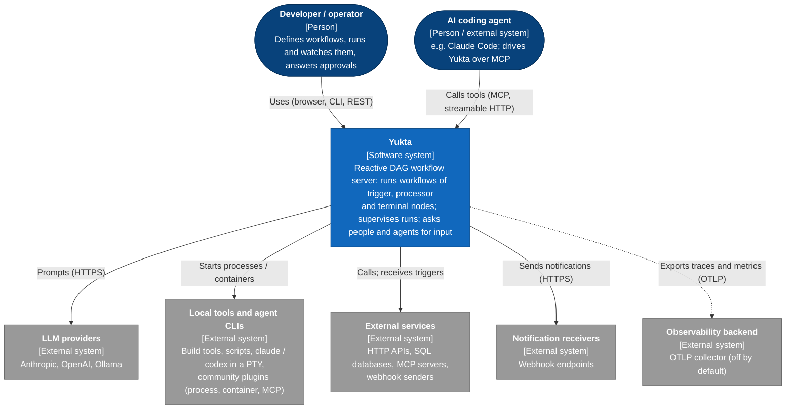
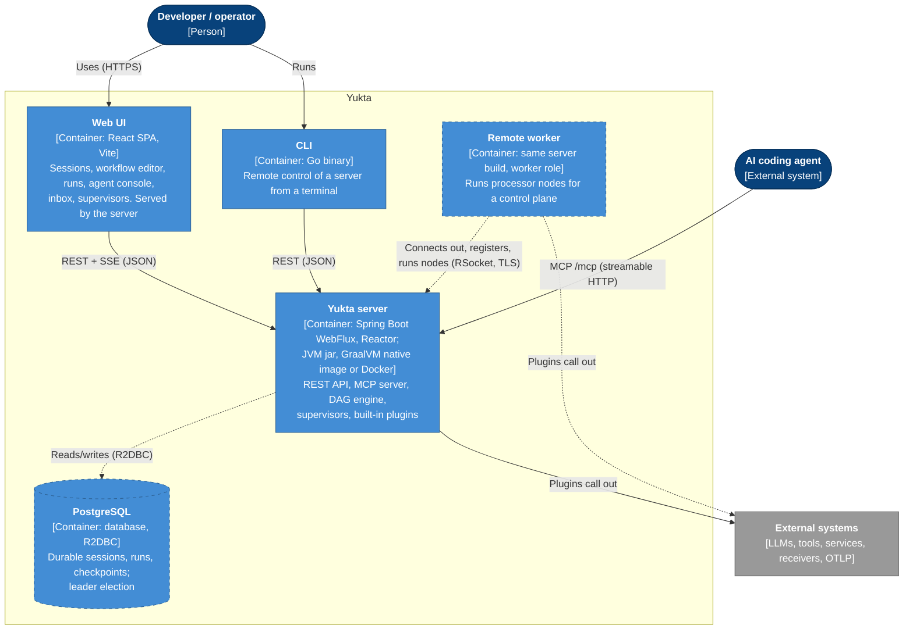
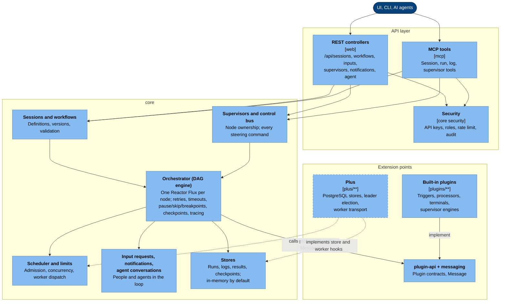

# C4 architecture

Yukta at the first three levels of the [C4 model](https://c4model.com): system context, containers, and the main components of the server. It is a high-level map; [architecture.md](architecture.md) and the ADRs explain the decisions, and the module guides explain the code. Level 4 (code) is left to the code.

Legend for all diagrams: **blue** is Yukta, **grey** is outside Yukta, **dashed** is Plus edition (AGPL, see [ADR 0005](decisions/0005-editions.md)) or optional.

## Level 1: System context

Who uses Yukta and what it talks to.

| Element | Notes |
|---|---|
| Developer / operator | Holds an API key with a role (`VIEWER`, `OPERATOR`, `ADMIN`). The server listens on loopback until `YUKTA_SERVER_ADDRESS` and `yukta.api-keys` open it. |
| AI coding agent | Uses the same engine as a person: start runs, read failure digests, answer input requests, act as a supervisor. |
| LLM providers | Reached by the `llm-call` and `decision` plugins and the assistant. |
| Local tools and agent CLIs | `process-executor` runs commands; `agent-session` runs terminal agents; community plugins run out of process ([ADR 0008](decisions/0008-community-plugins.md)). |
| External services | `http-request`, `sql-query`, `mcp-tool-call` call out; `webhook-trigger`, `api-trigger` and `schedule-trigger` start runs. |

## Level 2: Containers

The separately runnable or deployable parts.

| Container | Technology | Module(s) | Edition |
|---|---|---|---|
| Yukta server | Java 25, Spring Boot WebFlux, Project Reactor, Spring AI MCP; jar, native image, Docker image | `boot` (wires `core`, `web`, `mcp`, `plugins/**`, `messaging`, `plugin-api`) | Community |
| Web UI | React 19, Vite, Tailwind; built into a static jar served by the server | `ui` | Community |
| CLI | Go | `cli` | Community |
| Remote worker | The server build started in the worker role; RSocket over TCP or TLS/mTLS | `plus/workers` ([ADR 0006](decisions/0006-remote-workers.md)) | Plus |
| PostgreSQL | R2DBC stores and leader election for high availability | `plus/persistence-postgres` | Plus |

Community keeps all state in memory in the server process. Plus adds durable state, several servers behind one leader, and workers.

## Level 3: Components of the Yukta server

The main building blocks inside the server, grouped by module. Arrows are "uses".

| Component | Where | What it does |
|---|---|---|
| REST controllers | `web` | HTTP API and SSE streams the UI and CLI use; OpenAPI at `/swagger-ui.html` |
| MCP tools | `mcp` | The same operations as tools for AI agents at `/mcp` |
| Security | `core` `security` | API-key authentication, roles, call rate limits, audit records |
| Sessions and workflows | `core` `service.session`, `service.workflow` | Store and version workflow definitions (JSON nodes and edges), validate them |
| Orchestrator | `core` `service.orchestrator` | Turns a workflow into Reactor pipelines and runs it; owns retries, timeouts, checkpoints ([delivery](../docs/concepts/delivery-and-backpressure.mdx), [failure model](../docs/concepts/failure-model.mdx)) |
| Scheduler and limits | `core` `service.runtime`, `service.worker` | Admits runs within limits, sends node attempts to local execution or a remote worker |
| Supervisors and control bus | `core` `service.supervisor`, `service.control` | Each node has one owner; pause, resume, stop, approve go through it; decision engines (`rules`, `http`, `process-engine`) plug in ([ADR 0002](decisions/0002-supervisor-engine-split.md)) |
| Input, notifications, agent conversations | `core` `service.input`, `service.notify`, `service.agent` | Ask a person or agent and wait ([ADR 0001](decisions/0001-input-requests.md)); inbox and webhook delivery ([ADR 0003](decisions/0003-notifications.md)); agent console ([ADR 0004](decisions/0004-agent-console.md)) |
| Stores | `core` `service.store` and siblings | In-memory stores behind interfaces; Plus supplies PostgreSQL ones |
| plugin-api, messaging | `plugin-api`, `messaging` | Contracts every plugin compiles against; no web or data stack |
| Built-in plugins | `plugins/**` | Triggers (`api`, `webhook`, `schedule`, `constant-source`), processors (`process-executor`, `agent-session`, `http-request`, `sql-query`, `llm-call`, `mcp-tool-call`, `file-io`, `decision`, internal, `script-js`), terminals (`console`, `notify`, `outcome`), community plugin loader (`external`) |
| Plus | `plus/**` | Durable stores, leader election, worker control plane |

The dependency direction between these modules is enforced by ArchUnit: see [Architecture rules](../docs/contributing/architecture.mdx).

## How a run flows

1. A trigger fires: a REST or MCP `start`, a webhook, or a schedule.
2. The orchestrator builds the DAG's pipelines; the scheduler admits the run.
3. Each node's plugin processes messages; the engine routes outputs along edges by port.
4. Supervisors may pause, approve or stop nodes; a plugin may ask a person or agent for input.
5. Logs, results and checkpoints go to the stores; the UI follows progress over SSE.
6. Terminal nodes record the outcome and may send notifications.
