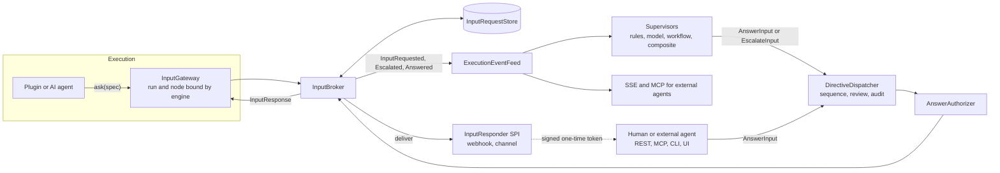
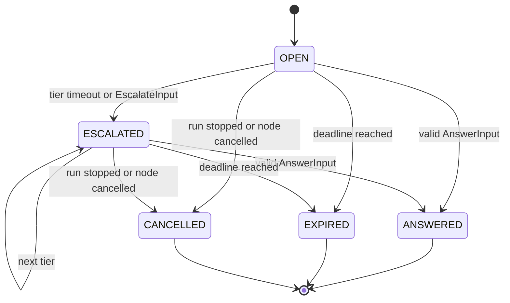
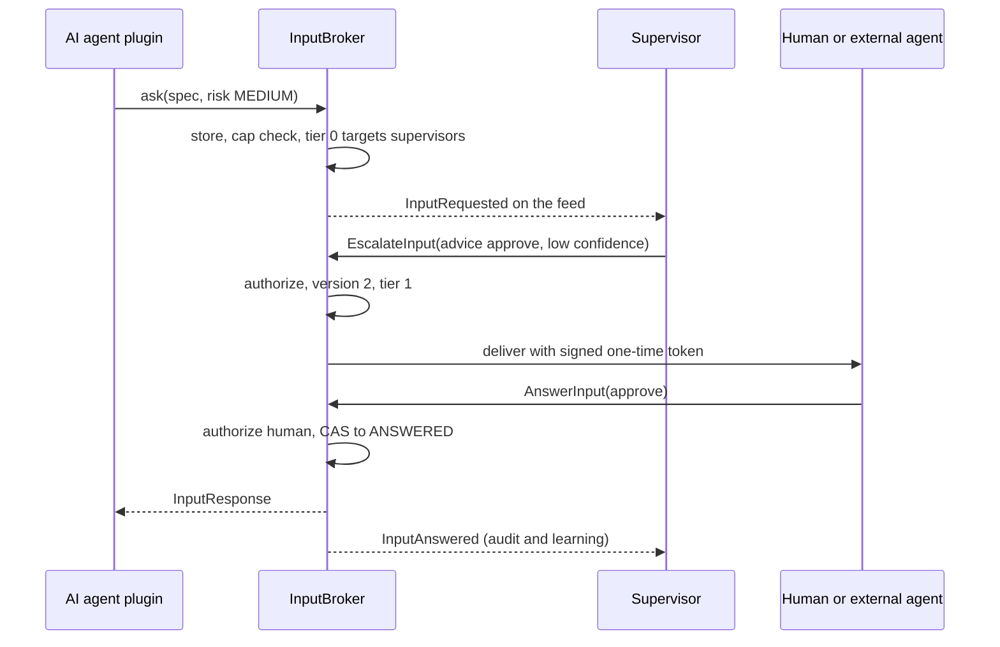

# Input requests and supervisor coordination

Design for letting a plugin ask a supervisor, a human or an external agent for input, and for letting supervisors work together: options considered, architecture, contracts, security, phases, risks and open decisions.

Work on this plan is tracked in Epic #1787 on the Yukta Roadmap project.

Status: **proposal, nothing is built.** Based on `origin/main` at e7e2fda49 (2026-11-01). Everything below was read from the code with git; nothing was built or run, so no behavior described as "today" has been re-tested for this plan.

## Summary

About half of this already exists. A node can hold for a named signal (`SignalWaits`, `WAIT_FOR_SIGNAL`), a person or agent can answer it with a decision and free text (`SignalNodeCommand`), and every answer goes through review, ordering and audit. What is missing is that the *question* is not a first-class object. It has no text, options, risk, owner or deadline, supervisors never see it, nothing says who may answer, it is lost on restart, and there is no way to hand it up the chain.

The proposal adds one concept, the **input request**, and builds everything on the existing control bus instead of beside it:

- A plugin calls an `InputGateway` with a typed question. The engine, not the plugin, fills in which run and node is asking.
- An `InputBroker` in core stores the request, publishes `InputRequested` on the existing event feed and tracks its state and deadline.
- Supervisors, humans and external agents all answer with the same new command, `AnswerInputCommand`. It reuses sequencing, `ControlReviewer` and audit, and adds an authorisation check on who may answer what.
- A route policy of tiers (supervisors first, then a human or external agent) handles escalation. Waiting is the broker's job, never a supervisor's, so a supervisor that needs a human never blocks.
- Supervisor coordination gets a conflict arbiter, composite supervisors and a workflow-backed supervisor that runs in an internal session.

The first usable cut (phases 1 to 5c) lets an agent ask, a supervisor or a person answer over REST and MCP, with every step authorised and audited. Escalation tiers, external responders, coordination and durability follow.

Related, already built or planned: Epic "Mission Control dashboard and scoped supervisors" (profiles, bindings, scopes, supervisor cockpit UI). This plan reuses those profiles and bindings and extends the cockpit UI.

## What exists on main and what is missing

| Need | State | On main today | Gap |
|---|---|---|---|
| Plugin waits for an answer | EXISTS | `SignalWaits.await(execution, node, name, timeout)`, `WAIT_FOR_SIGNAL`, `ToolApproval` in `MCP_TOOL_CALL` | Key is (execution, node, name): one open question per name, no request id. Static singleton, in memory. |
| Answer carries text | EXISTS | `SignalNodeCommand(executionId, nodeId, name, decision, data)` | Only strings. No structured answer, rationale or confidence. |
| Answer is reviewed and audited | EXISTS | `DirectiveDispatcher`: sequencer, `ControlReviewer`, `AuditRecord`. Raw `sendCommand` refuses payloads that carry a signal. | None. Reuse as is. |
| List open questions | PARTIAL | `pendingApprovals(session)` derived from `SignalWaits.pending()`; REST, MCP `list_pending_approvals`, UI strip | No prompt, options or risk. Not an event, so supervisors cannot react to it. |
| Supervisor sees the question | MISSING | `ExecutionEvent` has node and workflow status, `ControlOutcome`, `LogLine`, `EventsMissed` | No `InputRequested` event. |
| Supervisor answers | PARTIAL | A supervisor can emit any `ExecutionControlCommand`, including `SignalNodeCommand`; `ControlDecision` already has `confidence` | No rule about which supervisor may answer which request. Needs the signal's node and name, which are brittle. |
| Who may answer | MISSING | `ApiRole` (VIEWER, OPERATOR, ADMIN), per-key session list, actor string (`key:<name>` or supervisor id) | Any OPERATOR can answer any signal. No audience, no risk ceiling. |
| Escalate to human or external agent | PARTIAL | SSE `/api/events/stream`, MCP and REST, `NotifyTerminal` webhook with `EgressPolicy` | No routing, tier timeouts, signed callback or delivery retry. |
| Survives restart | PARTIAL | `WAIT_FOR_SIGNAL` records answers in the checkpoint store; `R2dbcSupervisorStore` (migration V7, Plus) | Open waits and early answers are in memory only. Supervisor profiles are durable only with the Postgres store. |
| Status of another execution | PARTIAL | Core has `ExecutionQueries`; MCP has status tools; `SubWorkflowGateway` runs children of the same session | No read-only gateway for plugins; cross-session access is undefined. |
| Supervisors cooperate | PARTIAL | Parallel and independent on the feed; sequential review, first denial wins; `RulesFirstControlPlane` chains two | No conflict resolution, loop guard, quorum or generic composition. |
| Supervisor as a workflow | MISSING | Factories: rule, rule/model/rules-first control plane | No workflow-backed type, no internal session, no recursion guard. |

## Architecture

### Design principles

1. **One bus.** Requests, answers and escalations are events and commands on the existing feed and dispatcher. No second control path.
2. **The server decides who may answer.** A supervisor that behaves badly, or a prompt-injected model, must not gain authority. Eligibility is checked in the processor, not trusted to the supervisor.
3. **The broker waits, supervisors stay stateless.** `SupervisorHost` applies commands with `concatMap`, and `ControlPlanePlugin.decide` has a 10 s limit. A supervisor can never block for a human.
4. **Identity is bound by the engine.** A plugin passes a question. It never passes the execution or node id.
5. **Additive and edition-safe.** New contracts in `plugin-api` are additive. Interfaces live in core with an in-memory default (`@ConditionalOnMissingBean`); the durable store goes in `plus`. Community never depends on Plus.
6. **Untrusted by default.** Prompts, context and external answers are treated as hostile input: size caps, schema validation, redaction, rate limits.

### Components



| Component | Module | Responsibility |
|---|---|---|
| `InputGateway` | plugin-api | What a plugin sees: `Mono<InputResponse> ask(InputRequestSpec)`. Placed in the Reactor context by the node runner, the way `ResultCollector` is, with execution, session and node already bound. |
| `InputBroker` | core `service/input` | Create (idempotent by key), enforce caps, state machine, deadlines and tier timers, publish events, complete the waiting `Mono`. |
| `InputRequestStore` | core interface, plus R2DBC impl | Requests, responses, deliveries (outbox). In-memory default. |
| `AnswerInputCommandProcessor` | core `control/processor` | Handles the new commands like the other processors. Calls `AnswerAuthorizer`, then the broker. |
| `AnswerAuthorizer` | core, replaceable SPI | Decides whether this actor may answer this request (see Security). Enterprise can replace it with group or SSO rules. |
| `InputResponder` SPI | plugin-api | Delivers a request to a tier (webhook, chat, channel). The answer comes back as `AnswerInputCommand`. |
| `CommandArbiter` | core `supervisor` | Resolves conflicts between commands from several supervisors and stops flapping. |
| `CompositeSupervisor`, `WorkflowSupervisor` | core or plugins | Created through `SupervisorFactory` (types `composite`, `workflow`). No change to `SupervisorHost`. |
| `ExecutionInsightGateway` | plugin-api, core impl | Read-only run summaries for plugins (status, current nodes, progress), session-scoped. |

### Request lifecycle



- Terminal states never change. Every transition bumps a `version` and compare-and-sets it, so two supervisors answering at once produce one winner.
- A second answer with the same responder and decision is acknowledged as a duplicate. A different one gets 409 `ALREADY_ANSWERED`.
- The request id is the handle for everything. `(execution, node, name)` stays only as the compatibility alias for signals.

## Contracts

New package `com.infenia.yukta.plugin.input` in `plugin-api`. Records, per the coding standards, and every public type gets `@since`. Field names are a proposal.

```java
public record InputRequestSpec(
    String key,                       // idempotency key: hash(session, workflow, node, message id, name)
    Kind kind,                        // APPROVAL | CHOICE | TEXT | STRUCTURED | QUERY
    String prompt,                    // untrusted text, capped (default 4 KB)
    Map<String, Object> context,      // untrusted, redacted, capped (default 16 KB)
    List<Option> options,             // APPROVAL and CHOICE
    @Nullable String responseSchema,  // JSON Schema for STRUCTURED
    Risk risk,                        // LOW | MEDIUM | HIGH
    Audience audience,                // who may answer, see Security
    Duration ttl,                     // capped by yukta.input.max-ttl
    TimeoutAction onTimeout,          // FAIL | USE_DEFAULT | ESCALATE
    @Nullable String defaultDecision) {}

public record InputResponse(
    String requestId, String decision, @Nullable String text,
    Map<String, Object> data, Responder responder,   // type SUPERVISOR | HUMAN | EXTERNAL, id
    @Nullable String rationale, @Nullable Double confidence, Instant answeredAt) {}

public interface InputGateway {
  String CONTEXT_KEY = "yukta.input.gateway";
  Mono<InputResponse> ask(InputRequestSpec spec);   // errors: InputExpired, InputCancelled, InputRejected
}
```

New commands in the sealed `ExecutionControlCommand` (update the `permits` list). Both carry `executionId`, so the per-run sequencer, review and audit apply unchanged.

```java
record AnswerInputCommand(String executionId, String requestId, @Nullable Long expectedVersion,
    String decision, @Nullable String text, Map<String, Object> data,
    @Nullable String rationale, @Nullable Double confidence) implements ExecutionControlCommand {}

record EscalateInputCommand(String executionId, String requestId,
    String reason, @Nullable String advice) implements ExecutionControlCommand {}
```

New events in the sealed `ExecutionEvent`: `InputRequested` (a snapshot of the request, its current tier and who it targets), `InputEscalated`, `InputAnswered`, `InputExpired`, `InputCancelled`. Because the interface is sealed, search every `switch` and `instanceof` over `ExecutionEvent` (tracker, SSE controller, `LogLineClassifier`, `RuleSupervisor` `Fields`, UI types) and extend them in the same change.

> **Why the existing signal is not enough.** `SignalNodeCommand` addresses a node and a name. An agent that asks two questions from one node, or asks again after a retry, cannot tell the answers apart, and a late answer can land on the wrong wait. A request id fixes that and gives supervisors something stable to reference.

## Flows

### An agent asks, a supervisor decides, a person is the fallback



If tier 0 had answered with enough confidence on a LOW or MEDIUM request, the broker would have completed it there and tier 1 would never have been contacted. A HIGH risk request skips supervisors that are not allowed to answer it and goes straight to a human tier.

### An execution wants the status of another

- **Facts** (is run X finished, which node is it on): a plugin calls `ExecutionInsightGateway`. It is read-only, returns summaries (status, current nodes, progress, last error truncated), never payloads, and is limited to the caller's own session unless the node config lists allowed peers and the session permits it.
- **Judgement** (should I wait for X, is X healthy enough): a `QUERY` request. A supervisor answers, with the facts it looked up in `data`. This keeps the policy in one place and is audited.

### Compatibility with signals

`WAIT_FOR_SIGNAL` and `requireApproval` become thin users of `InputGateway` (kind APPROVAL, risk HIGH, so only people answer, as today). `SignalNodeCommandProcessor` maps `(execution, node, name)` to the open request if there is one, and falls back to `SignalWaits` otherwise. `pendingApprovals` returns the union. `SignalWaits` is deprecated after one release and removed in the next.

## Security and authorisation

### Who may answer

`AnswerAuthorizer` runs in `AnswerInputCommandProcessor`, after `ControlReviewer`. All of these must hold.

| Rule | Detail |
|---|---|
| Audience | The actor matches a selector on the request: `supervisor:<id>`, `supervisor:*`, `role:OPERATOR`, `key:<name>`, `external:<tier>`. Default audience follows the current tier. |
| Tier | The actor is a target of the *current* tier. A supervisor answering a request already escalated to a human tier is rejected, even if it is in scope. |
| Risk ceiling | HIGH: human responder only (API key principal or a tier marked `HUMAN`). MEDIUM: a supervisor whose profile has `canAnswer` and `maxRisk >= MEDIUM`. LOW: any eligible responder. |
| Scope | Supervisor: `scope().matches(session, workflow)`. Key: the request's session is in the key's session list. Both already exist as concepts. |
| Separation | The run's own plugin cannot answer its own request. A supervisor cannot answer a request raised by a run it started. |
| Answer shape | `decision` is one of the options for APPROVAL and CHOICE; `data` validates against `responseSchema` for STRUCTURED; text and data are size-capped. |
| Allowed commands | A supervisor profile gets `allowedCommands`. New supervisor types default to none, so a model cannot emit `StopWorkflowCommand` unless granted. Existing types keep today's behavior. |

> **Auth disabled.** With no API key configured, `CallerIdentity` reports ADMIN and the actor is null. In that mode every caller counts as a human. Document this; it is the same trust level as today's signals.

### Threats and controls

| Threat | Control |
|---|---|
| Plugin forges which run or node is asking | The gateway is bound per node by the engine; the spec has no execution or node field. |
| Actor spoofing (a key named like a supervisor) | Actors keep their prefixes: supervisors are plain ids set by the host through the Reactor context, keys are `key:<name>`. Confirm no REST or MCP input can set `ControlActor.CONTEXT_KEY`. |
| Confused deputy (supervisor approves beyond its authority) | Risk ceiling, tier check, `allowedCommands`, and review by other supervisors. The broker re-checks; the supervisor is not trusted to behave. |
| Prompt injection through `prompt` and `context` into a model supervisor | Pass them as a delimited data block, never into the system prompt. Accept only schema-valid output with a decision from the option list. Confidence threshold; below it the supervisor escalates. HIGH risk never auto-answers. |
| Secrets and personal data leaking in context | Redact before storing, before the event, and before any outbound delivery. Reuse an existing redaction helper if one exists, otherwise add one with tests. |
| Exfiltration through outbound routes | Responders use `EgressPolicy` (deployment, workflow, session host lists). Payload is the redacted snapshot only. |
| Forged or replayed external answer | One-time token: HMAC over (request id, tier, expiry) with a server secret, single use, bound to one tier. Recorded actor is `token:<tier>`. Optional mTLS or API key on top. |
| Stale or misdirected answer | Answers address a request id and may carry `expectedVersion`. Terminal states are immutable. |
| Request spam by a looping agent | Caps per execution (default 5 open), per session (50), and an ask rate through `CallRateLimiter`. A cap breach fails the ask with a clear error and a metric. |
| Supervisor and run deadlock (a supervisor workflow asks, a supervisor must answer) | Requests raised inside a supervisor workflow route only to human tiers. See Supervisor coordination. |
| No audit of who decided what | Every command is already audited; add the request id, responder type, risk and rationale to the execution log entries. |

## Routing and escalation

A **route** is an ordered list of tiers. It is read from the request spec, then node config, then session config, then `yukta.input.route`.

```yaml
route:
  - tier: auto
    responders: [supervisor:*]        # whatever is bound in scope and allowed
    timeout: 30s
    mode: FIRST                       # FIRST | QUORUM(2) | UNANIMOUS
    minConfidence: 0.8
  - tier: ops
    responders: [external:slack-ops]  # an InputResponder bean
    type: HUMAN
    timeout: 1h
  on-final-timeout: FAIL              # or USE_DEFAULT
```

- **Delivery** is an outbox row per (request, tier), sent at least once with backoff. Responders must be idempotent by request id.
- **External agents** that cannot be called can pull: SSE `/api/events/stream?type=InputRequested`, MCP `list_pending_inputs`, then `answer_input`. The Claude Code channel under `examples/11-dogfood/channel` is one such transport and needs no core change.
- **Supervisors** influence a route without owning it. `EscalateInputCommand` adds advice ("approve, because the deploy matches policy X") that the next tier sees.
- **Quorum** turns answers from supervisors in a tier into votes. The broker resolves when the quorum agrees and escalates on disagreement.

## Supervisor coordination

Today supervisors run in parallel and never see each other. Three additions, none of which changes the `ExecutionSupervisor` contract.

### 1. Command arbiter (parallel supervisors)

A step between `SupervisorHost.send` and the dispatcher. Per execution it looks at a short window (default 2 s) and applies:

- Precedence: stop beats pause beats the rest. Opposite commands from different supervisors (pause and resume) are decided by `order()`.
- Duplicate commands coalesce into one.
- Flap guard: more than N state flips on one target in M seconds blocks that target for the offending supervisors and emits a `SupervisorFlapping` event.
- Every decision is recorded in the existing decision list, so conflicts are visible in `GET /api/supervisors`.

### 2. Composite supervisors (sequence, parallel, consensus)

A `SupervisorFactory` of type `composite`. Settings: `mode` (`CHAIN`, `PARALLEL`, `FIRST_MATCH`, `QUORUM`) and `children` (profile ids). Children run inside the composite and are not separate bindings, so nothing is subscribed twice.

- `CHAIN` generalises `RulesFirstControlPlane`: the first child with an opinion wins, later ones are the fallback.
- `review` defaults to all children must allow.
- Validation at save time: children exist, no cycles, depth at most 3, each child scope inside the composite scope. The factory needs a `SupervisorResolver` bean to look profiles up.

### 3. Workflow-backed supervisor

A supervisor implemented as a workflow in an internal session, with guard rails.

- Type `workflow`. Settings: `sessionId`, `workflowId`, event filter (event types plus an optional SpEL condition reusing the rule supervisor's evaluator), `maxConcurrent`, `timeout`, `allowedCommands`.
- Per matching event the host starts a run with the event or request as payload and an idempotency key derived from the event. The child result maps through the existing `OUTCOME_TERMINAL` outcomes: SUCCESS yields commands from the result (validated against `allowedCommands`), ESCALATE becomes `EscalateInputCommand`, RETRY re-runs once, FAILED is "no opinion" plus a metric.
- It must be a core-internal runner. Do not widen `SubWorkflowGateway`, which is deliberately same-session and public.
- **Internal session**: a session flag `internal=true`, created by ADMIN only (workflows can run processes and SQL). Hidden from default lists. Its runs are excluded from the supervisor event feed unless a binding opts in, so a supervisor workflow cannot trigger itself.
- **Recursion and deadlock**: the payload carries `yukta.supervisor.depth` (reuse the existing `yukta.depth` nesting limit). An input request raised inside a supervisor workflow routes only to human tiers, never to supervisors.
- **Capacity**: supervisor runs get reserved slots that do not count toward `yukta.execution.max-concurrent` (the way `borrowed()` works for children). Otherwise a saturated server, the very case a resource supervisor must handle, would starve its own supervisor.

## Durability, cluster and editions

- **Store interface** `InputRequestStore` in core, in-memory default through `DefaultsAutoConfiguration` with the existing in-memory notice. `R2dbcInputRequestStore` in `plus/persistence-postgres` with a Flyway migration (V7 is supervisors; take the next free number when you start). Add a contract test in `testFixtures` the way the other stores have one.
- **Tables**: `input_request` (id, unique key, execution, session, workflow, node, kind, state, version, spec jsonb, tier, deadline, timestamps), `input_response`, `input_delivery` (outbox). Indexes on (state, deadline), (session, state), unique (key). Retention purge of terminal rows (`yukta.input.retention`).
- **Deadlines are absolute times**, re-armed from the store on start and on leader change. Do not rely on an in-process `Mono.delay` alone.
- **Resume**: the request key is deterministic and does not contain the execution id (a recovered run gets a new one), so a resumed run that asks again gets the stored answer at once. Phase 0 confirms that message ids survive a recover. This replaces the ten-minute in-memory early-signal buffer. Open requests whose run cannot be resumed become CANCELLED with reason `run-ended`.
- **High availability**: waiters live where the run lives. Follow `core/.claude/rules/workers-and-ha.md` and the leader lease; an answer that reaches a non-leader must be forwarded or rejected with a retryable error. Confirm the exact behavior before the durability phase.
- **Editions**: in-memory broker, supervisors, webhook responder and REST in Community. Postgres store in Plus. Group, SSO and approval-chain policies belong in Enterprise, behind the `AnswerAuthorizer` SPI. Check `FeatureGate` for how a durable-only feature should report itself.

## APIs, tools and UI

| Surface | Proposal |
|---|---|
| REST answer | `POST /api/executions/{executionId}/inputs/{requestId}/answer` and `/escalate`. Under `/api/executions/` on purpose: `ApiRole` lets OPERATOR call only `/api/executions/` and `/api/workflow/`, and session-limited keys cannot reach paths that name no session. A top-level `/api/inputs/` would need changes to both. |
| REST read | `GET /api/sessions/{s}/inputs?state=&workflow=`, `GET /api/executions/{e}/inputs/{id}`. VIEWER may read. Keep `/approvals` as a compatibility view. |
| External token | `POST /api/inputs/token-answer` with the one-time token, no API key, rate limited, outside the role filter by design and covered by its own tests. |
| MCP | `list_pending_inputs` (VIEWER), `answer_input` and `escalate_input` (OPERATOR). Add them to the access map in `McpToolAccess`. |
| CLI (Go) | `yukta inputs` with the subcommands `list`, `show`, `answer` and `escalate`. |
| UI | Turn the pending-approvals strip into an Inputs panel: prompt, option buttons or text box, risk badge, current tier with countdown, supervisor advice, history. The Control page shows supervisor conflict and flap decisions. |
| Generated files | Regenerate `ui/openapi.json`, `docs/api/openapi.json` and `ui/src/types/api.generated.ts` with the project task. Claude cannot read them; run the generator and review the diff by eye. |
| Docs | New page next to `docs/building/approvals-and-signals.mdx`; extend `docs/running/supervisors.mdx`; update `core/.claude/rules/supervisors.md` and `execution-limits-and-control.md`. |

### Observability

- Metrics: `yukta.input.requests{kind,risk,outcome}`, `yukta.input.wait` timer by tier, `yukta.input.open` gauge, `yukta.input.escalations{tier}`, `yukta.supervisor.conflicts{type}`, `yukta.input.denied{rule}`.
- Execution log entries `INPUT_REQUESTED`, `INPUT_ESCALATED`, `INPUT_ANSWERED`, `INPUT_EXPIRED`, each with request id, tier and responder.
- Add the request id to the logging context for every broker log line.
- Alert suggestion: open requests older than their tier timeout, and any request that reaches the final tier.

## Implementation plan

Sizes are rough relative effort (S under 2 days, M about a week, L more), for planning only. Build, test and check through `yk gradle`, `yk tool` and `yk check`. Run the smallest scope per module, `yk gradle spotlessApply` once at the end, and use Conventional Commits. Each phase is its own PR and its own sub-issue of the Epic (phase 5 is three: 5a REST, MCP and CLI, 5b UI, 5c supervisor side and docs). The Epic is #1787 and the sub-issues are #1788 to #1800; they carry the detailed, per-file instructions.

**Minimum usable cut: phases 1 to 5c.** Agent asks, supervisor or person answers over REST and MCP, everything audited and authorised. Phases 6 to 9 add external delivery, coordination, workflow supervisors and durability. Phase 9 can move earlier if restarts during waits matter.

| Phase | What (issue) | Size | Depends on |
|---|---|---|---|
| 0 | Decisions, ADR and spike (#1788) | S | none |
| 1 | Contracts in `plugin-api` (#1789) | M | 0 |
| 2 | Broker, store, state machine (#1790) | L | 1 |
| 3 | Commands, authorisation, signal bridge (#1791) | L | 2 |
| 4 | Plugin integration (#1792) | M | 3 |
| 5a | REST, MCP, CLI (#1793) | M | 3 |
| 5b | Inputs panel in the UI (#1794) | M | 5a |
| 5c | Rule and model supervisors answer, docs (#1795) | M | 3 (4 for tests) |
| 6 | Routes, escalation, external responders (#1796) | L | 5a, 5c |
| 7 | Arbiter and composite supervisors (#1797) | M | 1 (can run beside 2 to 5) |
| 8 | Workflow-backed supervisor and internal session (#1798) | L | 5a, 5c, 6, 7 |
| 9 | Durable store and failover, Plus (#1799) | L | 2 (needs 6 for the outbox) |
| 10 | Hardening and release (#1800) | M | 8, 9, 5b |

### Phase 0: decisions and spike (S)

- Settle the decisions in the last section.
- Confirm that message ids survive `recover` and checkpoint replay, because the request key is built from session, workflow, node, message id and name.
- Confirm how `SubWorkflowGateway` and `ResultCollector` reach plugins (Reactor context), and where the node runner can bind identity.
- List every consumer of `ExecutionEvent` and `ExecutionControlCommand` that switches over the sealed types.
- Check that no entry point lets a caller set `ControlActor.CONTEXT_KEY`.
- Output: a short ADR and the consumer list attached to the phase 1 PR.

### Phase 1: contracts in plugin-api (M)

- Package `plugin.input`: spec, response, enums, `InputGateway`, `InputResponder`, errors.
- Add `AnswerInputCommand` and `EscalateInputCommand` to the `ExecutionControlCommand` permits. Constructor validation (blank ids, size caps).
- Add the five input events to `ExecutionEvent` and fix every exhaustive consumer.
- Add `allowedCommands`, `canAnswer`, `maxRisk` as documented `SupervisorProfile` settings, not new record fields, to keep the record stable.
- Tests: record validation, JSON round trip, exhaustive-switch compile check, no dependency from `plugin-api` to core.
- Done when `yk gradle :plugin-api:test` passes and dependants compile (`yk plan` lists them).

### Phase 2: broker, store, state machine (L)

- `InputRequestStore` and `InMemoryInputRequestStore` (default bean).
- `InputBroker`: idempotent create by key, caps (per execution, per session, ttl, sizes), compare-and-set transitions, waiter `Sinks.One` per request, deadline sweeper, cancel on run end (hook the run-finished path that already releases plugins).
- Publish events through `ExecutionEventFeed` and log entries through `ExecutionLogStore`. Metrics.
- `InputGatewayFactory` creates a per-node gateway and the node runner puts it in the Reactor context.
- Tests: state machine table test; `StepVerifier.withVirtualTime` for deadlines; concurrent answers (exactly one winner); duplicate key returns the same request; caps; cancel on stop.
- Done when a test plugin can `ask` and be completed by calling the broker directly.

### Phase 3: commands, authorisation, signal bridge (L)

- `AnswerInputCommandProcessor` and `EscalateInputCommandProcessor` beside the other processors; register them like the rest.
- `AnswerAuthorizer` (default implementation with the rules table above), replaceable bean.
- Gateway methods `answerInput` and `escalateInput` on `ControlBusGateway` and `DefaultControlBusGateway`.
- Bridge `SignalNodeCommandProcessor` and `pendingApprovals` to requests, with the `SignalWaits` fallback.
- Tests: authorisation matrix (actor type by risk by tier by scope), review veto, audit entries, a rejected answer leaves the request open, legacy `WAIT_FOR_SIGNAL` flows unchanged.
- Done when existing signal and approval tests pass untouched and a supervisor-issued answer works end to end in an integration test.

### Phase 4: plugin integration (M)

- Move `WAIT_FOR_SIGNAL` and `ToolApproval` onto `InputGateway` (risk HIGH, same options and timeouts, same `signal.*` metadata).
- New internal-core plugin `ASK_INPUT` for workflows: prompt template, options, risk, ttl, `onTimeout`; output tagged `input.decision`, `input.text`, `input.data`.
- For agent plugins (`LLM_CALL` tools, MCP): an `ask_for_input` tool that calls the gateway, within the existing LLM budget rules.
- The engine node timeout must outlast the ttl, as `WAIT_FOR_SIGNAL` does today (+30 s).
- Tests: plugin unit tests with a fake gateway; a workflow-level test with a branch on `input.decision`; checkpoint replay returns the stored answer.

### Phase 5: REST, MCP, CLI, UI, docs, supervisor side (three sub-issues, L in total)

- Controllers under `/api/executions/{e}/inputs/...` and `/api/sessions/{s}/inputs`; role and session-scope tests next to the existing signal endpoint tests.
- MCP tools and `McpToolAccess` entries; CLI commands; UI Inputs panel; regenerate OpenAPI and TypeScript types.
- Supervisor side: expose the new events to `RuleSupervisor` (`Fields`) and add an answer action to its rule format, so a rule can auto-approve LOW risk requests. Let `ModelControlPlane` return `AnswerInputCommand` in `ControlDecision`, and escalate when confidence is below the threshold.
- Docs and the two rules files.
- Tests: WebTestClient (OPERATOR, VIEWER, session-limited key, no key), UI vitest and Playwright with MSW, CLI Go tests, MCP contract tests.
- Done when `yk check --full` is green for 5a, 5b and 5c. This ends the minimum cut.

### Phase 6: routes, escalation, external responders (L)

- `RoutePolicy` resolution (spec, node, session, server), tier timers, `EscalateInputCommand` semantics and advice.
- Delivery outbox and `InputResponder` beans: `webhook` (reuse `EgressPolicy`, redaction, HMAC token) and `channel` pull through SSE and MCP.
- One-time token verification endpoint with rate limit and replay protection.
- QUORUM and UNANIMOUS modes.
- Tests: virtual-time tier progression, token replay, expired token, egress denied, quorum disagreement escalates, delivery retry and idempotency.

### Phase 7: arbiter and composite supervisors (M)

- `CommandArbiter` between `SupervisorHost.send` and the dispatcher; precedence, coalescing, flap guard; decisions into the existing decision list and metrics.
- `CompositeSupervisor` and factory with save-time validation, `SupervisorResolver`. Re-express `RulesFirstControlPlane` as a chain (keep its type name for compatibility).
- Tests: two supervisors issuing pause and resume, flapping detection with virtual time, cycle and depth rejection, review mode ALL.

### Phase 8: workflow-backed supervisor and internal session (L)

- `internal` flag on the session model, ADMIN-only creation, list filtering, feed exclusion, UI under System.
- Core-internal workflow runner with idempotent start, reserved capacity, depth guard, result mapping and `allowedCommands` enforcement.
- Factory type `workflow`; an example workflow in `examples/` that answers LOW risk requests after reading status through the Yukta MCP with a VIEWER key (the same pattern the dogfood fixer uses).
- Tests: no self-trigger loop, depth limit, a request raised in a supervisor run routes to humans only, capacity reserved under saturation, a result with a forbidden command is dropped and counted.

### Phase 9: durable store and failover, Plus (L)

- `R2dbcInputRequestStore`, migration, contract test shared with the in-memory store.
- Deadline and tier timer rehydration on start and leader change; outbox redelivery; retention job.
- Answer routing on non-leader nodes; document edition behavior and the in-memory warning.
- Tests: restart in the middle of a wait (Testcontainers, as the other Postgres stores do), leader switch, a resumed run reuses the stored answer, retention.

### Phase 10: hardening and release (M)

- Security review of the authorisation matrix and token flow (`/security-review` on the branch), OpenGrep run, fuzz of answer payloads.
- Load check with 1,000 open requests and a burst of answers; confirm the sweeper cost.
- Deprecate `SignalWaits`; release notes; migration note for custom plugins.

## Test strategy

- **Unit**: JUnit 5, Mockito, AssertJ, `StepVerifier` with virtual time for every timeout. Table tests for the state machine and the authoriser.
- **Contract**: one shared suite for `InputRequestStore` run against in-memory and Postgres.
- **Integration**: broker plus dispatcher plus a real supervisor bean; REST with WebTestClient across the role and session-key matrix.
- **Concurrency**: many parallel answers and escalations on one request; exactly one terminal state.
- **Security**: spoofed actor, HIGH risk answered by a supervisor, answer to a request of another session, replayed token, oversized and malformed payloads, injection strings in `prompt` through a fake model supervisor.
- **Resilience**: restart mid-wait, leader loss, slow supervisor, full feed buffer (the supervisor receives `EventsMissed` and must recover by listing open requests from the store, so add that to the supervisor guide).
- Coverage thresholds are module-specific; keep Checkstyle, PMD and SpotBugs clean for tests too.

## Decisions

Each has a recommended default so work can start before every decision is ratified. Record the outcome in the phase 0 ADR.

| Decision | Recommendation | Why |
|---|---|---|
| Name of the concept | `InputRequest` | Covers approvals, choices, text and queries without sounding like only a permission step. |
| Replace or wrap `SignalWaits` | Wrap, then deprecate | Existing flows and docs keep working during the move. |
| Default risk for approvals | HIGH for `WAIT_FOR_SIGNAL` and tool approvals, MEDIUM for `ASK_INPUT` | Keeps today's human-only behavior; automation is opt-in. |
| Can a supervisor ever answer HIGH risk | No, in the default authoriser | An automated reviewer approving the riskiest actions defeats the control. Enterprise can relax it. |
| Where the durable store lives | Plus, with in-memory in Community | Matches the editions plan and the other stores. |
| Token answers without an API key | Yes, phase 6, single use, never above the tier's declared type | Lets Slack or an external agent answer without handing out keys. |
| Internal session mechanism | A session flag plus ADMIN-only creation | A naming convention is easy to bypass and easy to forget. |
| Workflow supervisors in the first release | No, phase 8 | Needs the arbiter, the reserved capacity and the loop guards first. |

### Read from the code, to re-check when work starts

- That the node runner provides gateways to plugins through the Reactor context (the docs say so for `ResultCollector`; the runner itself was not read).
- That nothing external can set `ControlActor.CONTEXT_KEY`.
- The next free Flyway number, the HA forwarding behavior, and whether a redaction helper already exists.
- How `FeatureGate` reports a Plus-only feature.
