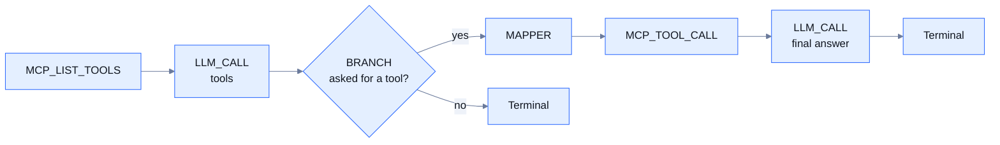

A model-driven workflow calls a chat model from a node, lets the model ask for tools, and keeps the model on a short leash with budgets and filters. The plugins involved (`LLM_CALL`, `MCP_LIST_TOOLS`, `MCP_TOOL_CALL`, `SESSION_MEMORY` and the decision plugins) are optional modules chosen when the server is built. See [Built-in plugins](/plugins/overview).

Yukta keeps the control flow in the graph, not in the model. The model suggests an action; a node you wired runs it, and you decide what happens next. That makes an agent easy to inspect, limit, pause and approve like any other workflow. This page shows how to put the pieces together. For the options of each plugin, see [AI plugins](/plugins/ai) and [Decision plugins](/plugins/decisions).

## The pieces

| Need | Use |
|---|---|
| Ask a model a question | `LLM_CALL` |
| Remember a conversation | `SESSION_MEMORY` before and after the model |
| Let the model use tools on an MCP server | `MCP_LIST_TOOLS` to list them, `LLM_CALL` with `tools` to choose, `MCP_TOOL_CALL` to run |
| Route or gate on a model's judgement | `CLASSIFY`, `GATE`, `SCORE`, `ASK`, `ANOMALY`, `DEDUPE` |
| Stop a runaway agent | `budget` on `LLM_CALL` and `MCP_TOOL_CALL`, with `hardStop` |
| Require a human to approve a tool call | `requireApproval` on `MCP_TOOL_CALL`, or a `WAIT_FOR_SIGNAL` node |

## Calling a model

`LLM_CALL` supports three kinds of provider:

| `provider` | Notes |
|---|---|
| `openai` | OpenAI. Set `baseUrl` for any OpenAI-compatible service such as Groq, vLLM or a local gateway. `openai-compatible` is an alias |
| `anthropic` | Anthropic. Needs an API key |
| `ollama` | A local or remote Ollama server. `baseUrl` defaults to the local one |

Give a key as `decrypted:<key>` so the secret is read from the environment variable `YUKTA_SECRET_<KEY>` and not stored in the workflow. The prompt can be built from the message with `${payload.message}` and the system prompt is a plain option. The answer is in `payload.content`, with token usage in `payload.usage`.

A failed call fails the node by default. With `failureMode` `CONTINUE` and `routeByStatus` on, the node emits on `success` or `failure`, so the `failure` port can lead to a second `LLM_CALL` with a different model as a fallback. See [Failure handling](/concepts/failure-handling).

## Chat with memory

A chat turn is a `SESSION_MEMORY` node in `load` mode, the model, and a `SESSION_MEMORY` node in `append` mode:

```json
{
  "nodes": [
    { "nodeId": "trigger", "type": "API_TRIGGER", "config": {} },
    {
      "nodeId": "memory-load",
      "type": "SESSION_MEMORY",
      "config": { "mode": "load", "sessionId": "${payload.sessionId}", "message": "${payload.message}", "maxTurns": 20 }
    },
    {
      "nodeId": "llm",
      "type": "LLM_CALL",
      "config": {
        "provider": "ollama",
        "model": "llama3.2",
        "system": "You are a concise, helpful assistant.",
        "messages": "payload['history']",
        "prompt": "${payload.message}"
      }
    },
    { "nodeId": "memory-append", "type": "SESSION_MEMORY", "config": { "mode": "append", "maxTurns": 20 } },
    { "nodeId": "end", "type": "CONSOLE_TERMINAL", "config": {} }
  ],
  "edges": [
    { "source": "trigger", "target": "memory-load" },
    { "source": "memory-load", "target": "llm" },
    { "source": "llm", "target": "memory-append" },
    { "source": "memory-append", "target": "end" }
  ]
}
```

Start it with a payload such as `{"sessionId": "user-42", "message": "My name is Ada."}`. A later start with the same `sessionId` sees the earlier turns in `payload['history']`. `messages` is written as an expression on purpose: a `${...}` reference would turn the list into text.

## Tools and the agent loop

An agent loop has four steps: the model reads the task and the tools on offer, decides whether it needs a tool, the workflow runs the tool, and the result goes back to the model.



- `MCP_LIST_TOOLS` reads the tool names, descriptions and input schemas of an MCP server. `allowedTools` narrows the list.
- `LLM_CALL` takes them in its `tools` option (an expression such as `payload.tools`). If the model wants a tool, the call appears in `payload.actions` as `{"tool", "arguments", "id"}`. The node does not run it.
- A `BRANCH` node tests whether `payload.actions` has entries.
- `MCP_TOOL_CALL` runs the tool. Give it `allowedTools` so that a model can never reach a tool you did not intend, even by choosing a name.
- The result, in `payload.text` and `payload.structured`, goes into a second `LLM_CALL` that writes the answer.

A graph has no cycles, so an agent that may need several rounds is built in one of two ways. Unroll a fixed number of rounds by repeating the `LLM_CALL`, `BRANCH` and `MCP_TOOL_CALL` group, which gives a hard upper bound that is easy to read. Or move one round into its own workflow and run it again with `SUB_WORKFLOW`; nesting is capped at 5 levels, which bounds the loop. See [Sub-workflows](/concepts/sub-workflows). `LOOP_PREDICATE` repeats a single processor, so it suits polling and retrying one call, not a whole round.

Each node replaces the payload with its own result, so carry what you still need in the message metadata. The example below sets the task into the metadata and reads it again with `${metadata.task}`.

### Complete example

This session runs a one-tool agent against a hypothetical issue tracker. The first `LLM_CALL` may ask for one tool. If it does, the workflow runs the tool and a second `LLM_CALL` writes the answer; if not, the first answer is final. Both model nodes and the tool node share one budget named `triage`, and `hardStop` ends the whole execution if it is used up.

```json
{
  "sessionId": "issue-agent",
  "name": "Issue triage agent",
  "description": "A model that may call one tool before it answers",
  "initiator": "docs",
  "projectPath": "/tmp",
  "tags": {},
  "workflows": {
    "triage": {
      "workflowId": "triage",
      "description": "List tools, ask the model, run the tool it picks, answer",
      "nodes": [
        {
          "nodeId": "task",
          "type": "CONSTANT_SOURCE",
          "config": {
            "target": "METADATA",
            "variables": { "task": "List the open issues labelled bug and summarise the most urgent one in two sentences." }
          }
        },
        {
          "nodeId": "tools",
          "type": "MCP_LIST_TOOLS",
          "config": {
            "url": "https://issues.example.com/mcp",
            "authToken": "decrypted:issues-mcp",
            "allowedTools": ["search_issues", "get_issue"]
          }
        },
        {
          "nodeId": "plan",
          "type": "LLM_CALL",
          "config": {
            "provider": "anthropic",
            "model": "claude-sonnet-5-5",
            "apiKey": "decrypted:anthropic",
            "system": "You are an issue triage agent. Call a tool when you need data. Otherwise answer.",
            "prompt": "${metadata.task}",
            "tools": "payload.tools",
            "maxTokens": 1024,
            "timeout": 60,
            "retries": 1,
            "prices": { "input": 3.0, "output": 15.0 },
            "budget": { "maxTokens": 20000, "maxCost": 0.5, "agent": "triage", "hardStop": true }
          }
        },
        {
          "nodeId": "route",
          "type": "BRANCH",
          "config": {
            "mode": "EXPRESSION",
            "cases": { "payload.actions.size() > 0": "tool" },
            "defaultPort": "answer"
          }
        },
        {
          "nodeId": "pick",
          "type": "MAPPER",
          "config": {
            "mode": "PROJECTION",
            "mapping": { "tool": "payload.actions[0].tool", "args": "payload.actions[0].arguments" }
          }
        },
        {
          "nodeId": "act",
          "type": "MCP_TOOL_CALL",
          "config": {
            "url": "https://issues.example.com/mcp",
            "tool": "${payload.tool}",
            "arguments": "payload.args",
            "allowedTools": ["search_issues", "get_issue"],
            "authToken": "decrypted:issues-mcp",
            "timeout": 30,
            "budget": { "maxCalls": 4, "agent": "triage", "hardStop": true }
          }
        },
        {
          "nodeId": "finish",
          "type": "LLM_CALL",
          "config": {
            "provider": "anthropic",
            "model": "claude-sonnet-5-5",
            "apiKey": "decrypted:anthropic",
            "system": "Answer the task using the tool result. Be brief.",
            "prompt": "Task: ${metadata.task}\n\nTool result:\n${payload.text}",
            "maxTokens": 512,
            "timeout": 60,
            "prices": { "input": 3.0, "output": 15.0 },
            "budget": { "maxTokens": 20000, "maxCost": 0.5, "agent": "triage", "hardStop": true }
          }
        },
        { "nodeId": "direct-answer", "type": "CONSOLE_TERMINAL", "config": {} },
        { "nodeId": "final-answer", "type": "CONSOLE_TERMINAL", "config": {} }
      ],
      "edges": [
        { "source": "task", "target": "tools" },
        { "source": "tools", "target": "plan" },
        { "source": "plan", "target": "route" },
        { "source": "route", "target": "pick", "sourcePort": "tool" },
        { "source": "route", "target": "direct-answer", "sourcePort": "answer" },
        { "source": "pick", "target": "act" },
        { "source": "act", "target": "finish" },
        { "source": "finish", "target": "final-answer" }
      ]
    }
  }
}
```

Create the session with `POST /api/sessions`, then start the workflow with `POST /api/workflow/start` and the body `{"sessionId": "issue-agent", "workflowId": "triage"}`. The tool server, tool names and token here are placeholders for your own. The `prices` are per million tokens; use your provider's current prices.

Things to notice:

- If the model asks for several tools, `pick` takes the first one. To run all of them, split `payload.actions` with a `SPLITTER` node first.
- The `agent` name puts the three nodes in one budget. Without it, each execution has one budget for all its nodes.
- A trigger-set `metadata.task` survives every node, so the final prompt can quote the task.

## Decisions instead of free text

When a node must choose, not write, a decision plugin is cheaper and easier to route on than a free-text answer: `CLASSIFY` gives one label from your list, `GATE` a yes/no with a probability, `SCORE` a position on a scale, `ASK` several answers in one call. They use a small local decision model (Ollama System One) or any chat model. Typical uses:

- `CLASSIFY` with `routeByLabel` at the start of a workflow, so each kind of request takes its own branch, with an `uncertain` port for the unclear ones.
- A `GATE` in front of `MCP_TOOL_CALL` that asks whether the arguments the model proposed are safe, with `state` set to `payload.args`.
- `ANOMALY` and `DEDUPE` in a long-running, scheduled workflow, to react to an unusual or repeated event. See [Scheduling](/building/scheduling).

## Guardrails

Models can loop, overspend and be fed hostile input. Yukta gives you limits at four levels.

| Guardrail | Where | Effect |
|---|---|---|
| Token, cost and call budgets | `budget` on `LLM_CALL` and `MCP_TOOL_CALL` | Counts use per execution (and per `agent` name). When used up, the next call fails. With `hardStop` it ends the whole execution and nothing retries or absorbs it |
| Timeouts and retries | `timeout`, `retries`, `timeoutSeconds` | Bound a single call and a whole node |
| Provider rate limit | `yukta.llm.rate-limit.<provider>` (requests per minute) | Spaces calls evenly; a call that would wait longer than half its `timeout` fails |
| Prompt and answer filters | `yukta.llm.deny-input-patterns`, `yukta.llm.deny-output-patterns`, `yukta.llm.max-input-chars` | Refuse a call whose prompt matches a pattern or is too long, and an answer (or tool arguments) that matches a pattern |
| Tool allow-list | `allowedTools` on a node, `yukta.mcp-client.allowed-tools` on the server | Refuse any other tool |
| Tool argument limits | `yukta.mcp-client.max-argument-bytes` (65536), `yukta.mcp-client.deny-argument-patterns` | Refuse oversize arguments or arguments that match a pattern |
| Human approval | `requireApproval` on `MCP_TOOL_CALL`, or `WAIT_FOR_SIGNAL` | The call waits for a signal; `reject` or no answer refuses it. See [Approvals and signals](/building/approvals-and-signals) |

A few facts about budgets:

- The ledger is shared by every model and tool node of the execution (and `agent`), and `maxCalls` counts tool calls only.
- The check runs before a call and the usage is added after it, so one call can overshoot, and calls that run at the same time can each pass the check.
- Budgets live in server memory. They start again from zero after a restart or a resume.

<Warning>
  Text from users, web pages or tools goes straight into the prompt. A model can be talked into asking for a tool you did not expect. Keep `allowedTools` narrow, put `requireApproval` on tools that change things, and never let a tool name or argument from a model reach something dangerous without a check.
</Warning>

## Related

- [AI plugins](/plugins/ai)
- [Decision plugins](/plugins/decisions)
- [Approvals and signals](/building/approvals-and-signals)
- [Variables and expressions](/building/variables-and-expressions)
