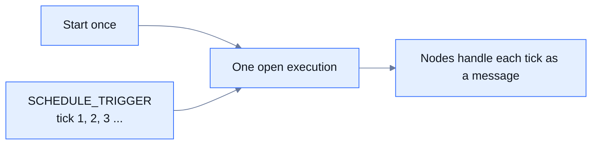

There are two ways to run a workflow repeatedly. Put a `SCHEDULE_TRIGGER` node at the start of the workflow and let Yukta keep time, or keep time outside Yukta and start the workflow each time over REST, the CLI or MCP.

## How a scheduled workflow runs

A schedule lives inside one long-running execution. You start the workflow once. Its `SCHEDULE_TRIGGER` node then emits a message on every tick, and the rest of the graph handles each message as it arrives. The execution stays open, and holds one execution slot, until you stop it, the trigger reaches its `maxRuns`, or the server stops. It is not a separate scheduler that creates a new execution per tick.



Every tick is a message with the payload `{"tick": 1, "firedAt": "2026-10-15T09:00:00Z"}`. `tick` counts from 1 and `firedAt` is the creation time in UTC.

## Interval or cron

Set exactly one of `intervalMs` and `cron`. Setting both, or neither, is rejected when the workflow is validated. See [Triggers](/plugins/triggers#schedule_trigger) for the full option table.

| Option | Type | Default | Meaning |
|---|---|---|---|
| `intervalMs` | number | none | A tick every this many milliseconds, counted from when the execution starts. The first tick comes after one interval, not at once. Must be positive |
| `cron` | string | none | A cron expression. The next tick is the next time that matches |
| `zone` | string | the server's time zone | The time zone in which `cron` is read, for example `Europe/Berlin`. It has no effect with `intervalMs` |
| `maxRuns` | number | unlimited | Stop after this many ticks. The trigger then completes and the execution ends once the work is done |

A cron expression has six fields: second, minute, hour, day of month, month and day of week.

| Expression | Fires |
|---|---|
| `*/10 * * * * *` | Every 10 seconds |
| `0 */5 * * * *` | Every 5 minutes, on the minute |
| `0 0 9 * * MON-FRI` | At 09:00 on weekdays |
| `0 30 2 1 * *` | At 02:30 on the first day of each month |

Invalid values are rejected when the workflow is validated: an invalid cron expression, an unknown time zone, a cron expression that has no future date, a non-positive `intervalMs` and a `maxRuns` that is not a positive whole number.

<Warning>
  A trigger node has an idle timeout of 30 seconds, like any other node. If the gap between two ticks is longer, set `timeoutSeconds` on the `SCHEDULE_TRIGGER` node to more than the longest gap, or the node times out between ticks. For a daily cron, for example, use a value above `86400`.
</Warning>

## Example

This session checks a URL every minute and sends a webhook message when the check fails. The `SCHEDULE_TRIGGER` node allows 120 seconds of silence, twice the interval.

```json
{
  "sessionId": "uptime-watch",
  "name": "Uptime watch",
  "description": "Probe a URL every minute and notify on failure",
  "initiator": "docs",
  "projectPath": "/tmp",
  "tags": {},
  "workflows": {
    "probe": {
      "workflowId": "probe",
      "description": "Runs until stopped",
      "nodes": [
        {
          "nodeId": "every-minute",
          "type": "SCHEDULE_TRIGGER",
          "config": { "intervalMs": 60000, "timeoutSeconds": 120 }
        },
        {
          "nodeId": "check",
          "type": "HTTP_REQUEST",
          "config": {
            "url": "https://example.com/health",
            "timeout": 10,
            "failureMode": "CONTINUE",
            "routeByStatus": true
          }
        },
        { "nodeId": "ok", "type": "CONSOLE_TERMINAL", "config": {} },
        {
          "nodeId": "alert",
          "type": "NOTIFY_TERMINAL",
          "config": { "url": "https://hooks.example.com/services/T000/B000/XXXX", "text": "Health check failed" }
        }
      ],
      "edges": [
        { "source": "every-minute", "target": "check" },
        { "source": "check", "target": "ok", "sourcePort": "success" },
        { "source": "check", "target": "alert", "sourcePort": "failure" }
      ]
    }
  }
}
```

Create the session with `POST /api/sessions`, then start the workflow once:

```http
POST /api/workflow/start
```

```json
{ "sessionId": "uptime-watch", "workflowId": "probe" }
```

## Stopping a schedule

An execution with a schedule runs until it is stopped. Use `maxRuns` for a bounded schedule. To stop an open one, stop the workflow's executions. The default `DRAIN` mode stops the trigger and lets in-flight work finish.

```http
POST /api/workflow/uptime-watch/probe/stop
```

The same works from the CLI with `yukta workflow stop <session-id> <workflow-id>`, and for one execution with `yukta workflow executions stop <execution-id>`. See [Run controls](/running/run-controls).

## Overlap

All ticks of a schedule belong to one execution, so schedules do not overlap as executions. Each tick is an independent message, and Yukta does not replay missed ticks. If the work a tick starts takes longer than the gap between ticks, new ticks arrive while earlier ones are still being handled. Keep the interval longer than the work, or put `engine.edgeBuffer` on the slow node so that it drops the oldest or newest waiting messages instead of slowing the trigger. See [Delivery and backpressure](/concepts/delivery-and-backpressure).

Starting the workflow twice gives two executions and two independent schedules, subject to the [admission limits](/running/admission-and-limits). Start it once, and use an `Idempotency-Key` header on the start request so that a retried start does not create a second schedule.

## What happens on a restart

The schedule is not stored. Its position lives in the running execution and is lost with the server process.

- After a restart nothing starts the workflow again by itself, and ticks that were missed while the server was down are not replayed.
- Start the workflow again, for example from a script that runs when the server boots. A new execution begins with `tick` 1 and waits a full interval, or until the next cron time, before its first message.
- If you resume an interrupted execution, or turn on automatic resume, the trigger likewise starts its schedule again from the beginning. See [Checkpoints and resume](/operations/checkpoints-and-resume).

## Starting workflows from outside

When you need a schedule that survives restarts, or runs that are independent of each other, run the clock outside Yukta (cron, a CI scheduler, a cloud scheduler) and start the workflow for each run. Each start is a separate, short execution.

| Interface | How |
|---|---|
| REST | `POST /api/workflow/start` with `{"sessionId", "workflowId", "payload"}`. It answers `202` with the new `executionId`, `404` for an unknown session or workflow and `429` when the execution limit is reached. An optional `Idempotency-Key` header makes a retried start return the original execution |
| CLI | `yukta workflow start <session-id> <workflow-id> --payload '{"key": "value"}'`, or `--payload-file` to read the payload from a file |
| MCP | The `start_workflow` tool with `sessionId` and `workflowId`. It does not take a payload, so use REST or the CLI for a workflow that needs one |

The workflow for this mode begins with `API_TRIGGER`, which passes the payload of the start request into the graph, or with `CONSTANT_SOURCE` when it needs no input:

```json
{ "nodeId": "start", "type": "API_TRIGGER", "config": {} }
```

For example, a scheduler job that runs at 02:00 every night and sends this request starts a nightly report:

```http
POST /api/workflow/start
Content-Type: application/json
Idempotency-Key: nightly-2026-10-15

{ "sessionId": "reports", "workflowId": "nightly" }
```

If the server requires an API key, send it as described in [Security](/operations/security). See [Executions](/api/executions) for the full request and response.

| | `SCHEDULE_TRIGGER` | External scheduler |
|---|---|---|
| Who keeps time | Yukta, inside one execution | Your scheduler |
| Executions | One that stays open | One per run |
| After a server restart | Start the workflow again; the position is lost | The next start goes through when the server is up |
| Gap longer than 30 seconds | Set `timeoutSeconds` on the trigger | Not an issue |
| Holds an execution slot | All the time | Only while a run is active |

## Limits and defaults

| Item | Value |
|---|---|
| Node idle timeout of the trigger | 30 seconds unless `timeoutSeconds` is set |
| First tick | after one `intervalMs`, or at the next cron time |
| `tick` | starts at 1 |
| `maxRuns` | unlimited |
| Cron fields | 6: second, minute, hour, day of month, month, day of week |
| Schedule position across a restart | not kept |

## Related

- [Triggers](/plugins/triggers)
- [Executions](/api/executions)
- [Run controls](/running/run-controls)
- [Time limits](/concepts/time-limits)
