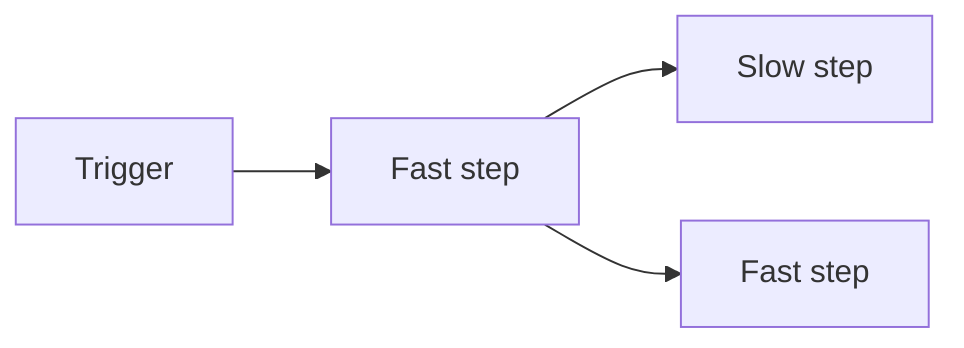

import { ReaderState } from "/snippets/reader-state.jsx";

<ReaderState
  learn="Yukta's honest promises about delivery and ordering, and how a slow step affects the rest of the chart"
  time="8 minutes"
  need="you have read How Yukta works"
  end="a design habit: make side effects safe to repeat, and know what a slow step does to its neighbours"
/>

Every system promises something about delivery. Most promise more than they can keep. This page says exactly what Yukta guarantees and where each promise stops, because those limits shape how you should design workflows.

## The headline: at-least-once

A step may run more than once for a message; it never silently runs zero times once started. After a retry, a restart or a resume, a node can see the same message again.

Exactly-once is not on offer, and that is honest rather than lazy. Between a plugin acting on the outside world (sending an email, writing a row) and Yukta recording that the node finished, there is a gap. If the server stops inside it, nothing can know whether the effect happened. Claiming exactly-once across the side effects of arbitrary plugins would mean pretending that gap does not exist.

So the responsibility is shared. Yukta guarantees it will not lose work. You make repeating work harmless, which is called being **idempotent**: running it again for the same message has the same effect as running it once. Use the message id (and the attempt label) as the de-duplication key when a node writes to an external system. Prefer "set to this value" over "add one", and check for an existing result before creating one.

## What else is promised

| Topic | Promise | What it means for you |
|---|---|---|
| Command order | Commands for one run are applied one at a time, in order, acknowledged and audited | Commands for different runs are independent |
| Status order | Node and run status only move forward | A late event cannot reopen a finished node |
| Output atomicity | With retries or error routing, a message yields all of its output or none | That output is buffered until the attempt ends |
| Start | One run id per granted slot | A repeated idempotency key returns the first run, within a finite window |
| Resume | At most once per run, only if the definition is unchanged | Needs durable checkpoints |
| Failure isolation | A slow or failing supervisor never blocks a run | Its events are dropped, not queued |

## Back-pressure: a slow step slows its feeders

Each arrow is a stream, and streams push back. When a step is slow, the steps feeding it wait instead of piling messages up, so memory per edge stays bounded and no queue grows without limit between nodes.

A trigger feeds a fast step. The fast step feeds a slow step and another fast step. The slow step sets the pace for the fast step and the trigger.

*Figure 1: The slowest child sets the pace. Notice that the other fast step is held back too, because both receive every message.*

Two consequences are worth internalising.

- **A fan-out moves at the speed of its slowest child.** One slow branch slows its siblings, because each message goes to all of them. It is not a bug; it is how bounded memory is paid for.
- **No early message is lost.** Every consumer subscribes before its source starts.

### Choosing to lose messages

By default delivery is lossless, which is usually what you want. If you would rather drop messages than slow the producers, for example for a noisy monitoring feed, you can put a bounded buffer in front of a node that drops the oldest or newest messages when full. Drops are counted. That is a deliberate trade of completeness for speed, and a decision to make on purpose.

## Large payloads

Every node a payload passes through holds it in memory, and there is no reference-passing for very large data. Keep payloads small and pass references (file paths, object keys) in messages instead. Treat a multi-megabyte payload moving through many steps as a smell.

## Related

- [Failure model](/concepts/failure-model) and [Durability and high availability](/concepts/durability-and-high-availability).
- [Handle failures](/guides/build/handle-failures): set retries and buffers.
- [Messages reference](/reference/messages): message fields, identity and limits.
