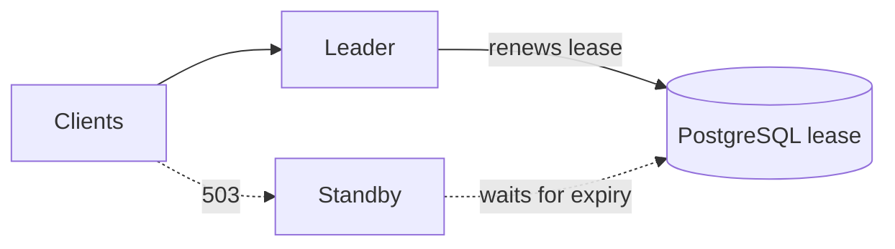

import { ReaderState } from "/snippets/reader-state.jsx";

<ReaderState
  learn="what Yukta keeps and loses when the server stops, how checkpoints make resuming possible, and what high availability does and does not give you"
  time="12 minutes"
  need="you know what a run and a node are"
  end="a clear view of which durability setup your use needs, and what it will not protect"
/>

Every workflow tool has to answer one question honestly: **what happens when the server dies in the middle of a run?** Yukta's answer depends on how you run it, and it is a deployment choice rather than a different product. This page explains the choices and the reasoning.

## The default forgets, on purpose

Out of the box, Yukta keeps everything in memory: sessions, workflow definitions and versions, run history, node outputs. A restart gives a clean server. That is the right default for trying things out and for stateless automation whose definitions live in git. It is the wrong default for anything you cannot afford to lose, and Yukta says so in its start-up log.

You then move each kind of state to durable storage, one kind at a time.

| State | Why you would keep it |
|---|---|
| Sessions and workflows, with versions | So your definitions survive a restart |
| Run history and audit | So you can see what happened, and so interrupted runs are recognised |
| Checkpoints (node outputs) | So a run can resume and a node can be retried without redoing earlier work |
| Chat memory and key-value state | So AI conversations and counters persist |
| Input requests | So a question waiting for a person survives a restart |
| The leader lease | So several servers can share one database safely |

Files suit a single server. PostgreSQL suits a shared database and high availability. Both are part of the Plus edition; the Community edition has only memory. A middle path that works in every edition is to keep definitions in files and have the server apply a folder of them at start-up, so memory is rebuilt from git.

## Checkpoints: what makes resuming possible

A **checkpoint** is the recorded output of one node in one run. Every message a node emits is recorded as it leaves, and when the node finishes normally a small durable **end marker** is written before downstream nodes see the completion. A node counts as finished only if its marker exists.

A resume trusts only that marker, not the execution log. The log record of a node's end could still have been waiting to be written when the server stopped; the marker is forced to disk first. If a checkpoint cannot be saved, the run carries on and the node is left unmarked, so a resume runs it again rather than trusting partial output. The design prefers redoing work to believing something that might be false.

This gives you three related abilities, all of which start a *new* run:

- **Restart** the whole workflow.
- **Restart from a node**, or retry a node that failed, replaying the recorded output of what came before.
- **Resume** a run a restart aborted: finished nodes replay, unfinished ones run.

What you can restart depends on what is checkpointed, and where. In memory, checkpoints are capped per node and are lost on restart; a node that outgrows a cap is marked incomplete and a restart that needs it is refused rather than replaying part of it. In files or PostgreSQL there are no such caps. And after a restart, only resume works for the runs that were aborted.

## What a crash looks like

On the next start with a durable execution log, Yukta reads the log, marks every run that had a start and no end as `ABORTED`, restores recent runs into history and reapplies the last scheduler limits. You can then resume, one run at a time, or turn on auto-resume to do it for you.

Two honest limits:

- **Resume is at most once per run**, and only when the workflow has not changed since the run started.
- **A wait for a person is lost, then asked again.** An open request survives only with PostgreSQL; otherwise a resumed run asks again.

And because delivery is at-least-once, a resumed node may repeat a side effect that happened immediately before the crash. See [Delivery and back-pressure](/concepts/delivery-and-backpressure).

## High availability: one leader, standbys behind it

If losing the server that admits runs is unacceptable, run several against one PostgreSQL database. They elect a leader with a **lease**: a row in the database naming the current holder and when its lease expires.

Clients send requests to the leader. A standby answers with 503. The leader renews a lease row in PostgreSQL and the standby waits for it to expire.

*Figure 1: One leader renews, the standby waits. Notice that clients must find the leader: a standby refuses work rather than forwarding it.*

The scheme is deliberately conservative:

- The leader renews the lease several times per lease period. A standby may take it only once it has expired, in one atomic statement.
- A server counts itself leader only while its **own** last renewal is younger than the lease, by its own clock. A server that loses the database therefore stops admitting runs *before* anyone else can take over. This prevents two leaders, at the price of a brief gap.
- Each change of holder increases a fencing number.
- A server that stops gracefully releases the lease at once.

On takeover the new leader runs recovery once, exactly as after a restart: unfinished runs are marked `ABORTED`, history is restored, and, if enabled, interrupted runs resume from their checkpoints.

### What high availability is not

- **It is failover, not scale-out.** One server at a time admits runs, orders commands and holds run state. To spread node work across machines, use remote workers.
- **It is not seamless.** Treat a takeover like a restart: clients reconnect, check status and resume or restart aborted runs. Queued starts, execution slots, open approval waits (without PostgreSQL-backed requests) and live progress beyond the log do not carry over.
- **Yukta does not proxy to the leader.** A client that reaches a standby gets `503` and must try another address, or sit behind a load balancer whose health check selects the leader.

## Choosing

| If you need | Use |
|---|---|
| Trying it out, or definitions that live in git | Memory (default) |
| One server, definitions and history surviving restarts | Files |
| Resume after a crash, or a database you already run | PostgreSQL |
| Failover when a server dies | PostgreSQL plus high availability |
| Run state surviving for years with exact replay | A tool built for that. See [Compared with other tools](/concepts/compared-with-other-tools) |

## Related

- [Persist sessions](/guides/operate/persist-sessions) and [Run highly available](/guides/operate/run-highly-available): the how-to.
- [Configuration reference](/reference/configuration) and [Licensing](/reference/licensing): settings and editions.
- [Runs](/concepts/runs) and [Delivery and back-pressure](/concepts/delivery-and-backpressure).
