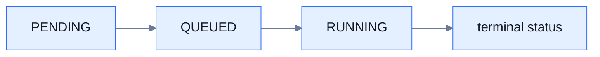

An **execution** is one live run of a workflow. Starting a workflow creates one with its own `executionId`, a status for the whole run and a status for every node.

## Starting

A start request names a session and a workflow, and may carry a payload for the trigger:

```http
POST /api/workflow/start
```

```json
{ "sessionId": "demo", "workflowId": "greet", "payload": { "name": "Ada" } }
```

The response is `202 Accepted` with `data.executionId`. The id is handed out only after the scheduler has granted a slot, so a refused start never gets one. If your client retries after a network failure, send an `Idempotency-Key` header: a repeat with the same key, session and workflow within ten minutes returns the first execution id instead of starting a second run.

Two keys in the start payload are reserved:

| Key | Effect |
|---|---|
| `yukta.version` | Run a saved version of the workflow instead of the current one |
| `yukta.priority` | Queue priority when the server is at its limit; a number, higher first, default `0` |

## Status model

Run and node status only move forward:



| Status | Meaning |
|---|---|
| `PENDING` | Created, not yet started |
| `QUEUED` | Waiting for a slot because a concurrency limit is reached |
| `RUNNING` | Active. A node becomes `RUNNING` at its first activity (its first input, or its start for a trigger), not when the graph is wired |
| `SUCCESS` | Finished normally |
| `FAILURE`, `ERROR` | Failed |
| `STOPPED`, `CANCELLED` | Ended by a stop command, or because the caller cancelled |
| `TIMED_OUT` | A time limit expired; see [Time limits](/concepts/time-limits) |
| `SKIPPED` | A processor that was skipped |
| `UPSTREAM_FAILED` | A node that never ran because an upstream node failed |
| `ABORTED` | The server stopped while the execution was running; assigned on the next boot |

A status that would step back is ignored, so a late or out-of-order event can never reopen a finished node. The full list is in [Status values](/reference/status-values).

### How a failure ends the run

- Nodes behind a failed node end as `UPSTREAM_FAILED`, so only the node that failed shows `FAILURE`.
- The first terminal that fails ends the run at once and cancels the other branches (`CANCELLED`).
- A caller that cancels ends the run `CANCELLED`. A second end of a run is ignored.

## While it runs

- **Progress**: `GET /api/executions/{executionId}` returns the run and node statuses; a live stream of changes is available as server-sent events.
- **Logs**: lines written by nodes while they run, labelled `stdout` or `stderr`, as a stream.
- **Results**: a separate channel recording what reaches every terminal node, with payloads kept whole and typed.
- **Commands**: pause, resume, step, skip, breakpoints, signals, retry, restart and stop. See [Run controls](/running/run-controls).

See [Observability](/running/observability) for how to read each of these.

## Results

Terminals publish each message they receive and an end marker for the node; the run publishes an end marker when it finishes. The live stream is complete. Only the replay buffer for a late reader is bounded (1,000 events per run by default), and end markers say `truncated` when anything was dropped. Results are kept in memory only, so they are gone after a restart.

## Restart, retry and resume

| Action | What it does |
|---|---|
| Restart | Run the workflow again from the start |
| Restart from node | Re-run one node and everything after it, replaying the recorded output of the nodes before it |
| Retry node | The same for a node that ended `FAILURE` or `TIMED_OUT` |
| Resume | Continue an execution that a server restart aborted; finished nodes replay, the rest run again |

See [Checkpoints and resume](/operations/checkpoints-and-resume).

## Limits and defaults

| Item | Default |
|---|---|
| Idempotency window | 10 minutes (`yukta.start.idempotency-ttl`) |
| Run deadline | 3600 seconds (`yukta.session.execution-timeout-seconds`) |
| Finished execution data kept in memory | 10 minutes (`yukta.tracker.cleanup-ttl`) |
| Progress snapshots kept per run | 200 |

## Related

- [Delivery and back-pressure](/concepts/delivery-and-backpressure)
- [Admission and limits](/running/admission-and-limits)
- [REST: executions](/api/executions)
