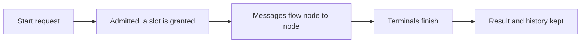

import { ReaderState } from "/snippets/reader-state.jsx";
import { Diagram } from "/snippets/diagram.jsx";

<ReaderState
  learn="the four ideas that make every Yukta workflow readable: steps, outcomes, messages and a run"
  time="10 minutes"
  need="no prior Yukta knowledge; you have drawn a flowchart before"
  end="a picture in your head that lets you predict what a workflow will do"
/>

If you have ever drawn a flowchart to explain a process, you already know how Yukta thinks. A workflow is that flowchart, written down as data, and Yukta walks it for you. Everything else on this site is a refinement of four ideas.

## A workflow is a flowchart

A **workflow** is a set of boxes joined by arrows. Each box is a **node**: one step, such as "call this API", "run the tests" or "ask a model to classify this ticket". Each arrow is an **edge**: "when this step is done, do that one."

Nodes come in three roles, and the role is visible in the shape of the chart:

- A **trigger** starts things. It has no arrows going in.
- A **processor** does the work in the middle: transforms, calls out, decides.
- A **terminal** ends a branch. It has no arrows going out.

The chart is saved as JSON, so a person, a script or an AI assistant can write it, review it in a pull request and diff it. That is a deliberate choice, and it has a cost we return to at the end: the shape is fixed, so a workflow cannot rewrite itself while it runs.

## Steps have outcomes, and outcomes choose the arrow

A real step does not only "finish". The tests passed, or they failed. The request returned 200, or 503. The ticket is a bug, or a question.

Yukta models this with **ports**: named exits on a node. An edge can say "I only follow the `success` exit". One step can therefore send different outcomes down different arrows, and that is how a workflow branches.

<Diagram name="concept-message-ports" alt="One step has three exits, success, failure and error, and each exit is followed by its own arrow: the branching lives on the arrows." caption="One node, three exits. The branching lives on the arrows, not inside a separate if-step: the node reports what happened and the chart decides what follows." />

Three details make ports pleasant in practice:

- An arrow with no port name follows every normal exit. A named arrow follows only that exit.
- Which ports a node offers depends on its plugin. A process node routes by exit code, an HTTP node can route by status, a branch node has one port per case.
- `error` is built in and separate. A message that fails all its retries can leave through `error`, so failures go to a dead-letter step instead of leaking into the normal path.

A message sent out of a port that no arrow follows is dropped. That is the sharp edge of the model: Yukta validates that ports exist, but not that you have drawn an arrow for every outcome you care about.

## Messages carry the data

What travels along the arrows is a **message**: the data (the **payload**) plus a few labels, such as where it came from and an id you can trace through the whole run. A trigger can emit one message or thousands. A step can turn one into several, or several into one.

Two properties explain most of the behaviour you will see:

- **Messages are never edited in place.** A step builds a new message from the one it received. Two branches that get the same message cannot disturb each other. The copy is shallow, so treat a received payload as read-only.
- **A message keeps its identity as it moves.** Transforming a payload keeps the message id and trace id. That is what lets you follow one input from trigger to terminal, and lets a step recognise a message it has seen before.

Because each step replaces the payload with its own result, a value you need later has to travel with the message, in its labels (the metadata), or be read from the start payload. This surprises people once; after that it is a useful discipline, because the data flow is always visible on the arrows.

When a node has several parents, a **join rule** says what a failed parent means. By default one failed parent fails the node. You can let it carry on with the parents that worked. The rule belongs to the node, not to an arrow.

## A run is one pass through the chart

Saving a workflow does nothing. Starting it creates a **run**: one live pass, with its own id and a status for the whole run and for every node. The same workflow can have many runs, and each remembers which version of the chart it used. (The API calls a run an `execution`.)

Picture a token walking the chart. The trigger emits a message; each node receives it, does its work and emits on a port; the next node receives it, and so on until a terminal ends the branch. Nodes work in a stream, so a second message can be in step 3 while the first is in step 5.

A start request is admitted when a slot is granted, messages flow from node to node, terminals finish, and the result and history are kept.

*Figure 1: The life of a run. Notice that admission comes first: a run gets its id only once the server has a slot for it, so a refused start never leaves a half-created run behind.*

Statuses only move forward. A finished node cannot reopen because a late event arrived. If something fails, only the node that failed shows a failure; the nodes behind it show that they never ran because of it. [Runs](/concepts/runs) covers the statuses in detail.

## What Yukta does around your steps

You describe the steps. Yukta wraps every one of them in the same machinery, so a plugin only has to do its own job:

- **Back-pressure.** A slow step makes the steps feeding it wait, so memory stays bounded. See [Delivery and back-pressure](/concepts/delivery-and-backpressure).
- **Retries and error routing**, per step. See [The failure model](/concepts/failure-model).
- **Time limits** on the run and on each step. See [Time limits](/concepts/time-limits).
- **Pause, step, skip and breakpoints** for any step of a live run.

Behind the chart sit two jobs that Yukta keeps apart. The data side moves messages through the graph. The control side admits, steers and records runs. Anyone who steers a run (a person, a REST call, an assistant or a [supervisor](/concepts/supervisors)) goes through the same ordered, audited path, so steering never tangles with the work itself.

*Figure 2: Clients reach the stream engine through admission. Notice that commands to a running workflow come in through one separate, ordered path.*

## Trade-offs you accept

Every model buys something by giving something up. Be clear-eyed about these:

- **No cycles.** A workflow is a directed acyclic graph, checked before anything runs. You cannot draw an arrow back to an earlier step. Repetition is expressed differently: a step that loops over one call, a fixed number of unrolled rounds, or a [sub-workflow](/concepts/sub-workflows) run again. You get a hard upper bound and a chart that can always be read left to right. You lose open-ended "keep going until done" in the graph.
- **Data, not code.** A chart is simple to review and generate but is not a programming language. Complex logic goes into a step (an expression, a script, a program) rather than into the graph.
- **At-least-once delivery.** After a crash or a retry, a step may see the same message again. Make side effects safe to repeat.
- **One server.** A run's state lives in one server at a time. See [Durability and high availability](/concepts/durability-and-high-availability).

If your problem is a long-lived business process that must survive years of crashes, or a Python data pipeline with backfills, see [Compared with other tools](/concepts/compared-with-other-tools) before you commit.

## Related

- [Your first workflow](/learn/your-first-workflow): see the model run, in about ten minutes.
- [Workflow playground](/learn/playground): connect nodes in the browser and watch a simulated run.
- [AI and deterministic work](/concepts/ai-and-deterministic-work): what happens when some boxes are AI steps.
- [Define a workflow](/guides/build/define-a-workflow) and [Route and branch](/guides/build/route-and-branch): do it yourself.
- [Workflow JSON reference](/reference/workflow-json) and [Messages reference](/reference/messages): every field.
