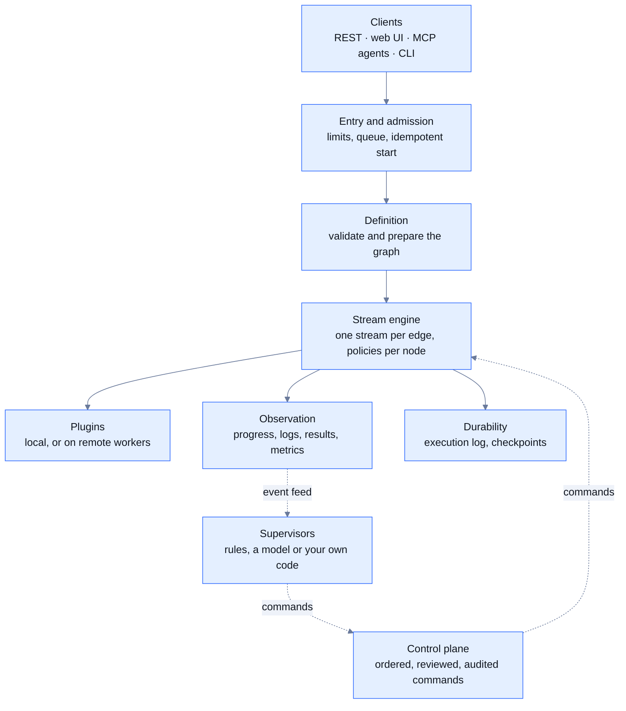

Yukta splits cleanly into a **data plane** that moves messages through a workflow graph and a **control plane** that admits, steers and records executions. Everything else, such as storage, remote workers and high availability, plugs in behind that split.

## The model in one paragraph

A **session** groups workflows. A **workflow** is a directed acyclic graph of **nodes** joined by **edges**. Each node is an instance of a **plugin** with its own configuration. Starting a workflow creates an **execution**: a live run with its own id and a status for the run and for every node. Triggers put **messages** into the graph, messages stream along edges from node to node, and terminals consume them.

## The life of an execution

<Steps>
  <Step title="Start">
    A start request arrives over REST, MCP or the CLI. If it carries an `Idempotency-Key` that was already used, the first execution id is returned instead of starting a second run.
  </Step>
  <Step title="Prepare">
    The workflow is loaded, validated and compiled into a runnable graph. Concurrent starts of the same definition share one preparation.
  </Step>
  <Step title="Admit">
    The scheduler grants a slot, queues the start, or refuses it with `429`. Only then is the execution id handed out, so two requests racing for the last slot can never both succeed.
  </Step>
  <Step title="Wire">
    Every node is wrapped in the same pipeline, and every consumer subscribes before the triggers start, so no early message is lost.
  </Step>
  <Step title="Flow">
    Messages stream through the graph. Retries, time limits, pause, skip and breakpoints apply to every node in the same way.
  </Step>
  <Step title="Observe and record">
    Ordered events feed progress, logs, results and metrics. Node outputs are checkpointed and the execution log is appended.
  </Step>
  <Step title="Finish">
    Terminals complete, the final status is set, the slot is released and the execution is archived so it can be restarted.
  </Step>
</Steps>

## What every node gets

Whatever a node does, it is assembled into the same pipeline, in this order:

| Stage | What it does |
|---|---|
| Merge parents | A join rule decides what a failed parent means when a node has several parents |
| Edge buffer | Optional bounded buffer that drops messages instead of slowing the parents |
| Valve | Implements pause, step, skip and breakpoints |
| Plugin call | Runs the plugin with an attempt timeout, retries and error routing |
| Clocks and status | Idle and deadline clocks; forward-only status |
| Broadcast | Sends the output to every child; the slowest child sets the pace |

Plugins hold only business logic. Back-pressure, retries, timeouts, pause and failure routing live in the engine once, around every node.

## Design principles

- **One path to change a run.** People, supervisors, REST and MCP all send the same commands through one ordered, reviewable, audited pipeline.
- **Safe defaults, explicit opt-in.** Process execution is off, environment access is allow-listed and the server listens on loopback only.
- **Storage is a deployment choice.** Memory, files and PostgreSQL implement the same stores, so durability is a setting, not a different product.
- **Honest guarantees.** Delivery is at-least-once, status only moves forward and commands are applied in order per execution. See [Delivery and back-pressure](/concepts/delivery-and-backpressure).

## Related

- [Sessions and workflows](/concepts/sessions-and-workflows)
- [Nodes, edges and ports](/concepts/nodes-edges-ports)
- [Executions](/concepts/executions)
- [Run controls](/running/run-controls)
