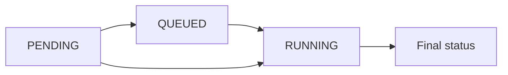

import { ReaderState } from "/snippets/reader-state.jsx";

<ReaderState
  learn="how a run starts, how its statuses move, why one failure ends in several statuses, and the difference between restart, retry and resume"
  time="10 minutes"
  need="you have read How Yukta works"
  end="the ability to read a run's statuses and predict what restart, retry or resume will do"
/>

A **run** is one live pass through a workflow. (The API and logs call it an `execution`.) Starting a workflow creates a run with its own id, a status for the whole run and a status for each node. The same workflow can have many runs at once, and each is independent.

## A run exists only once it is admitted

Starting a workflow is a request, not yet a run. The server prepares the definition, then asks the scheduler for a slot. It may grant one, queue the request when a concurrency limit is reached, or refuse it. Only after a slot is granted is the run's id handed out.

The order is deliberate. If ids were handed out first, two requests racing for the last slot could both believe they had started. Because the id follows the slot, a refused start never leaves a ghost. Retries from a flaky client are safe too: a start can carry an idempotency key, and a repeat with the same key within the window returns the first run instead of starting a second.

## Statuses only move forward

A run and each of its nodes move through states in one direction: created, queued if it had to wait, running, then a final state. The final states are `SUCCESS`, `FAILURE` or `ERROR`, `STOPPED` or `CANCELLED`, and `TIMED_OUT`. There are also two that describe a node that never ran: `SKIPPED` (nothing reached it) and `UPSTREAM_FAILED` (it sat behind a failure). `ABORTED` is assigned on the next boot to a run the server was running when it stopped.

A run is pending, may be queued, then running, then reaches a final status. Pending can also go straight to running.

*Figure 1: One direction only. Notice there is no arrow back: a finished node cannot reopen.*

"Only forward" is a promise with a reason. Events arrive concurrently and sometimes late. If a stale event could move a node backwards, a finished run could look alive again. Instead, a status that would step back is ignored. Some late information is dropped, but its labels still merge. The full list of statuses is in [Status values](/reference/status-values).

## One failure, several statuses

When a node fails, the run does not show a wall of red. Only the node that failed shows `FAILURE`. Nodes behind it end as `UPSTREAM_FAILED`, which means "I never ran, because of that failure". A node on a healthy branch that had not started yet ends the same way, which can surprise you: the status says what happened to the node, not whether its branch was healthy.

Two rules explain the rest:

- **The first failing terminal ends the run at once** and cancels the other branches.
- **A join rule can contain a failure.** A node set to carry on when some parents fail lets the run end `SUCCESS` even though a branch failed. So a successful run does not by itself mean every branch delivered; check the node statuses.

[The failure model](/concepts/failure-model) explains how to decide what a failure should mean.

## What you can watch

While a run is going you can read its progress, its logs (lines written by nodes, labelled by stream), and its results, which are a separate channel recording what reaches every terminal. The live stream is complete; only the replay buffer for a late reader is bounded, and end markers say when something was dropped. All of it is held in memory, so after a restart it is gone unless you keep history durably.

You can also steer: pause, resume, step, skip, set breakpoints, stop. Every command goes through one ordered path and is audited. When a supervisor owns the part you are steering, it decides who may. See [Supervisors](/concepts/supervisors).

## Restart, retry, resume

Three words that sound alike and do different things.

| Action | What it means |
|---|---|
| **Restart** | Run the workflow again from the start, as a new run. |
| **Restart from a node / retry a node** | Re-run one node and everything after it, replaying the recorded output of the nodes before it. Retry is the same, for a node that failed or timed out. |
| **Resume** | Continue a run that a server restart aborted, as a new run. Finished nodes replay; the rest run again. |

All three rely on **checkpoints**: the recorded output of each node. What is recorded, and for how long, depends on how you store state, so what you can restart depends on it too. See [Durability and high availability](/concepts/durability-and-high-availability).

Because a replayed or retried node may run again, side effects must be safe to repeat. See [Delivery and back-pressure](/concepts/delivery-and-backpressure).

## Related

- [Control a run](/guides/build/control-a-run): pause, step, restart and the rest, as steps.
- [Time limits](/concepts/time-limits): how a run is stopped from hanging.
- [Status values](/reference/status-values) and the [API: executions](/api/executions).
