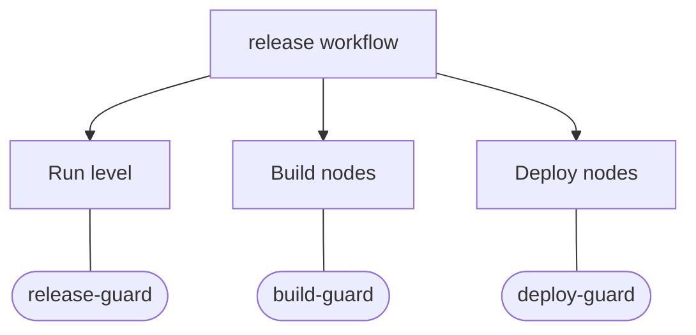

import { ReaderState } from "/snippets/reader-state.jsx";
import { Diagram } from "/snippets/diagram.jsx";

<ReaderState
  learn="what a supervisor owns, why the part that decides is kept apart from the part that is enforced, and how that answers 'who may steer this run?'"
  time="15 minutes"
  need="you know what a run and a node are (How Yukta works)"
  end="a clear picture of ownership, operator access and hierarchy, and a feel for whether you need a supervisor at all"
/>

A running workflow can be steered: paused, resumed, skipped past a node, stopped, restarted, asked a question. As soon as more than one party can do that (you, a colleague, a script, an AI assistant), a question appears: **who is in charge of this run?**

A **supervisor** is Yukta's answer. It is the owner of a unit of work. It watches what happens there, steps in when something looks wrong, and decides whether people may steer that unit directly. It is optional. With no supervisor, people control everything, exactly as before.

## Two layers: a shell Yukta enforces, an engine that decides

The idea that makes the rest of this page readable: a supervisor is two things glued together, and only one of them is yours to change.

| | Shell | Engine |
|---|---|---|
| Who owns it | Yukta | A plugin you choose |
| What it holds | What the supervisor owns, who it reports to, which commands it may send, whether people may steer through it | Nothing but the logic of "given this signal, do this" |
| Decides | Whether a directive is **allowed** | What to **do** |
| Can be bypassed by the engine | No | Not applicable |

The engine reads signals (events from the runs it owns) and returns directives ("pause that node", "approve this request"). The shell then checks every directive: is the target owned by this supervisor, is the command on its allow-list, is there a reason, is it within the rate limit. Only then does anything happen. The engine has no handle to the stores or to the dispatcher; it can only propose.

<Diagram name="concept-supervisor-shell" alt="A supervisor's engine only proposes a directive; Yukta's shell checks it, and only an allowed one becomes an audited command while a refused one is recorded." caption="The engine proposes, the shell disposes. No path leads from the engine straight to a command." />

Why split it? Because the interesting part, the judgement, varies enormously. Sometimes it is a dozen lines of rules, sometimes an AI agent, sometimes a script you already have. The safety part should not vary. By keeping the safety in one place, Yukta can let you plug in an untrusted or imperfect decision-maker, including a language model, without trusting it. A confused engine can be wrong; it cannot step outside the shell.

### The engines

An engine is chosen per supervisor, and a supervisor has exactly one. To combine decision makers, use hierarchy (below), not several engines.

| Engine | Decides with | Reach for it when |
|---|---|---|
| `rules` | A JSON rules file, or a ready-made preset | You can state the situations and responses exactly |
| `http` | An outside system or AI agent, over an HTTP agent API | The logic lives in another service, or needs open-ended judgement |
| `workflow` | A Yukta workflow in an internal session | You want the decision itself to be a chart you can see and edit |
| `process` | A program on the server | A script or binary already makes the call |

The rule of thumb: start with `rules`. It is the cheapest to understand and test, and it never surprises you. Move to `http` when judgement matters, to `workflow` when you want to read the decision as a graph, and to `process` when something already exists.

The model-driven and rules-first control planes of earlier versions are retired. A stored supervisor of those types stays stored, does not start, and is named in a warning at start-up. Use an `http` supervisor that calls your model instead.

## Ownership: one owner per unit

A supervisor owns **units**. The units are a node, the run level of a workflow (start, pause, stop, restart, priority), and the server (scheduler limits, drain). A supervisor is attached to units through **assignments**, which can name a whole session, a whole workflow, only its run level, or selected nodes by id, prefix or group.

The rule that holds everything together: **a unit has at most one owner.**

Why so strict? Because the alternative is a negotiation. If two supervisors can both own a node, you need a way to decide who wins when one wants to pause it and the other wants to resume it. Earlier designs had an arbiter for this. Giving each unit exactly one owner removes the question: there is nothing to arbitrate. The price is that nothing is inherited and nothing is overridden. To hand one node to a specialist, the main supervisor's assignment has to stop covering it first. Yukta refuses a save that would give a unit to two owners (`409 OWNERSHIP_CONFLICT`, naming the other supervisor and the units), and refuses a workflow definition that would do it by accident.

A release workflow has three units: its run level, its build nodes and its deploy nodes. Each is owned by exactly one supervisor: release-guard, build-guard and deploy-guard.

*Figure 1: One workflow, three owners, no overlaps. Notice that each unit connects to exactly one supervisor.*

A supervisor can also be named in the workflow definition itself, so ownership travels with imports, templates and every saved version.

Units that nobody owns are carried by the **default supervisor**. It is a fallback that lets people act as they always did, through REST, MCP, the CLI and the UI, and it never applies where a real owner exists. You can switch it off; then an unowned unit cannot be controlled by anyone, and every workflow must name its supervisor. (The contract describes its engine as an operator gateway. The code does not have an engine by that name: it is the absence of an owner, handled in one place.)

## Who may steer: operator access

Ownership answers "who is responsible". **Operator access** answers "may a person still reach in?"

When a person sends a command, it goes to the owner of the target unit. The owner's `operatorAccess` is a list of command names, and **the default is none**. A command not on the list is refused with `409 CONTROLLED_BY_SUPERVISOR`, which names the supervisor. A command that is on the list is not automatically allowed: it reaches the owner's engine as a review, and the verdict applies. Reading is never restricted.

The default is deliberate. If a supervisor owns a build stage, the reason is usually that you do not want any passing operator, or any key that leaked, pausing the middle of a release. You open exactly the doors you mean to, by name. And a person can always stop a run: a stop sent by a person is never held, it runs with a warning if the review does not decide in time.

Three more settings shape what the shell lets a supervisor do. `allowedCommands` is the list of command names it may send, and a supervisor sends nothing until it names some. `initiative` lists the commands it may send with no triggering event (a timer, its own idea); the default is none, and each use needs a reason and stays under a per-minute cap. `canAnswer` and `maxRisk` decide whether it may answer input requests, and up to which risk; see [Who decides](/concepts/who-decides).

## Hierarchy: reporting upward

A supervisor can list **parents**, with no cycles and at most four levels. When a supervisor's own command needs approval, the parents are asked first, in a mode you choose: in order (the first answer decides), all must allow, or any (the first answer decides). A refusal from any parent asked is final. When nobody decides, a person does. A parent needs no assignment of its own.

This is how you combine decision makers without giving one supervisor several engines. A cheap rules supervisor handles the clear cases and reports to an AI supervisor for the unclear ones, which in turn reports to a person. A supervisor may approve another's parked command only from above it in the hierarchy, and never a high-risk one.

## Why this is safe to hand to an AI

The shell exists so you can answer "what is the worst a confused engine can do?" with a bounded answer:

- It can only touch what it owns.
- It can only send commands on its allow-list, with a reason for anything it starts itself, under a rate limit.
- It never sees the outcome of its own commands, and a guard stops it flapping back and forth on one target.
- It cannot answer a high-risk question, whatever its settings.
- Everything it does goes through the same ordered, audited path as a person's command, and a dry-run mode records without applying.
- A slow or failing supervisor never holds up a run. Its events are dropped, not queued, and it is told that it missed some.

Events are delivered on a best-effort basis, so an engine that must never miss a case should treat the missed-events notice as a reason to check the log or fail safe.

## When not to use a supervisor

- **Your runs are steered by one person, or by a team that trusts itself.** The default supervisor already does that. Do not add structure you do not need.
- **The constraint belongs inside the workflow.** If "never deploy without a passing test" is part of the process, draw it as a gate in the graph. A supervisor watches from outside; a gate is part of the chart and cannot be skipped. See [AI and deterministic work](/concepts/ai-and-deterministic-work).
- **You want the decision to be a step.** Use a decision node or an input request. A supervisor is for ownership and oversight over time, not for one-off branching.
- **You expect it to be a security boundary on its own.** It is a control on who steers runs. It does not replace API-key roles. See [Security model](/concepts/security-model).

## Related

- [Add a supervisor](/learn/add-a-supervisor): the tutorial.
- [Assign a supervisor](/guides/supervise/assign-a-supervisor), [Write a rules supervisor](/guides/supervise/write-a-rules-supervisor), [Write an agent supervisor](/guides/supervise/write-an-agent-supervisor), [Write a workflow supervisor](/guides/supervise/write-a-workflow-supervisor) and [Build a hierarchy](/guides/supervise/build-a-hierarchy).
- [Shell reference](/reference/supervisors/shell), [Engines reference](/reference/supervisors/engines), [Contract](/reference/supervisors/contract) and [Rule files](/reference/supervisors/rule-files).
