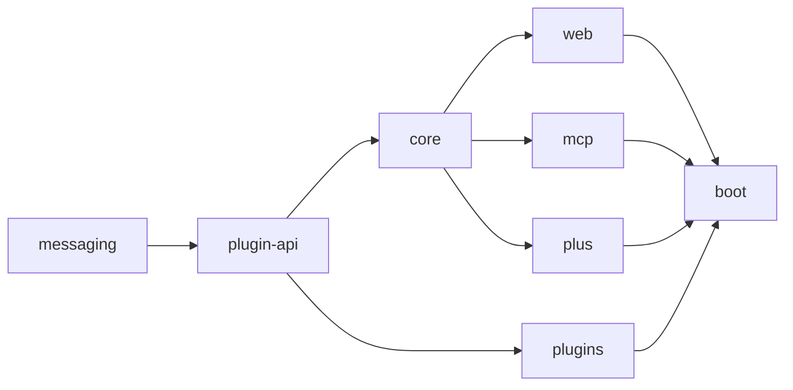

<Info>
  **In plain terms:** a set of tests fails the build when someone adds a dependency or writes code that breaks the intended structure of the project. Nothing is frozen or ignored: a violation is fixed.
</Info>

## The intended structure

An arrow means "may be used by". Rules of thumb:

- `core` is the base. `web`, `mcp` and the Plus modules use it; `cli` and `ui` talk to the server over REST (not Java, so not checked here).
- `messaging` and `plugin-api` define the interfaces. They stay free of the web, data and security stacks.
- Plugins implement `plugin-api` and know nothing of `core`, `web` or `mcp`. A plugin may use another plugin only through the edges listed in `ModuleRules` (today nine).
- Only `boot` wires everything together, and only `boot` and `plus/**` may depend on `:plus`.

## Where the rules live

| Module | Runs over | License |
|---|---|---|
| `architecture` | every Apache module | Apache-2.0 |
| `plus/plus-architecture` | the Plus modules, and the border between Plus and the rest | AGPL-3.0-only |

Run them with `yk gradle :architecture:test :plus:plus-architecture:test`. CI runs `:architecture:build` whenever any Java module changes, because the module depends on all of them.

## Rule catalogue

| Rule (holder class) | What it enforces | Why |
|---|---|---|
| `ModuleRules.MODULES_FOLLOW_THE_LAYERING` | Layers by Gradle module: nobody uses plugins, web or mcp; only web and mcp use core | One-way dependencies |
| `ModuleRules.PLUGIN_DEPENDENCIES_AS_LISTED` | Plugin-to-plugin dependencies only as listed | Plugins stay swappable |
| `ModuleRules.PLUGINS_IMPLEMENT_PLUGIN`, `PLUGINS_AVOID_WEB_LAYER` | `*Plugin` classes implement `Plugin`; plugins never touch controllers or DTOs | The engine finds plugins by interface |
| `ModuleRules.PLUGIN_API_IS_PURE`, `MESSAGING_IS_PURE` | No Spring web, http, jdbc, r2dbc, data, security or servlet API | They are contracts others compile against |
| `ModuleRules.REST_ONLY_IN_WEB_AND_MCP` | `@RestController` only in web and mcp | HTTP is the REST layer's job |
| `ModuleRules.NO_BLOCKING_CALLS`, `noDeprecatedApi` | No `Mono/Flux.block*`, `toIterable`, `toStream`, `Thread.sleep`; no deprecated API (a short exemption list with reasons) | A parked event-loop thread stalls every run |
| `CoreRules.PACKAGES_FOLLOW_THE_DIAGRAM` | Core's top-level packages follow `architecture/src/test/resources/core-packages.puml` | The diagram is the documented target |
| `StructureRules.NO_PACKAGE_CYCLES` | No cycles between top-level packages of core, web, mcp, plugin-api, plus | Cycles cannot be tested or moved apart |
| `WebRules` | DTOs do not use controllers; `*Controller` is a `@RestController` | Plain data, routed controllers |
| `HygieneRules` | No generic exceptions, Jackson 2, `java.util.logging`, standard streams, field injection or hand-written loggers; utility classes cannot be instantiated | Conventions from `coding-standards.md` |
| `PlusRules` | Plus does not use web or mcp; no Apache module uses Plus | `LICENSING.md` |

The rules are checked by tests of their own: `RuleSelfTest` runs each coding rule against a small class that breaks it and one that does not, and `ModuleLocationTest` checks that a class from each module resolves to the right layer, so a change of build layout cannot silently empty a layer.

## A rule failed: what now?

1. Read the first line: it names the rule and the reason (`because ...`). The lines below it name every violating class and line.
2. **Fix the code.** Do not freeze the violation, add `@ArchIgnore` or loosen the rule: `NoEscapeHatchesTest` fails on `FreezingArchRule`, `@ArchIgnore`, ArchUnit store settings and empty reasons.
3. If the dependency is truly intended, change the structure on purpose: edit `core-packages.puml`, the plugin edge list or the layering in the same PR and say why in the description. Both files are owned by the maintainers (`CODEOWNERS`).
4. If code genuinely has to block a thread or use a deprecated API, add the class to the exemption map next to the rule with a one-line reason. Keep these lists short: every entry is a debt.

## Adding a rule

1. Put it in a holder class (`public final class …Rules`) as `@ArchTest public static final ArchRule` with `.because("…")`. Shared rules go to `architecture/src/testFixtures`, so `plus-architecture` can reuse them.
2. Make sure a runner covers it: `ModuleArchitectureTest` (all modules), `CoreArchitectureTest`, `WebArchitectureTest`, `McpArchitectureTest`, `PluginApiArchitectureTest` or the Plus runners. A runner scopes the import with `Scopes`.
3. Add a fixture class that breaks it to `RuleSelfTest`. A rule that matches nothing fails by default (`archRule.failOnEmptyShould`); use `allowEmptyShould(true)` only when "no match" is a normal state, and prove the rule with the self-test.
4. Run it on the whole code base. Fix what it finds; if it finds hundreds, the rule is not ready: list it under "not enforced yet" below.

## Not enforced yet

- **Cycles between the sub-packages of core's `service`** (`control`, `input`, `leader`, `log`, `orchestrator`, `session`, `supervisor`, `workflow` form one tangle). Untangling it is a design change of its own.
- **The plugin modules against Plus**: checked by the license-compliance CI job (`only boot depends on :plus`), not by ArchUnit.
- **`boot`**: nothing may depend on it, which Gradle already guarantees; its console prints on purpose.
- **Test code**: the rules look at production classes only.
