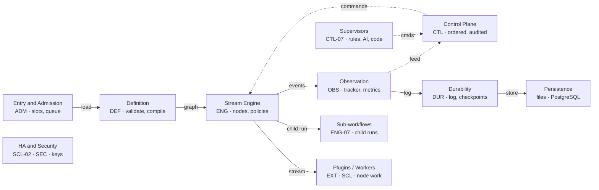

The `core` module is the engine and control plane of Yukta. It takes a workflow definition (a DAG of trigger, processor and terminal nodes), runs it as a live stream of messages, lets people and programs steer it while it runs, and records enough to explain or resume it afterwards.

Last verified against commit `d2424ed` on 2026-10-15.

<CardGroup cols={2}>
  <Card title="Reactive">
    Project Reactor (`Mono`/`Flux`) everywhere; no blocking on the event loop.
  </Card>
  <Card title="Streaming DAG">
    One stream per edge, with back-pressure from consumer to producer.
  </Card>
  <Card title="At-least-once">
    Retries and resumes may repeat a step; plugins de-duplicate on the message id.
  </Card>
  <Card title="Single JVM">
    Run state lives in one process; active/standby HA is optional.
  </Card>
</CardGroup>

## Overview

### Who this is for and how to read it

| You are | Start with | Then |
|---|---|---|
| New to the module | [Core concepts](#core-concepts) | [Architecture](#architecture), then [Run lifecycle](#run-lifecycle) |
| Building a workflow | [Failure policy](#eng-04-failure-policy-engine-config), [Clocks](#eng-05-clocks-and-timeouts) | [Configuration reference](#configuration-properties) |
| Operating a server | [Scheduler and limits](#adm-01-scheduler-limits-and-queue), [Command pipeline](#ctl-01-command-pipeline) | [Metrics](#metrics), [Durability matrix](#durability-matrix) |
| Writing a plugin | [Plugin contract](#ext-01-plugin-contract-and-registry) | [Clocks](#eng-05-clocks-and-timeouts) (heartbeat), [Guarantees](#guarantees-and-limits) (idempotency) |
| Changing core | [Package map](#package-map) | [Maintaining this document](#maintaining-this-document) |

### Scope: what is and is not in core

**In core**

- Workflow definitions, versions, validation and compilation
- The stream engine and per-node failure and time policy
- Admission control, idempotent starts, the command pipeline
- Tracker, progress, results, metrics and tracing
- Execution log, checkpoints, recovery and resume
- Supervisor and reviewer hosts, worker registry, leader election
- API key and role model, variable allow-list

**Elsewhere (and where)**

- REST controllers, SSE endpoints, Host/Origin filter: `web`
- MCP tools: `mcp`. CLI: `cli`. UI: `ui`
- Node implementations (`LLM_CALL`, `HTTP_REQUEST`, ...): `plugins/*`; contracts: `plugin-api`
- PostgreSQL stores and Flyway migrations: `persistence-postgres`
- RSocket worker transport and agent: `workers`
- Application wiring and native image: `boot`

<Note>
  **Related documents.** The [core module guide](/contributing/modules/core) covers the design debate (scenario replays, quality lenses, risks, decisions). This page is the stable reference: use it for what exists and how to configure it. Known bugs are tracked in the [bug backlog](/internal/bugs); module build notes live in `core/CLAUDE.md`. Related public pages: [glossary](/reference/glossary), [limits and defaults](/reference/limits-and-defaults), [status values](/reference/status-values) and [configuration](/operations/configuration).
</Note>

### Status legend

Feature cards carry one of four statuses.

| Status | Meaning |
|---|---|
| `stable` | on by default or always available |
| `optional` | needs configuration, a build flag or another module |
| `partial` | works, with a documented gap |
| `planned` | designed, not built |

## Core concepts

The vocabulary used throughout. Terms appear in `code` style where they match a type, field or setting.

| Term | Meaning | Where in code |
|---|---|---|
| **Session** | A scope that groups workflows, runs and configuration. Fair queueing and per-session limits apply per session. | `SessionService`, `SessionConfig` |
| **Workflow** | A graph of nodes and edges stored once and run many times. Identified by `workflowId` within a session. | `WorkflowDefinition` |
| **Node** | One step: `nodeId`, plugin `type`, `config`. Its kind is set by the plugin category: **Trigger** starts the flow (no input), **Processor** transforms messages, **Terminal** ends a branch. | `WorkflowNode`, `NodeAssembler` |
| **Edge and port** | A one-way connection `source → target`. An optional `sourcePort` selects a named output; the only built-in port is `error`, used for dead letters. | `WorkflowEdge` |
| **Message** | The unit of data on an edge: payload, headers and a stable `id`. A trigger may emit many per run. Retries repeat the same id and add an `attempt` header. | `MessageMapper` (plugin-api) |
| **Run (execution)** | One live execution of a workflow with its own `executionId`, a status and a status per node. | `WorkflowExecution`, `WorkflowState` |
| **Plugin** | Code that gives a node its behaviour. The engine only knows the contract. | `PluginRegistry` |
| **Engine policy** | The reserved `engine` object in a node's config (retry, onError, timeouts, placement). The engine reads it; plugins never see it. | `NodePolicy` |
| **Command** | An instruction to a live run (pause, stop, skip, signal ...), applied in order and audited. | `ExecutionControlCommand` |
| **Supervisor / reviewer** | A supervisor watches the event feed and returns commands. A reviewer can veto any command before it runs. | `ExecutionSupervisor`, `ControlReviewer` |
| **Checkpoint** | A node's recorded output, kept so a restart or resume can replay it instead of recomputing. | `FileNodeCheckpointStore` |

### A workflow, concretely

The shape below is the real JSON model. The `engine` block is the failure policy described in [ENG-04](#eng-04-failure-policy-engine-config); the plugin types are examples.

```json
{
  "workflowId": "triage",
  "description": "Classify a ticket, wait for approval, update the tracker",
  "nodes": [
    { "nodeId": "ticket",   "type": "API_TRIGGER",     "config": {} },
    { "nodeId": "classify", "type": "LLM_CALL",
      "config": { "engine": {
        "retry":   { "maxAttempts": 3, "backoffMs": 200, "maxBackoffMs": 5000 },
        "onError": "ROUTE" } } },
    { "nodeId": "approve",  "type": "WAIT_FOR_SIGNAL", "config": { "signal": "approve" } },
    { "nodeId": "update",   "type": "HTTP_REQUEST",    "config": {} },
    { "nodeId": "done",     "type": "CONSOLE_TERMINAL","config": {} },
    { "nodeId": "dead",     "type": "CONSOLE_TERMINAL","config": {} }
  ],
  "edges": [
    { "source": "ticket",   "target": "classify" },
    { "source": "classify", "target": "approve" },
    { "source": "approve",  "target": "update" },
    { "source": "update",   "target": "done" },
    { "source": "classify", "target": "dead", "sourcePort": "error" }
  ]
}
```

Illustrative: node configs other than `engine` are abbreviated, and plugin option names are defined by each plugin. For complete, runnable workflows see [examples](/examples) and the [workflow guide](/building/defining-a-workflow).

## Architecture

Core splits cleanly into a **data plane** that moves messages through the graph and a **control plane** that admits, steers and records runs. Everything else (storage, workers, HA) plugs in behind interfaces.

### Position in the system

| Layer | Role |
|---|---|
| **Clients** | REST, web UI, MCP agents, CLI, external supervisors on the SSE feed |
| **web · mcp · ui · cli** | Translate requests into calls on the core gateway |
| **core** (this document) | Engine and control plane |
| **plugin-api · plugins** | The contracts, and the node types that implement them |
| **persistence-postgres · workers** | Optional backends and the remote worker transport |
| **boot** | Wires everything into one Spring Boot application |

### Component map

Solid arrows carry data. Dashed arrows carry commands (cmds) or the event feed about a run. Each box maps to a feature group in the [catalog](#feature-catalog).



### Design principles

- **Plugins hold business logic only.** Back-pressure, retries, timeouts, pause/step and failure routing live in the engine once, wrapped around every node.
- **One path to change a run.** Humans, supervisors, REST and MCP all send the same commands through the same ordered, reviewable, audited pipeline.
- **Safe defaults, explicit opt-in.** Process execution is off, environment access is allow-listed, limits are off (not unbounded by accident: documented in the [reference](#configuration-properties)).
- **Storage behind interfaces.** Memory, files and PostgreSQL implement the same stores, so durability is a deployment choice, not a code path.
- **Honest guarantees.** At-least-once, forward-only status, FIFO per run: see [Guarantees](#guarantees-and-limits).

### Run lifecycle

What happens from a start request to a finished run. Each step links to its feature.

<Steps>
  <Step title="Start">
    Gateway receives the request; an `Idempotency-Key` repeat returns the first id. [ADM-02](#adm-02-idempotent-start)
  </Step>
  <Step title="Prepare">
    Load, validate, compile; concurrent starts share one preparation. [DEF-03](#def-03-preparation-and-compile-cache)
  </Step>
  <Step title="Admit">
    Scheduler grants a slot, queues or refuses (429). Only then is the id handed out. [ADM-01](#adm-01-scheduler-limits-and-queue)
  </Step>
  <Step title="Wire">
    Each node gets its wrapper; every child subscribes before sources start. [ENG-01](#eng-01-streaming-dag-and-back-pressure)
  </Step>
  <Step title="Flow">
    Messages stream; policies, valves and clocks apply per node. [ENG-02](#eng-02-node-wrapper-pipeline)
  </Step>
  <Step title="Observe and record">
    Ordered events feed progress and metrics; outputs are checkpointed, the log is appended. [OBS-01](#obs-01-tracker-and-live-progress) [DUR-01](#dur-01-execution-log)
  </Step>
  <Step title="Finish">
    Terminals complete, status set, slot released, end logged, run archived for restart. [ENG-06](#eng-06-status-model)
  </Step>
</Steps>

### The node wrapper

Every node, whatever the plugin, is assembled into the same pipeline. Order matters: a pause happens before the plugin call, and a retry happens inside the clocks.

<Steps>
  <Step title="Merge parents">
    Join rule decides what a failed parent means. [ENG-03](#eng-03-join-rules)
  </Step>
  <Step title="Edge buffer">
    Optional bounded buffer that drops instead of pacing parents. [ENG-01](#eng-01-streaming-dag-and-back-pressure)
  </Step>
  <Step title="Valve">
    Pause, step, skip, breakpoint. [CTL-02](#ctl-02-pause-step-breakpoint-and-skip)
  </Step>
  <Step title="Plugin call">
    Attempt, element timeout, retry, onError. [ENG-04](#eng-04-failure-policy-engine-config)
  </Step>
  <Step title="Clocks and status">
    Idle and deadline clocks, forward-only status. [ENG-05](#eng-05-clocks-and-timeouts)
  </Step>
  <Step title="Broadcast">
    Output goes to every child; the slowest sets the pace. [ENG-01](#eng-01-streaming-dag-and-back-pressure)
  </Step>
</Steps>

### Package map

Base package `com.infenia.yukta` under `core/src/main/java`. Use this to find where a change belongs.

| Package | Responsibility | Key classes | Features |
|---|---|---|---|
| `service.orchestrator` | Runs a workflow end to end; restart and resume entry points | `WorkflowOrchestrator` `ExecutionResumer` `RestartPlan` `SubWorkflowRunner` | ENG, DUR-03 |
| `…orchestrator.validator` | Structural and policy validation | `WorkflowValidator` | DEF-02 |
| `…orchestrator.preparator / compiler` | Topological sort, compile, resources, run deadline | `WorkflowPreparator` `WorkflowCompiler` `TopologicalSortService` | DEF-03 |
| `…orchestrator.assembly / strategy` | One assembler per node kind; shared stream helpers | `TriggerNodeAssemblerStrategy` `ProcessorNodeAssemblerStrategy` `TerminalNodeAssemblerStrategy` | ENG-02 |
| `…orchestrator.stream` | Node runtime: policies, activity/clocks, broadcast, failure ledger | `NodePolicies` `NodeActivity` `NodeTimeouts` `NodeBroadcast` `FailureLedger` `StreamTopologyDecorator` | ENG-01…05 |
| `…orchestrator.tracker` | Event queue, per-run state, telemetry, history, streams | `DefaultTaskTrackerService` `WorkflowState` `TrackerEventApplier` `RunTelemetry` `ExecutionHistory` `ExecutionStreams` | OBS, ENG-06 |
| `service.control` | Scheduler, command sequencing, per-run control handles | `ExecutionScheduler` `CommandSequencer` `ExecutionControl` `ControlBusService` | ADM, CTL |
| `…control.gateway` | The facade REST and MCP call; split by concern | `ControlBusGateway` `DefaultControlBusGateway` `WorkflowStarter` `NodeCommands` `RestartCoordinator` `ExecutionQueries` `StartIdempotency` | ADM-02, CTL |
| `…control.processor / valve / directive / store` | One processor per command; the valve; plugin-level directives; control handle stores | `SignalNodeCommandProcessor` `ReactiveControlValve` `DirectiveDispatcher` `InMemoryExecutionControlStore` | CTL |
| `service.supervisor` | Supervisor host, reviewer hook, event feed | `SupervisorHost` `ControlReviewer` `ExecutionEventFeed` | CTL-06, CTL-07 |
| `service.log / archive / store` | Execution log, recovery, archive, node checkpoint stores | `ExecutionLogStore` `JsonlExecutionLogStore` `ExecutionRecovery` `ExecutionArchive` `FileNodeCheckpointStore` | DUR |
| `service.workflow / workflow.store` | Definitions, versions, diff, prepared-workflow cache | `WorkflowService` `WorkflowDefinitionStore` `FileWorkflowDefinitionStore` `PreparedWorkflowCache` `WorkflowDiff` | DEF-01 |
| `service.session` | Session config and its stores | `SessionService` `FileSessionConfigStore` `InMemorySessionConfigStore` | DUR-05 |
| `service.result / streaming` | Terminal results channel; progress history cache | `ExecutionResultService` `StatusHistoryCache` | OBS |
| `service.worker / leader` | Worker registry and remote node execution; leader election | `WorkerRegistry` `RemoteProcessor` `RemoteNodes` `LeaderElection` `TakeoverRecovery` | SCL |
| `service.plugin` | Plugin lookup by type | `PluginRegistry` | EXT-01 |
| `security` | API keys, roles, request path rules | `ApiKeys` `ApiRole` `RequestPaths` | SEC-01 |
| `logging.api` | Plugin logging API and log store | `PluginLogger` `PluginLoggerFactory` `PluginLogStore` | EXT-02, OBS-02 |
| `model.* · event · validation · util · config` | Records, tracker events, identifier validators, helpers, Spring config | `NodePolicy` `TaskStatus` `SinkEmit` `VariableResolver` `SessionConfigProperties` | various |

## Feature catalog

Every capability of the core module, grouped by concern. Each card states what it does, how it behaves, how to configure it, where the code lives and what its limits are. Cards are headed `GROUP-NN: name` with a `Status` line; the groups are Workflow definitions (DEF), Execution engine (ENG), Admission and governance (ADM), Control plane (CTL), Observability (OBS), Durability and persistence (DUR), Scale-out and high availability (SCL), Security (SEC) and Extensibility (EXT).

## Workflow definitions

Storing, versioning, validating and compiling a workflow before any plugin runs.

### DEF-01: Definition store and versions

**Status:** stable

Keeps each workflow definition per session together with its newest 20 versions, so edits can be diffed, annotated and rolled back, and a run can be pinned to one version.

**Behaviour**

- Saving an identical definition adds no version. Each run records a content hash of the graph it used (`definitionVersion`), carried by progress, history and the log.
- A start payload with `yukta.version` runs that saved version and bypasses the prepared-workflow cache.
- `WorkflowDiff` reports a changed description, nodes added, removed or changed, and edges added or removed. A version may carry a note.
- File layout: `<baseDir>/workflows/<session>/<workflow>/current.json` and `history/<version>.json`; ids are URL-encoded; writes are atomic and fsynced.

**Configure:** `yukta.session.store-type` = `in-memory` \| `file` \| `postgres`

**Surface:** REST `GET …/versions/diff?from=&to=` (omit `to` for current), rollback endpoint, `POST …/versions/note?version=&note=`. MCP `list_workflow_versions`, `diff_workflow_versions`, `rollback_workflow`, `note_workflow_version`. UI Versions panel.

**Source:** `WorkflowDefinitionStore` `FileWorkflowDefinitionStore` `InMemoryWorkflowDefinitionStore` `DefinitionRevision` `WorkflowDiff` `WorkflowService`

**Limits:** Newest 20 versions kept. PostgreSQL variant lives in [DUR-04](#dur-04-postgresql-stores).

### DEF-02: Validation

**Status:** stable

Refuses a broken graph before any plugin runs, with an error naming the node and the option at fault.

**Behaviour**

- Rejects cycles, duplicate node ids, duplicate edges, an edge `sourcePort` the source plugin does not declare (`error` is allowed on nodes with `onError: ROUTE`), and graphs over **500 nodes** or **2000 edges**.
- Rejects malformed [failure policies](#eng-04-failure-policy-engine-config): unknown keys, `maxBackoffMs` not below the node timeout, `retryOn` and `noRetryOn` sharing a class, `deadlineMs` not above `elementTimeoutMs`.
- Identifiers (session, workflow, node, plugin name, file path, config key) are shape-checked by Bean Validation annotations at the orchestrator boundary, e.g. no path separators in a session id.

**Source:** `WorkflowValidator` `NodePolicy` `TopologicalSortService`. Package `validation` (`SessionId`, `WorkflowId`, `NodeId`, `PluginName`)

**Limits:** Size caps are constants, not settings.

### DEF-03: Preparation and compile cache

**Status:** stable

Turns a validated graph into a runnable form, once per definition content, and shares the work between concurrent starts.

**Behaviour**

- One assembler per node kind (trigger, processor, terminal) builds each node's wrapper ([ENG-02](#eng-02-node-wrapper-pipeline)).
- Concurrent starts of a workflow that is not yet prepared share one preparation, keyed by definition content.
- A prepared workflow is cached only if the stored definition has not changed meanwhile, so an old compile never overwrites a newer edit. Applying a session configuration drops a stale cached entry.
- A processor with `engine.placement` has its plugin swapped for a `RemoteProcessor` here ([SCL-01](#scl-01-remote-workers)).

**Source:** `WorkflowPreparator` `WorkflowCompiler` `PreparedWorkflowCache` `ExecutionResources` `PreparedWorkflow`

**Limits:** Cost grows with graph size (hence the 500-node cap). The cache is in memory and simply rebuilt after a restart.

## Execution engine

Running a prepared graph as streams of messages, with failure and time policy applied uniformly to every node.

### ENG-01: Streaming DAG and back-pressure

**Status:** stable

Each edge is a Reactor stream. A slow consumer slows its producers, so memory stays bounded without queues between nodes.

**Behaviour**

- Every child subscribes before its source starts, so no early message is lost. A fan-out moves at the speed of its slowest child.
- **Opt-out per node:** `engine.edgeBuffer {size, overflow}` puts a bounded buffer in front of a node. When the node is slower than its parents it drops messages (`DROP_OLDEST` default, or `DROP_NEWEST`) instead of pacing the fan-out. Drops are counted in `yukta.edge.dropped`. The default stays lossless.
- Blocking plugins run on virtual threads so they do not hold the event loop.

**Configure:** per node: `engine.edgeBuffer`

**Source:** `StreamTopologyDecorator` `NodeStreams` `NodeBroadcast` `StreamAssemblyHelper`

**Limits:** If a terminal on one branch fails and stops reading, siblings stall until the run ends (see [ENG-06](#eng-06-status-model)). Guarded by `StreamTopologyDecoratorBackpressureTest` (20-node chain, 10k messages, bounded memory).

### ENG-02: Node wrapper pipeline

**Status:** stable

Every node, whatever its plugin, is wrapped in the same pipeline so plugin authors write only business logic.

**Behaviour**

- Order: merge parents → edge buffer → valve → plugin call (attempt, timeout, retry, onError) → clocks and status → broadcast to children. See the steps in [Architecture](#the-node-wrapper).
- The plugin gets a Reactor context holding the execution id, node id, a heartbeat `Runnable` (`WorkflowContext.HEARTBEAT_KEY`), a `PluginLogSink` and, for sub-workflows, a result collector.
- With `retry`, `onError` or `elementTimeoutMs` the plugin is called **once per message** and the message carries an `attempt` header (1, 2, ...).

**Source:** `NodePolicies` `NodeActivity` `ProcessorNodeAssemblerStrategy` `TriggerNodeAssemblerStrategy` `TerminalNodeAssemblerStrategy` `ExecutionContextBuilder`

### ENG-03: Join rules

**Status:** stable

Decides what a node with several parents does when one parent fails.

**Behaviour**

| `engine.trigger` | Effect |
|---|---|
| `ALL_SUCCESS` (default) | The node fails as soon as one parent fails. |
| `ALL_DONE` | Carry on with the parents that worked. |
| `ONE_SUCCESS` | Carry on, but fail if every parent failed. |

**Configure:** per node: `engine.trigger`

**Source:** `NodePolicy` (`JoinRule`) `ParentEdgeInfo` `UpstreamFailure`

**Limits:** The rule is per node, not per edge.

### ENG-04: Failure policy (`engine` config)

**Status:** stable

A reserved `engine` object in any node's config sets retry, error routing and time limits. Plugins never see it.

```json
"engine": {
  "retry":   { "maxAttempts": 3, "backoffMs": 200, "maxBackoffMs": 5000 },
  "onError": "ROUTE",
  "trigger": "ALL_DONE",
  "elementTimeoutMs": 20000,
  "deadlineMs": 600000,
  "failureBudget": { "maxFailures": 10, "windowMs": 60000 },
  "edgeBuffer": { "size": 100, "overflow": "DROP_OLDEST" },
  "placement": { "pool": "default" }
}
```

| Key | Applies to | Behaviour |
|---|---|---|
| `retry` | processors | Re-runs the plugin for the failing message with exponential backoff and jitter. Every attempt counts as node activity. `IllegalArgumentException` (bad input) is never retried. `retryOn` / `noRetryOn` list exception class names (simple or fully qualified; subclasses and causes match); `noRetryOn` wins. |
| `onError` | processors | `FAIL` (default) ends the node. `CONTINUE` drops the message. `ROUTE` sends it, tagged `failure.attempts`, `failure.exception`, `failure.time` (plus `origDest`, `failureReason`), to the `error` output port. Wire an edge with `sourcePort: "error"` to a dead-letter node; an edge without a port never carries dead letters. |
| `failureBudget` | needs CONTINUE or ROUTE | When more than `maxFailures` messages fail within `windowMs`, the node fails instead of dropping or routing the next one. Counted per run (`FailureLedger`), so silent data loss cannot continue unnoticed. |
| `trigger` | multi-parent nodes | Join rule: [ENG-03](#eng-03-join-rules). |
| `elementTimeoutMs`, `deadlineMs` | processors, any node | Time limits: [ENG-05](#eng-05-clocks-and-timeouts). |
| `edgeBuffer` | any node with a processor | Drop instead of pace: [ENG-01](#eng-01-streaming-dag-and-back-pressure). |
| `placement {pool}` | processors | Run on a remote worker of the pool: [SCL-01](#scl-01-remote-workers). |

**Behaviour**

- **All-or-nothing output.** With `retry` or `onError` CONTINUE/ROUTE, what an attempt emitted before it failed is held back and dropped, so a retry or dead letter never lands on top of a partial result. One message's output is therefore buffered until its attempt ends.
- Malformed policies are rejected by validation ([DEF-02](#def-02-validation)) with node id and option.

**Source:** `NodePolicy` (parsing) `NodePolicies` (behaviour) `FailureLedger`

**Limits:** Retry is per message, so use it with per-message processors. A retried plugin can see the same message twice: de-duplicate on the message `id`.

### ENG-05: Clocks and timeouts

**Status:** stable

Five independent clocks, all pause-aware, so a timeout means what you expect.

| Clock | Scope | Resets on | Ends with |
|---|---|---|---|
| **Queue wait** | a start waiting for a slot | n/a | `TIMED_OUT` after `yukta.execution.queue-timeout` (off by default) |
| **Run deadline** | whole run | never | `TIMED_OUT` via `ExecutionTimeoutException`; session setting, default 3600 s |
| **Node idle** | one node | any input, output, retry attempt or heartbeat | node `TIMED_OUT` |
| **Element timeout** | one message attempt | each attempt | attempt fails, so `retry` / `onError` apply |
| **Node deadline** | one node, from first activity | never (paused time excluded) | node `TIMED_OUT` |

**Behaviour**

- Idle timeout is the node's `timeoutSeconds`, else the plugin's `getDefaultTimeout(config)`. Built-ins: `PROCESS_EXECUTOR` its `timeout` (300 s) + 10 % (min 5 s); `LLM_CALL` every attempt plus backoff; `HTTP_REQUEST` its timeout + 5 s; others 30 s. `WAIT_FOR_SIGNAL` adds its wait + 30 s.
- A timeout given as an expression is unknown at compile time: the node starts with the default and is re-timed when its first message arrives (`NodeTimeouts`). Write numeric options as typed expressions, e.g. `${payload.secs:int}`.
- Pausing freezes all clocks. A terminal's idle timeout and `deadlineMs` also cover what it does after its last input.
- Long silent work keeps its node alive by calling the heartbeat `Runnable` found under `WorkflowContext.HEARTBEAT_KEY` in the Reactor context.

**Configure:** per node: `timeoutSeconds`, `engine.elementTimeoutMs`, `engine.deadlineMs`. Server: `yukta.execution.queue-timeout`. Per session: execution timeout.

**Source:** `NodeActivity` `NodeTimeouts` `ExecutionResources` `ExecutionTimeoutException`

**Limits:** Triggers have no input, so they keep the default idle timeout unless the plugin declares another.

### ENG-06: Status model

**Status:** stable

Run and node status only move forward, so a late or out-of-order event can never reopen a finished node.

**Behaviour**

- Order: `PENDING < QUEUED < RUNNING < any terminal status`. A status that would step back is ignored, but its metadata is still merged.
- A node becomes `RUNNING` (and gets its `startTime`) at its first activity (`NodeActivity.onFirstTouch`: first input, or subscribe for a trigger), not when the graph is wired.
- Nodes behind a failed node end `UPSTREAM_FAILED`, so only the node that failed shows `FAILURE`.
- The **first terminal that fails ends the run at once** and cancels the other branches (`CANCELLED`). A caller that cancels ends the run `CANCELLED`. A second end of a run is ignored.
- A processor skipped from the start can be unskipped later.

**Source:** `TaskStatus` `WorkflowState` `NodeActivity`. Tests: `WorkflowStateTransitionTest` (thousands of random event orders)

All statuses: see [Enumerations](#enumerations).

### ENG-07: Sub-workflows

**Status:** stable

A `SUB_WORKFLOW` node runs another stored workflow of the same session for each message, enabling composition and agent-style plans.

**Behaviour**

- The child is a normal run with its own execution id, tracked and audited like any other. Its terminal nodes feed a `ResultCollector`; the node emits `{executionId, results[]}`. A failing child fails the node, so the parent's failure policy applies.
- The child's start payload carries `yukta.depth` and `yukta.parentExecutionId`. **Nesting is limited to 5.**
- With `yukta.execution.max-concurrent` set, a child runs on the slot its parent holds (`ExecutionScheduler.borrowed()`): children are not counted in limits or the running gauge, which prevents a parent waiting on children from starving them.
- The child is subscribed inside the parent node, so cancelling the node cancels the child (`CANCELLED`).

**Source:** `SubWorkflowRunner` `SubWorkflowGateway` `ExecutionScheduler`

**Limits:** The parent-child link exists only in the child's start payload and its `RUN_STARTED` entry; run history does not show it yet.

## Admission and governance

Deciding whether, when and in what order a run may begin.

### ADM-01: Scheduler, limits and queue

**Status:** stable

Grants a slot to each run, or queues or refuses it. The caller receives an execution id only after a slot is granted, so two requests racing for the last slot can never both succeed.

**Behaviour**

- Caps: total concurrent runs, per workflow, per session. **All are off by default.** A start that does not fit waits (`QUEUED`) or is refused with HTTP 429, per `on-limit`.
- Queue order: payload key `yukta.priority` (number, higher first, default 0), then the session with the **fewest running runs** (oldest first on a tie), then arrival. One busy session cannot starve others.
- The slot is taken after preparation and before the id is handed out. Restarting a finished run, restart-from-node and resume take their slot the same way. Restarting a run that is still going keeps the old behaviour: the old run holds its slot until it ends.
- **Shutdown:** nothing new is admitted, queued starts are refused, running ones get `shutdown-timeout` to finish.
- Refusals are counted by reason in `yukta.executions.rejected{reason=shutdown|limit|queue_full|workflow_queue_full|queue_timeout|not_leader}`.

**Configure:** `yukta.execution.max-concurrent` · `…max-concurrent-per-workflow` · `…max-concurrent-per-session` · `…on-limit` (QUEUE\|REJECT) · `…queue-capacity` (100) · `…queue-capacity-per-workflow` · `…queue-timeout` · `…shutdown-timeout` (30s)

**Surface:** Status `QUEUED` in progress; gauges `yukta.executions.running` and `yukta.executions.queued`

**Source:** `ExecutionScheduler` `SchedulerMetrics` `ExecutionRejectedException` `QueueTimeoutException` `WorkflowStarter`

**Limits:** One scheduler in one JVM. Queue positions and slots are lost on a crash; the start was logged first, so the run is marked `ABORTED` on boot and can be recovered.

### ADM-02: Idempotent start

**Status:** stable

A client that retries a start after a network failure gets the first run back instead of starting a second.

**Behaviour**

- `POST /workflow/start` accepts an `Idempotency-Key` header. A repeat with the same key, session and workflow within the TTL returns the first execution id. A failed start is not remembered.
- With the file log the keys are written as `IDEMPOTENCY_KEY` entries and reloaded on startup (the window restarts at the reload).

**Configure:** `yukta.start.idempotency-ttl` (10m) · `yukta.start.idempotency-max-keys` (100000)

**Source:** `StartIdempotency` `WorkflowStarter`

**Limits:** A key evicted before its TTL (cache full) lets a repeat start again.

### ADM-03: Live limit and priority changes

**Status:** stable

Operators change scheduler limits and a queued run's priority without a restart.

**Behaviour**

- `changeLimits(max, perWorkflow)` is recorded in the log under run id `scheduler`; the newest `retained-runs` of them are kept. On startup the newest applied `SetLimits(max, perWorkflow)` entry is re-applied, so **the log wins over configuration** from then on.
- `changePriority(execution, priority)` moves a `QUEUED` start and is recorded as `SetPriority(n)`; rejected if the run is not waiting.
- Both pass the [reviewers](#ctl-05-signals-and-approval-steps) and are audited with the actor. Over REST, limits need role ADMIN and priority OPERATOR.

**Surface:** REST `/scheduler/limits`, `/executions/{id}/priority`

**Source:** `SetLimitsCommand` `SetPriorityCommand` (in `ExecutionControlCommand`) `ExecutionRecovery`

## Control plane

Changing a run that is already going, by people or by programs, through one ordered and audited path.

### CTL-01: Command pipeline

**Status:** stable

All commands for one run enter one queue, are applied in the order sent, acknowledged to the caller, and recorded as applied or rejected with the actor.

**Behaviour**

- Commands are a sealed set (`ExecutionControlCommand`): pause/resume workflow and node, step mode, step, stop node, stop workflow, skip, breakpoint, signal, restart, restart-from-node, set limits, set priority. One processor class per command.
- The caller's answer arrives only once the command has been applied (`CommandSequencer`: FIFO per run; runs are independent).
- Audit: every command for a **known** run is logged as `CONTROL_APPLIED` (status = command name) or `CONTROL_REJECTED` (status = `command: reason`). Commands for unknown runs are not recorded. A restart that fails is audited as rejected.
- The actor is carried in the Reactor context (`ControlActor.CONTEXT_KEY`); REST uses the API key name, supervisors their id.

**Surface:** One facade, `ControlBusGateway`, used by REST, MCP and the CLI. Split internally into `WorkflowStarter`, `NodeCommands`, `RestartCoordinator`, `ExecutionQueries` (shared base `ControlDispatch`).

**Source:** `CommandSequencer` `ExecutionControl` `DefaultControlBusGateway` `DirectiveDispatcher`

**Limits:** A batch consumer: ample for people and supervisors, not a high-volume API.

### CTL-02: Pause, step, breakpoint and skip

**Status:** stable

A valve in front of every node implements fine-grained steering of a live run.

**Behaviour**

- **Pause** stops taking new messages; the one being processed finishes. All clocks freeze, so a pause never causes a timeout.
- **Step** lets exactly *n* messages through, then pauses.
- **Breakpoint** holds a node before the first element whose `payload`, `payload.some.path` or `metadata.key` equals a given text. Ordered and audited like any command (`SetBreakpointCommand`).
- **Skip** (processors only) passes elements through without calling the plugin from the next element on; one already in the plugin finishes. Unskip resumes. Other node kinds are rejected.

**Surface:** REST `POST /api/executions/{id}/nodes/{node}/skip|retry|breakpoint` (`DELETE` clears). MCP `control_node` `SKIP|UNSKIP|RETRY|BREAKPOINT_CLEAR`, `set_node_breakpoint`.

**Source:** `ReactiveControlValve` `SkipNodeCommandProcessor` `SetBreakpointCommandProcessor` `StepNodeCommandProcessor`

### CTL-03: Stop modes

**Status:** stable

Three strengths of stopping a run.

| Mode | Effect |
|---|---|
| `DRAIN` (default) | Work already in progress finishes, within `yukta.stop.drain-timeout` (30s). |
| `CANCEL` | In-flight work is cancelled. |
| `KILL` | Ends the run immediately. |

**Surface:** REST `POST /api/workflow/{session}/{workflow}/stop?mode=DRAIN|CANCEL|KILL`

**Source:** `StopMode` (plugin-api) `StopWorkflowCommandProcessor` `StopNodeCommandProcessor`

### CTL-04: Restart, restart-from-node and retry node

**Status:** stable

Re-run a whole run, or one node and everything after it, replaying the recorded outputs of the nodes before it so earlier work is not repeated.

**Behaviour**

- **Restart from node** re-runs the node and its descendants and replays the recorded output of the nodes feeding them (`RestartPlan`); independent branches are left alone. On a run still going, only parents that have **finished** (durable end marker) are replayed; a replayed output is marked finished under the new run.
- **Retry node** does the same for a node that ended `FAILURE` or `TIMED_OUT`, using the output its parents recorded.
- The **archive** keeps recent finished runs restartable: graph, start payload and recorded outputs (`ExecutionArchive`). A node that exceeds its caps makes a restart that needs it be refused rather than replayed partially, unless a spill directory is set ([DUR-02](#dur-02-checkpoints-and-durable-end-markers)).
- Restart-from-node after a **server restart** is not supported (the archive is in memory); use [resume](#dur-03-resume-and-recovery) for aborted runs.

**Configure:** `yukta.restart.retained-executions` (10) · `…messages-per-node` (200) · `…bytes-per-node` (4 MiB) · `…spill-dir`

**Source:** `RestartPlan` `RestartCoordinator` `RestartFromNodeCommandProcessor` `ExecutionArchive` `ArchivedExecution`

### CTL-05: Signals and approval steps

**Status:** stable

Hands a named signal (for example `approve`) to the plugin of a node, through the same review, ordering and audit as other commands. This is how human-in-the-loop steps work.

**Behaviour**

- The plugin must answer `ACCEPTED` or `QUEUED`. A node of a live run that is not waiting yet keeps the signal for **ten minutes** (at most 100, `QUEUED`); a signal for a node that is not registered gives HTTP 409.
- Waits of all plugins share `SignalWaits.shared()`, so one list of open approvals (oldest first) serves REST, MCP and the workflow page.
- `WAIT_FOR_SIGNAL` holds each message until its signal arrives (`signal`, `timeoutSeconds` default 3600, `onTimeout`, `onReject`) and tags it with `signal.name/decision/data`.
- An answer is recorded in the checkpoint store as a message of pseudo node `signal:<node>` (a timeout is not), so a resumed run reuses it for the same message id instead of waiting again.

**Surface:** REST `POST /api/executions/{id}/nodes/{node}/signal?name=&decision=&data=`, `GET /api/sessions/{s}/approvals`. MCP `signal_node`, `list_pending_approvals`.

**Source:** `SignalNodeCommandProcessor` `SignalWaits` `PendingApproval`

**Limits:** The wait itself is in memory: after a restart a message produced again waits for a new signal, and a pending approval is invisible until its node waits again. Live waits are lost on HA takeover.

### CTL-06: Reviewers

**Status:** stable

A policy hook that can refuse any command, human or automated, before it runs.

**Behaviour**

- A `ControlReviewer` bean implements `review(ControlRequest)`. The first refusal in `order()` wins; a reviewer that errors refuses.
- The caller gets `ControlRejectedException` (HTTP 403) and the log gets `CONTROL_REJECTED`.
- Limit and priority changes pass reviewers too. The raw plugin-level node command refuses signal bodies (use the signal command).

**Source:** `ControlReviewer` `ControlRejectedException` `ControlRequest`

### CTL-07: Supervisors

**Status:** stable

Programs that watch every run and steer it: a rule engine, an AI agent or your own code, inside or outside the JVM.

**Behaviour**

- A bean implements `ExecutionSupervisor`: `supervise(Flux<ExecutionEvent>)` receives the global event feed and returns `ExecutionControlCommand`s. `SupervisorHost` subscribes each supervisor once and applies commands with the supervisor id as actor (logged as `PauseWorkflowCommand [by <id>]`).
- **Isolation:** failures resubscribe with backoff; commands are limited to `yukta.supervisor.max-commands-per-second` (20); `yukta.supervisor.dry-run=true` records without applying; a supervisor never sees the outcome of its own commands; events arrive through a bounded buffer (256) on `boundedElastic`, and a slow supervisor drops events (`yukta.tracker.dropped`) instead of holding the tracker.
- **No JVM code needed:** the feed is also an SSE stream, `GET /api/events/stream` (filters `executionId`, `type`); external agents steer through REST or MCP.
- `GET /api/supervisors` reports kind (`CONTROL_PLANE` \| `SUPERVISOR`), order, dry-run flag and command counts.
- Reference implementation: `plugins/supervisors/rule-supervisor` (JSON rules + SpEL).

**Configure:** `yukta.supervisor.max-commands-per-second` · `yukta.supervisor.dry-run` · `yukta.supervisor.rules.file`

**Source:** `SupervisorHost` `ExecutionEventFeed` `SupervisorInfo` `ExecutionSupervisor`

**Limits:** Event delivery is best effort. Commands are rate limited but a supervisor can still react to the state changes it causes.

### CTL-08: Plugin-level control bus

**Status:** partial

An older channel beside run commands, carrying heartbeats, statistics and raw signals to a node's plugin.

**Behaviour**

- Keyed by **workflow and node** (not by run), it bypasses the reviewers and is not audited like run commands. Handlers: `ControlHeartbeatHandler`, `ControlStatisticsHandler`, `ControlSignalHandler`.

**Source:** `ControlBusService` `DirectiveDispatcher` `ActivePluginRegistry`

**Limits:** No code emits heartbeats or statistics through it today. Two sessions with equal workflow and node ids would share its state if one ever did (tracked as a latent item, see the [bug backlog](/internal/bugs)).

## Observability

Turning what happens in a run into ordered state, live streams, results and metrics.

### OBS-01: Tracker and live progress

**Status:** stable

Every change in a run becomes an event in one ordered queue; a single consumer turns them into progress snapshots, history and meters that REST, SSE and MCP all read.

**Behaviour**

- **State and workflow events are never dropped**: they go to an unbounded queue (gauge `yukta.tracker.queue.depth`). Log lines are best effort ([OBS-02](#obs-02-live-logs)).
- One consumer applies events in batches (`TrackerEventApplier`) to per-run `WorkflowState`; it resubscribes with capped backoff if its stream fails, until `shutdown()`.
- Every progress snapshot carries `definitionVersion` (content hash of the graph).
- History: the newest `status-history-max-per-run` (200) snapshots per run for `status-history-max-executions` (1000) runs, always the newest; a late SSE client catches up from this cache (TTL 5 minutes).
- `yukta.tracker.max-sessions` evicts the oldest session without a running run when more are held (off by default). `yukta.tracker.session-ttl` (off by default) drops a session with no running run once it has been idle that long, counted from the end of its last run or its last start; a timer checks every quarter of the TTL (between 1 s and 1 min). Finished runs are cleaned up after `yukta.tracker.cleanup-ttl` (10m).
- Use `SinkEmit.offer`, not `Sinks.Many#emitNext`, for any bounded sink: `emitNext` terminates the sink on overflow.

**Configure:** `yukta.tracker.max-sessions` · `yukta.tracker.session-ttl` · `yukta.tracker.cleanup-ttl` · `yukta.streaming.status-history-max-per-run` · `…status-history-max-executions` · `…status-history-ttl-minutes`

**Source:** `DefaultTaskTrackerService` `TrackerEventApplier` `WorkflowState` `ExecutionStreams` `ExecutionHistory` `DefaultStatusHistoryCache` `SinkEmit`

**Limits:** Unbounded state queue means an event storm becomes memory growth, not data loss: alert on the depth gauge. Everything is in memory; after a restart the newest runs are restored from the log. With `max-sessions` set, each start scans every session while the limit is exceeded (O(sessions)): keep the value small.

### OBS-02: Live logs

**Status:** stable

Plugins write log lines while they run; they reach the feed, the stores and the logs endpoint as written, labelled stdout or stderr.

**Behaviour**

- A plugin writes through the `PluginLogSink` in the Reactor context. A node that did so (`NodeActivity.hasLoggedLive`) is not echoed again from its output message; other nodes log that message cut to 2,048 characters.
- More than 10,000 waiting lines are dropped and counted in `yukta.tracker.dropped{type=log}` (`type=state` counts events lost because the tracker had ended).
- A failed log write is logged and counted in `yukta.tracker.log.append.failed{type=node|run}`; it never blocks a status update or the end of a run.
- Engine log lines carry `executionId` / `nodeId` as structured key-values; there is no MDC.

**Configure:** `yukta.logs.store` (retention, capped at 24 h)

**Surface:** REST `GET …/logs` (SSE). MCP `get_execution_logs` with `afterCursor` (the previous `nextCursor`).

**Source:** `PluginLogStore` `PluginLogStoreConfig` `PluginLogEntry` `WorkflowLogEvent`

### OBS-03: Execution results

**Status:** stable

A separate channel, apart from logs, recording what reaches every terminal node of every run: payloads kept whole and typed.

**Behaviour**

- Terminals publish each input message and a `NODE_END`; the orchestrator publishes `EXECUTION_END` and completes the stream.
- The live stream is complete; only the replay buffer is bounded, and end events carry `truncated` when it dropped anything.

**Configure:** `yukta.results.retained-events` (1000 per run) · `yukta.results.retention` (1h after last use) · `yukta.results.max-executions` (200)

**Surface:** REST `GET /api/sessions/{s}/executions/{e}/results` (SSE, or JSON with `Accept: application/json` and `afterCursor`). MCP `get_execution_result`. CLI `yukta result`. UI progress panel.

**Source:** `ExecutionResultService` `ResultChannel` `ResultEvent` `TerminalNodeAssemblerStrategy`

**Limits:** In memory only: results are gone after a restart.

### OBS-04: Metrics

**Status:** stable

Micrometer meters for every governance and execution decision. The full list is in the [Metrics reference](#metrics).

**Behaviour**

- The tracker records node executions, durations and retries when a node reaches a terminal status, and run duration and queue wait per run.
- Scheduler gauges, rejection counts by reason, checkpoint bytes and errors, dropped events and edge drops complete the picture.

**Source:** `RunTelemetry` `SchedulerMetrics` `CheckpointMetrics` `MicrometerPluginMetricsReporter`

### OBS-05: Tracing

**Status:** optional

Each run is one Micrometer observation `yukta.run`, the parent of one `yukta.node` observation per node (tags `module`, `status`).

**Behaviour**

- Observations become spans only when a Micrometer tracer is on the classpath.
- Node spans are opened only for a status the run state accepted, so a late `RUNNING` for an ended node leaves no open span.

**Configure:** Add a Micrometer tracer to the classpath. No Yukta setting.

**Source:** `RunTelemetry`

## Durability and persistence

Making a run explainable and resumable after the process dies. Each backend has its own switch, so a deployment can be half durable: see the [durability matrix](#durability-matrix).

### DUR-01: Execution log

**Status:** stable

An append-only record of run starts (with the input payload), ends, control commands and idempotency keys.

**Behaviour**

- Event types: `RUN_STARTED`, `RUN_FINISHED`, `RUN_ABORTED`, `CONTROL_APPLIED`, `CONTROL_REJECTED`, `NODE_FINISHED` (history only), `RUN_RESUMED`, `IDEMPOTENCY_KEY`.
- Memory by default, trimmed like the file log (`LogRetention`: newest `retained-runs`, never a run without an end, every `compact-after` events). With `yukta.execution-log.dir` it is `executions.jsonl` on disk.
- File access runs on one background writer thread. Events are **not fsynced** unless `yukta.execution-log.fsync=true`; a rewritten file (compaction, session config) is forced to disk before it replaces the old one.
- **Boot recovery** (`ExecutionRecovery`): runs that never finished are marked `ABORTED`, the newest `retained-runs` are restored into history, and the log is rewritten without older ones.

**Configure:** `yukta.execution-log.dir` · `…retained-runs` (500) · `…compact-after` (10000) · `…fsync` (false)

**Source:** `ExecutionLogStore` `InMemoryExecutionLogStore` `JsonlExecutionLogStore` `ExecutionLogEvent` `ExecutionRecovery`

**Limits:** Without fsync, power loss can lose the last few events. A failure to write a run's end no longer keeps the run from ending.

### DUR-02: Checkpoints and durable end markers

**Status:** stable

Each node's output is recorded; when a node finishes, a small “done” marker is forced to disk with it before downstream nodes continue. A resume trusts only that marker.

**Behaviour**

- **Memory** store: capped by messages per node, bytes per node (strings and byte arrays by size, other payloads count 1 KiB) and retained executions. A node over a cap makes a restart that needs it refuse, unless a **spill directory** is set: the whole node output then moves to files (replayed as plain JSON), is deleted with the execution, and leftovers of an earlier process are removed at startup. Do not point it at a shared folder.
- **File** store (`yukta.restart.dir`): one JSON line per message through one open channel per node until `markComplete`; no caps. `markComplete` forces the output, writes and forces `<node>.done` and the directory.
- **PostgreSQL** store: [DUR-04](#dur-04-postgresql-stores).
- `yukta.checkpoint.errors` counts failed markers; that node then runs again on resume.

**Configure:** `yukta.restart.dir` · `…spill-dir` · `…store-type` · `…retained-executions` (10) · `…messages-per-node` (200) · `…bytes-per-node` (4194304)

**Source:** `NodeCheckpointStore` `FileNodeCheckpointStore` `InMemoryNodeCheckpointStore` `CheckpointMetrics`

**Limits:** There remains an instant between a plugin's side effect and the marker: make plugins idempotent on the message `id`. A resume reads a node's whole output into memory.

### DUR-03: Resume and recovery

**Status:** stable

Continue a run that a restart aborted: finished nodes replay their recorded output, the rest run again.

**Behaviour**

- Needs `yukta.execution-log.dir` (holds the start payload) and a file or PostgreSQL checkpoint store. A run resumes **once** (`RUN_RESUMED`) and only if its definition is unchanged. The claim is kept in memory and dropped on failure or if the caller cancels.
- Refused (HTTP 409 `ConflictException`) if the run was not aborted, was already resumed or its workflow changed.
- `yukta.restart.auto-resume=true` resumes each interrupted run after any recovery, one after another.
- Resume reads the log and checkpoint files on `boundedElastic`.

**Configure:** `yukta.restart.auto-resume` (false)

**Surface:** REST `POST /api/executions/{id}/recover`. MCP `control_workflow` action `RECOVER`.

**Source:** `ExecutionResumer` `ExecutionRecovery` `RestartPlan`

### DUR-04: PostgreSQL stores

**Status:** optional

Sessions, definitions with versions, the execution log, node checkpoints, KV state and session memory can all live in PostgreSQL, chosen per store by a property.

**Behaviour**

- R2DBC at run time (`spring.r2dbc.url`); Flyway migrations applied over JDBC (`spring.flyway.url`) from `persistence-postgres/src/main/resources/db/migration`. Profile `postgres`; build with `-Pyukta.persistence=postgres`.
- Stores: `R2dbcSessionConfigStore`, `R2dbcWorkflowDefinitionStore` (newest 20 versions, notes), `R2dbcExecutionLogStore` (one writer thread; trims to `retained-runs`; never drops a run without an end), `R2dbcNodeCheckpointStore` (one JSONB row per message plus a state row per node with the end marker; migration V3), `R2dbcKeyValueStore` (`KV_STORE`; V5), `R2dbcSessionHistoryStore` (`SESSION_MEMORY`; V6). Leader lease is V4.
- The in-memory and file defaults step aside when the type is `postgres`.

**Configure:** `yukta.session.store-type=postgres` · `yukta.restart.store-type=postgres` · `yukta.kv.store-type=postgres` · `yukta.session-memory.store-type=postgres`

**Limits:** Pool tuning, health checks and native-image metadata for R2DBC and Flyway are not finished.

### DUR-05: Session configuration

**Status:** stable

Stores each session's configuration (workflows, execution timeout, tags) and its workflow definitions.

**Behaviour**

- Applying a session configuration stores the session and its workflows, and drops a cached prepared workflow if the stored definition has moved on.
- Default execution timeout (the run deadline of [ENG-05](#eng-05-clocks-and-timeouts)) is 3600 s and can be set per session.

**Configure:** `yukta.session.store-type` (in-memory \| file \| postgres)

**Source:** `SessionService` `SessionConfigStore` `FileSessionConfigStore` `InMemorySessionConfigStore` `SessionConfigProperties`

## Scale-out and high availability

Running node work on other machines and surviving the loss of the server that admits runs.

### SCL-01: Remote workers

**Status:** optional

A processor node with `engine.placement {pool}` runs on a worker process of that pool. Retries, onError, timeouts, valves, checkpoints and status work exactly as for a local node.

**Behaviour**

- **Registry:** a registration or heartbeat renews a lease (`yukta.workers.lease`, 15s); a worker that misses it is dropped. Workers connect *out* to the control plane over RSocket (route `worker.session`), reconnecting with a growing pause.
- **Placement:** `WorkflowPreparator` swaps the plugin for a `RemoteProcessor`; the local plugin still provides type, schema, timeouts and validation. The control plane picks the connected worker of the pool that allows the plugin type and has the most free slots; none means the attempt fails at once, retryably.
- **Protocol:** one `requestChannel` per attempt (`node.run`): START, the input messages, COMPLETE; back come the output, HEARTBEATs that restart the node's idle clock, and COMPLETE or ERROR. Back-pressure and cancellation work end to end. Messages cross as plain JSON values.
- **Failure:** a worker lost mid-attempt fails it with a `WorkflowExecutionException` naming it; the engine's retry can land on another worker. A stopping worker drains first (`draining` on the lease frame), waiting up to `yukta.workers.drain-timeout` (30s).
- **Security:** shared token; optional mutual TLS (control plane: `spring.rsocket.server.ssl.bundle` and `client-auth=need`; worker: `yukta.workers.ssl-bundle`, host name verified).
- `yukta.workers.control-plane` may list several comma-separated addresses; a standby refuses registration, so workers find the leader after a failover.

**Configure:** control plane: `yukta.workers.token`, `spring.rsocket.server.port`. Worker: `yukta.workers.control-plane`, `…token`, `…id`, `…pools`, `…plugin-types`, `…capacity`. Build with `-Pyukta.workers=true`.

**Surface:** REST `GET /api/workers`. Gauges `yukta.workers`, `yukta.worker.slots`.

**Source:** `WorkerRegistry` `RemoteProcessor` `RemoteNodes` `RemoteNodeExecutor` `WorkerRegistration`. Module `workers`. Design: [remote workers plan](/internal/plans/remote-workers).

**Limits:** Triggers, terminals and the stateful plugins (`SESSION_MEMORY`, `KV_STORE`, `WAIT_FOR_SIGNAL`, `SUB_WORKFLOW`) cannot be placed. Without the `workers` module a placed node fails to prepare. The control plane still sees every message (a data hop). Default transport is a shared token over plain TCP. Native-image worker registration is not verified.

### SCL-02: Active/standby high availability

**Status:** optional

Several servers share a PostgreSQL database; one holds a lease and admits runs, the others stand by and take over when it expires.

**Behaviour**

- A single server is always leader (`SingleServerLeader`). With `yukta.ha.mode=postgres` the lease row (`V4__leader_lease`) has a fencing number that grows with every change of holder. It is renewed three times per lease; a graceful stop releases it.
- A server counts itself leader only while its last renewal is younger than the lease, so one that cannot reach the database stops *before* another takes over.
- A standby refuses every start, restart and resume with `NotLeaderException` (HTTP 503; `yukta.executions.rejected{reason=not_leader}`).
- **Takeover:** startup recovery is skipped in this mode; `TakeoverRecovery` runs `ExecutionRecovery.recover()` (old leader's unfinished runs become `ABORTED`). With `yukta.restart.auto-resume=true` they are resumed from the checkpoints (use the PostgreSQL store or a shared directory).

**Configure:** `yukta.ha.mode=postgres` · `yukta.ha.lease` (15s) · `yukta.restart.auto-resume`

**Surface:** Gauge `yukta.leader` (1 on the leader)

**Source:** `LeaderElection` `SingleServerLeader` `NotLeaderException` `TakeoverRecovery`

**Limits:** Lost on takeover: live approval waits, queued starts, slots and the old tracker state. Clients must send requests to the leader (no proxy); use a load-balancer health check on the leader gauge.

## Security

Who may call the API, what a workflow may read, and how much a node may run.

### SEC-01: API keys, roles and actors

**Status:** stable

One key set guards both REST and MCP. Named keys carry a role and may be limited to sessions; the key name becomes the actor in the audit.

**Behaviour**

- Keys come from `yukta.api-key` (one key that may do everything) and `yukta.api-keys[]` (`name`, `key`, `role`, `sessions`). A key is plain text or `sha256:<hex>`; several keys at once allow rotation without downtime. A request presents `Authorization: Bearer <key>` or `X-API-Key`.
- Roles: `VIEWER` reads. `OPERATOR` also starts, controls and recovers runs (paths under `/api/executions/` and `/api/workflow/`, no `..`). `ADMIN` everything, including defining sessions and workflows (which can run processes, scripts and SQL) and changing scheduler limits.
- The audit records the actor as `key:<name>`; `GET /api/control/audit` lists who sent which command.
- With no key set, the web layer enforces a **Host and Origin check** (`HostOriginFilter`): unknown `Host` or foreign `Origin` on a non-GET gets 403, protecting a local server from CSRF and DNS rebinding.

**Configure:** `yukta.api-key` · `yukta.api-keys` · `yukta.allowed-hosts` · `yukta.allowed-origins`

**Source:** `ApiKeys` `ApiRole` `RequestPaths`. Enforcement in `web` and `mcp`.

### SEC-02: Expressions, variables and secrets

**Status:** stable

Resolves `${...}` placeholders in a node's configuration just before it runs, from an allow-list, and hands out secrets by name.

**Behaviour**

- Sources: `${payload.x}`, `${metadata.key}`, typed values such as `${payload.secs:int}` (untyped stays text), `${context.x}` (plain values from the run's Reactor context, outside `yukta.*`).
- `${env.X}` and `${sys.x}` read only: `YUKTA_VAR_*` variables, `yukta.var.*` properties, a short list of harmless names (`HOME`, `USER`, `PATH`, `user.name`, `os.name`, ...), and names in `yukta.variables.allowed` / `YUKTA_VARIABLES_ALLOWED`. Names that look like secrets stay blocked even if listed.
- Secrets are written `decrypted:name`; the default provider reads `YUKTA_SECRET_NAME`, so values never appear in a stored definition.
- Expressions (SpEL) may call only a short list of methods (`SafeMethodResolver`). The evaluators live in plugin-api and the script plugin, not in core.

**Configure:** `yukta.variables.allowed` / `YUKTA_VARIABLES_ALLOWED` · `YUKTA_VAR_*` · `YUKTA_SECRET_*`

**Source:** `VariableResolver` `SpelUtils` `SafeMethodResolver`

**Limits:** A node whose configuration cannot be resolved fails that message like any plugin failure, so retry and error routing apply.

### SEC-03: Execution safety limits

**Status:** stable

Settings that bound what a node can do. Enforced by the plugins and web layer; documented here because they define core's trust boundary.

| Limit | Setting | Default |
|---|---|---|
| Process execution allow-list (refuses `useShell`) | `yukta.process.allowed-commands` | empty: nothing runs |
| Allow any command | `yukta.process.allow-any` | off |
| Script time and statement limit | `yukta.script.timeout-ms` · `…max-statements` | 10 s · 50 million |
| Request body size (413 above) | `spring.codec.max-in-memory-size` / `YUKTA_LIMITS_MAX_BODY` | 1 MiB |
| MCP tool calls | `yukta.mcp-client.allowed-tools` · `…max-argument-bytes` · `…deny-argument-patterns` | see plugin |
| Prompt and answer filters | `yukta.llm.deny-input-patterns` · `…deny-output-patterns` · `…max-input-chars` | see plugin |

GraalJS scripts may `Java.type` only `java.time.*` and a few value classes and cannot reflect on `Class`. They are given plain-data copies of the message, not Java objects, and are limited to 1,000,000 values in and out and 10,000,000-character strings. Scripts have no heap limit.

## Extensibility

The seam between the engine and the work a node does.

### EXT-01: Plugin contract and registry

**Status:** stable

Triggers produce messages, processors transform them, terminals consume them. Core discovers plugins as Spring beans and looks them up by type.

**Behaviour**

- `PluginRegistry` maps `getType()` to the plugin and **fails at startup on a duplicate type**. A plugin may declare config fields, output ports, a default timeout (`getDefaultTimeout(config)`) and a failure mode.
- The plugin runs inside the same JVM as the engine. Throwing `IllegalArgumentException` means “bad input” and is never retried.
- Plugins can be implemented by `plugin-api` contracts without depending on core internals; the engine hides its `engine` options from them.

**Source:** `PluginRegistry` `PluginCategory` (plugin-api) `ConfigField` (plugin-api) `FailureMode` (plugin-api)

**Limits:** A heavy or untrusted plugin competes with the engine for CPU and memory until it is placed on a worker ([SCL-01](#scl-01-remote-workers)). Adding a command type is a plugin-api change (sealed interface).

### EXT-02: Plugin logging API

**Status:** stable

A small functional API through which plugins write structured log lines tied to their execution.

**Behaviour**

- `PluginLoggerFactory` is a `@FunctionalInterface` with one method, `create(LoggerContext)`. `LoggerContext` is a record of execution id, session id, plugin id and plugin name; default methods for 3- and 4-argument creation keep older callers working.
- `DefaultPluginLoggerFactory` extracts the values and builds a `DefaultPluginLogger`. Lines flow to [live logs](#obs-02-live-logs).

**Source:** `PluginLogger` `PluginLoggerFactory` `PluginLogStore`

### EXT-03: LLM and MCP budgets

**Status:** stable

Per-run token, cost and call budgets that stop runaway agent loops. The nodes live in plugins; the shared ledger lives in plugin-api and the engine honours its abort signal.

**Behaviour**

- `LLM_CALL` takes `budget: {maxTokens, maxCost, maxCalls, hardStop, agent}`; `MCP_TOOL_CALL` takes `{maxCalls, agent, hardStop}`. Use is counted per run across nodes (`RunBudgets.shared()`; newest 10000 runs); a budget with an `agent` is counted apart.
- At the limit the next call fails like a failed call (so `failureMode` and `routeByStatus` apply). With `hardStop: true` it throws `RunAbortedException`, which `NodePolicies` never retries, drops or routes: the whole run ends.
- `yukta.llm.rate-limit.<provider>` (requests per minute) spaces calls to a provider across all nodes and runs.

**Metrics:** `llm.budget.exceeded` · `llm.tokens{provider,direction}` · `llm.cost{provider}`

**Limits:** One call may overshoot the limit.

## Reference

Lookup tables. Each row names the feature that owns it, so a change to a feature points straight at the rows to update.

### Configuration properties

"Module" notes say where the property is read when that is not core. Defaults are from the code; "off" means the feature is disabled until set.

| Property | Default | Feature | Purpose |
|---|---|---|---|
| `yukta.execution.max-concurrent` | 0 (off) | [ADM-01](#adm-01-scheduler-limits-and-queue) | Total concurrent runs |
| `yukta.execution.max-concurrent-per-workflow` | 0 (off) | [ADM-01](#adm-01-scheduler-limits-and-queue) | Concurrent runs of one workflow |
| `yukta.execution.max-concurrent-per-session` | 0 (off) | [ADM-01](#adm-01-scheduler-limits-and-queue) | Concurrent runs of one session |
| `yukta.execution.on-limit` | `QUEUE` | [ADM-01](#adm-01-scheduler-limits-and-queue) | `QUEUE` or `REJECT` (HTTP 429) a start that does not fit |
| `yukta.execution.queue-capacity` | 100 | [ADM-01](#adm-01-scheduler-limits-and-queue) | Waiting starts; beyond it, 429 |
| `yukta.execution.queue-capacity-per-workflow` | 0 (off) | [ADM-01](#adm-01-scheduler-limits-and-queue) | Waiting starts of one workflow |
| `yukta.execution.queue-timeout` | 0 (off) | [ADM-01](#adm-01-scheduler-limits-and-queue), [ENG-05](#eng-05-clocks-and-timeouts) | A start waiting longer ends `TIMED_OUT` |
| `yukta.execution.shutdown-timeout` | 30s | [ADM-01](#adm-01-scheduler-limits-and-queue) | Time running runs get on shutdown |
| `yukta.start.idempotency-ttl` | 10m | [ADM-02](#adm-02-idempotent-start) | Window in which a repeated key returns the first run |
| `yukta.start.idempotency-max-keys` | 100000 | [ADM-02](#adm-02-idempotent-start) | Key cache size |
| `yukta.priority` (start payload key) | 0 | [ADM-01](#adm-01-scheduler-limits-and-queue) | Queue priority, higher first |
| `yukta.version` (start payload key) | current | [DEF-01](#def-01-definition-store-and-versions) | Run a saved version of the workflow |
| `yukta.stop.drain-timeout` | 30s | [CTL-03](#ctl-03-stop-modes) | Deadline for `DRAIN` stop |
| `yukta.supervisor.max-commands-per-second` | 20 | [CTL-07](#ctl-07-supervisors) | Rate limit per supervisor |
| `yukta.supervisor.dry-run` | false | [CTL-07](#ctl-07-supervisors) | Record supervisor commands without applying |
| `yukta.supervisor.rules.file` | unset | [CTL-07](#ctl-07-supervisors) | Enable the rule supervisor (module: rule-supervisor) |
| `yukta.tracker.max-sessions` | 0 (off) | [OBS-01](#obs-01-tracker-and-live-progress) | Evict the oldest session without a running run beyond this count |
| `yukta.tracker.session-ttl` | unset (off) | [OBS-01](#obs-01-tracker-and-live-progress) | Drop a session with no running run once it has been idle this long |
| `yukta.tracker.cleanup-ttl` | 10m | [OBS-01](#obs-01-tracker-and-live-progress) | How long execution data is kept after a terminal status |
| `yukta.streaming.status-history-max-per-run` | 200 | [OBS-01](#obs-01-tracker-and-live-progress) | Progress snapshots per run |
| `yukta.streaming.status-history-max-executions` | 1000 | [OBS-01](#obs-01-tracker-and-live-progress) | Runs with progress history |
| `yukta.streaming.status-history-ttl-minutes` | 5 | [OBS-01](#obs-01-tracker-and-live-progress) | Progress cache time to live |
| `yukta.logs.store.backend` | `memory` | [OBS-02](#obs-02-live-logs) | Plugin log store implementation |
| `yukta.logs.store.retention.default-period-minutes` | 30 | [OBS-02](#obs-02-live-logs) | Log retention, clamped between 1 minute and 24 hours |
| `yukta.results.retained-events` | 1000 | [OBS-03](#obs-03-execution-results) | Replay buffer per run |
| `yukta.results.retention` | 1h | [OBS-03](#obs-03-execution-results) | Time after last use before results are dropped |
| `yukta.results.max-executions` | 200 | [OBS-03](#obs-03-execution-results) | Runs with retained results |
| `yukta.execution-log.dir` | unset (memory) | [DUR-01](#dur-01-execution-log) | Keep `executions.jsonl` on disk |
| `yukta.execution-log.retained-runs` | 500 | [DUR-01](#dur-01-execution-log) | Newest runs kept and restored |
| `yukta.execution-log.compact-after` | 10000 | [DUR-01](#dur-01-execution-log) | Compact after this many events |
| `yukta.execution-log.fsync` | false | [DUR-01](#dur-01-execution-log) | Force every event to disk |
| `yukta.restart.dir` | unset (memory) | [DUR-02](#dur-02-checkpoints-and-durable-end-markers) | Keep node outputs on disk (needed for resume) |
| `yukta.restart.spill-dir` | off | [DUR-02](#dur-02-checkpoints-and-durable-end-markers) | Move over-cap node outputs to files |
| `yukta.restart.store-type` | file/memory | [DUR-04](#dur-04-postgresql-stores) | `postgres` for checkpoints (module: persistence-postgres) |
| `yukta.restart.retained-executions` | 10 | [CTL-04](#ctl-04-restart-restart-from-node-and-retry-node), [DUR-02](#dur-02-checkpoints-and-durable-end-markers) | Finished runs kept restartable |
| `yukta.restart.messages-per-node` | 200 | [DUR-02](#dur-02-checkpoints-and-durable-end-markers) | Memory cap per node |
| `yukta.restart.bytes-per-node` | 4194304 (4 MiB) | [DUR-02](#dur-02-checkpoints-and-durable-end-markers) | Memory cap per node, bytes |
| `yukta.restart.auto-resume` | false | [DUR-03](#dur-03-resume-and-recovery), [SCL-02](#scl-02-active/standby-high-availability) | Resume interrupted runs after recovery |
| `yukta.session.store-type` | `in-memory` | [DEF-01](#def-01-definition-store-and-versions), [DUR-05](#dur-05-session-configuration) | `in-memory` \| `file` \| `postgres` |
| `yukta.kv.store-type` | memory | [DUR-04](#dur-04-postgresql-stores) | State of `KV_STORE` (module: persistence-postgres) |
| `yukta.session-memory.store-type` | memory | [DUR-04](#dur-04-postgresql-stores) | History of `SESSION_MEMORY` (module: persistence-postgres) |
| `yukta.workers.lease` | 15s | [SCL-01](#scl-01-remote-workers) | Worker lease; a missed renewal drops the worker |
| `yukta.workers.token` | unset | [SCL-01](#scl-01-remote-workers) | Shared token (module: workers) |
| `yukta.workers.control-plane` | unset | [SCL-01](#scl-01-remote-workers) | Worker side: `host:port`, comma-separated for HA (workers) |
| `yukta.workers.id` · `pools` · `plugin-types` · `capacity` | see module | [SCL-01](#scl-01-remote-workers) | Worker identity and what it may run (workers) |
| `yukta.workers.drain-timeout` | 30s | [SCL-01](#scl-01-remote-workers) | Time a stopping worker waits for running attempts (workers) |
| `yukta.workers.ssl-bundle` | unset | [SCL-01](#scl-01-remote-workers) | Worker mutual TLS bundle (workers) |
| `yukta.ha.mode` | single server | [SCL-02](#scl-02-active/standby-high-availability) | `postgres` enables active/standby (persistence-postgres) |
| `yukta.ha.lease` | 15s | [SCL-02](#scl-02-active/standby-high-availability) | Leader lease, renewed three times per lease |
| `yukta.api-key` | unset | [SEC-01](#sec-01-api-keys-roles-and-actors) | One key that may do everything |
| `yukta.api-keys[].name\|key\|role\|sessions` | unset | [SEC-01](#sec-01-api-keys-roles-and-actors) | Named keys; `key` may be `sha256:<hex>` |
| `yukta.allowed-hosts` · `yukta.allowed-origins` | loopback | [SEC-01](#sec-01-api-keys-roles-and-actors) | Host and Origin check while no key is set (web) |
| `yukta.variables.allowed` · `YUKTA_VARIABLES_ALLOWED` | empty | [SEC-02](#sec-02-expressions-variables-and-secrets) | Extra readable `${env.X}` / `${sys.x}` names |
| `yukta.var.*` · `YUKTA_VAR_*` | n/a | [SEC-02](#sec-02-expressions-variables-and-secrets) | Always-readable workflow variables |
| `YUKTA_SECRET_<NAME>` | n/a | [SEC-02](#sec-02-expressions-variables-and-secrets) | Value behind `decrypted:name` |
| `yukta.process.allowed-commands` · `yukta.process.allow-any` | empty · off | [SEC-03](#sec-03-execution-safety-limits) | Executables `PROCESS_EXECUTOR` may run (plugin) |
| `yukta.script.timeout-ms` · `yukta.script.max-statements` | 10000 · 50000000 | [SEC-03](#sec-03-execution-safety-limits) | Script limits (plugin) |
| `yukta.llm.rate-limit.<provider>` | off | [EXT-03](#ext-03-llm-and-mcp-budgets) | Requests per minute to a provider (plugin) |

### Metrics

All meters are Micrometer. Tags in braces.

| Meter | Type | Feature | Meaning |
|---|---|---|---|
| `yukta.node.executions` `{module, status}` | counter | [OBS-04](#obs-04-metrics) | Nodes reaching a terminal status |
| `yukta.node.duration` `{module}` | timer | [OBS-04](#obs-04-metrics) | Node run time |
| `yukta.node.retries` `{module}` | counter | [ENG-04](#eng-04-failure-policy-engine-config) | Retried messages |
| `yukta.execution.duration` `{status}` | timer | [OBS-04](#obs-04-metrics) | Run time |
| `yukta.execution.queue.wait` | timer | [ADM-01](#adm-01-scheduler-limits-and-queue) | Time a start waited for a slot |
| `yukta.executions.running` · `yukta.executions.queued` | gauge | [ADM-01](#adm-01-scheduler-limits-and-queue) | Scheduler state |
| `yukta.executions.rejected` `{reason}` | counter | [ADM-01](#adm-01-scheduler-limits-and-queue) | Refused starts: shutdown, limit, queue_full, workflow_queue_full, queue_timeout, not_leader |
| `yukta.tracker.queue.depth` | gauge | [OBS-01](#obs-01-tracker-and-live-progress) | State events waiting; alert on growth |
| `yukta.tracker.dropped` `{type, kind}` | counter | [OBS-02](#obs-02-live-logs), [CTL-07](#ctl-07-supervisors) | Dropped log lines, lost state events, supervisor overflow |
| `yukta.tracker.log.append.failed` `{type}` | counter | [OBS-02](#obs-02-live-logs) | Failed execution-log writes (node or run) |
| `yukta.edge.dropped` `{type}` | counter | [ENG-01](#eng-01-streaming-dag-and-back-pressure) | Messages dropped by an `edgeBuffer` |
| `yukta.checkpoint.bytes` | gauge | [DUR-02](#dur-02-checkpoints-and-durable-end-markers) | Node output held by the checkpoint store |
| `yukta.checkpoint.errors` | counter | [DUR-02](#dur-02-checkpoints-and-durable-end-markers) | End markers that failed to write |
| `yukta.plugin.events` `{plugin, outcome}` | counter | [EXT-01](#ext-01-plugin-contract-and-registry) | Counters a plugin reports through the metrics reporter |
| `yukta.supervisor.commands` `{id, outcome}` | counter | [CTL-07](#ctl-07-supervisors) | Commands issued by supervisors |
| `yukta.workers` · `yukta.worker.slots` | gauge | [SCL-01](#scl-01-remote-workers) | Connected workers and free slots |
| `yukta.leader` | gauge | [SCL-02](#scl-02-active/standby-high-availability) | 1 on the leader |
| `yukta.run` · `yukta.node` | observation | [OBS-05](#obs-05-tracing) | Run and node spans |
| `llm.tokens` `{provider, direction}` · `llm.cost` `{provider}` · `llm.budget.exceeded` | counter | [EXT-03](#ext-03-llm-and-mcp-budgets) | Model usage and budget refusals (plugin) |

### Enumerations

**Node and run status** (`TaskStatus`)

`PENDING` → `QUEUED` → `RUNNING` → one terminal status:

- `SUCCESS` · `FAILURE` · `ERROR`
- `STOPPED` · `CANCELLED` · `TIMED_OUT`
- `SKIPPED` · `UPSTREAM_FAILED` · `ABORTED`

`ABORTED` is given on boot to a run that never finished.

**Policy values**

- **onError:** `FAIL` · `CONTINUE` · `ROUTE`
- **trigger (join):** `ALL_SUCCESS` · `ALL_DONE` · `ONE_SUCCESS`
- **edgeBuffer.overflow:** `DROP_OLDEST` · `DROP_NEWEST`
- **stop mode:** `DRAIN` · `CANCEL` · `KILL`
- **on-limit:** `QUEUE` · `REJECT`
- **API role:** `VIEWER` · `OPERATOR` · `ADMIN`
- **Log event:** `RUN_STARTED` · `RUN_FINISHED` · `RUN_ABORTED` · `CONTROL_APPLIED` · `CONTROL_REJECTED` · `NODE_FINISHED` · `RUN_RESUMED` · `IDEMPOTENCY_KEY`

### HTTP outcomes produced by core

| Status | Cause | Feature |
|---|---|---|
| `403` | A `ControlReviewer` refused the command, or the role/Host/Origin check failed | [CTL-06](#ctl-06-reviewers), [SEC-01](#sec-01-api-keys-roles-and-actors) |
| `409` | Resume refused (not aborted, already resumed, definition changed); signal for an unregistered node | [DUR-03](#dur-03-resume-and-recovery), [CTL-05](#ctl-05-signals-and-approval-steps) |
| `413` | Request body above the in-memory limit | [SEC-03](#sec-03-execution-safety-limits) |
| `429` | Start does not fit and the queue is full or `on-limit=REJECT` | [ADM-01](#adm-01-scheduler-limits-and-queue) |
| `503` | A standby server refused a start, restart or resume | [SCL-02](#scl-02-active/standby-high-availability) |

### Client surface by capability

Defined in `web`, `mcp` and `cli`; every entry calls the same `ControlBusGateway` or query service.

| Capability | REST | MCP tool |
|---|---|---|
| Start / restart / recover | `POST /workflow/start` · `POST /api/executions/{id}/recover` | `control_workflow` (incl. `RECOVER`) |
| Node steering | `…/nodes/{node}/skip\|retry\|breakpoint` | `control_node`, `set_node_breakpoint` |
| Stop | `POST /api/workflow/{s}/{w}/stop?mode=` | `control_workflow` |
| Signals and approvals | `…/nodes/{node}/signal` · `GET /api/sessions/{s}/approvals` | `signal_node`, `list_pending_approvals` |
| Limits and priority | `/scheduler/limits` · `/executions/{id}/priority` | n/a |
| Versions | `…/versions/diff`, rollback, `…/versions/note` | `list_workflow_versions`, `diff_workflow_versions`, `rollback_workflow`, `note_workflow_version` |
| Logs and results | `GET …/logs` · `GET …/executions/{e}/results` | `get_execution_logs`, `get_execution_result` |
| Event feed, supervisors, workers | `GET /api/events/stream` · `/api/supervisors` · `/api/workers` | n/a |
| Audit | `GET /api/control/audit` | n/a |

## Guarantees and limits

What the module promises, and the honest edges of each promise.

| Topic | Guarantee | Edge |
|---|---|---|
| **Delivery** | At-least-once. A step may run more than once, never zero times once started. | A side effect between the plugin acting and the end marker can repeat after a crash; retries repeat per message. De-duplicate on the stable message `id` (and the `attempt` header). |
| **Command order** | FIFO per run, acknowledged, audited. | Commands for different runs are independent. The plugin-level control bus is not reviewed or audited ([CTL-08](#ctl-08-plugin-level-control-bus)). |
| **Status order** | Node status only moves forward. | Some late information is ignored (metadata is still merged). |
| **Output atomicity** | With retry or onError, a message yields all of its output or none. | That output is buffered until the attempt ends. |
| **Start** | One execution id per granted slot; the same `Idempotency-Key` returns the first id. | Key window is finite; cache is bounded. |
| **Resume** | At most once per run, only with an unchanged definition, trusting only the durable end marker. | Needs a file or PostgreSQL checkpoint store. |
| **Back-pressure** | Memory per edge is bounded; the slowest child paces a fan-out. | One slow branch slows the others unless `edgeBuffer` is set on it. |
| **Failure isolation** | A slow or failing supervisor never blocks a run. | Its events are dropped, not queued. |

### Durability matrix

What survives a restart, by deployment profile. "Memory" is the default; "File" sets the log and restart directories and file stores; "PostgreSQL" adds the PostgreSQL stores.

| Item | Memory | File | PostgreSQL |
|---|---|---|---|
| Workflow definitions and versions | Lost | Kept | Kept |
| Session configuration | Lost | Kept | Kept |
| Run history and audit | Lost | Kept; last events may be lost without fsync | Kept, newest runs |
| Runs in flight at the crash | Vanish | Marked ABORTED | Marked ABORTED |
| Idempotency keys | Lost | Reloaded | Reloaded |
| Node outputs (checkpoints) | Capped; spill to files | On disk, no caps | In PostgreSQL (`restart.store-type`) |
| Resume an aborted run | Not possible | Needs log + restart dirs | Log and outputs in PostgreSQL |
| Queued starts and slots | Lost | Lost; run marked ABORTED, recoverable | Lost; run marked ABORTED, recoverable |
| Signal waits (approvals) | Lost | Lost; an answered signal is reused on resume | Lost; an answered signal is reused on resume |
| Session memory (chat history) | Lost | Kept with its own directory | Kept (`session-memory.store-type`) |
| Limits changed at run time | Reset | Restored from the log | Restored from the log |
| Execution results | Lost | Lost | Lost |

<Warning>
  **Check before relying on this.** The PostgreSQL column assumes the matching store properties are set. Each backend has its own switch (`session.store-type`, `execution-log.dir`, `restart.dir` / `restart.store-type`, `session-memory`), so a deployment can be half durable.
</Warning>

### Capacity ceilings

- **One brain:** admission, command ordering and run state are in one JVM (active/standby gives failover, not scale-out of admission).
- **Graph size:** 500 nodes, 2000 edges, sub-workflow depth 5.
- **Memory growth:** the state queue is unbounded; sessions are evicted only when `yukta.tracker.max-sessions` or `yukta.tracker.session-ttl` is set; the in-memory log and idempotency cache are bounded by their retention settings.
- **Large payloads** are carried through memory by every node that touches them; there is no claim-check yet.

Known gaps, risk analysis and design decisions are tracked in the [bug backlog](/internal/bugs), the [remediation plan](/internal/plans/remediation), the [performance plan](/internal/plans/performance), the [core risks](/internal/risks#core) and the [core module guide](/contributing/modules/core).

## Maintaining this document

This page is built so that changing core means touching one or two small, predictable places. The code stays the source of truth; a script flags drift.

The page lives at `docs/contributing/core-reference.mdx`. The drift checker is `core/scripts/check-core-reference.sh`.

### How the page is organised

| Part | Holds | Edited by hand? |
|---|---|---|
| **Feature cards** (`### GROUP-NN: name` headings) | Behaviour, configuration, surface, source classes and limits of one feature. **The only place behaviour is described.** | Yes: one card per change |
| **Reference tables** | Configuration, metrics, enumerations, HTTP outcomes, client surface. Lookup only; each row links to its card. | Yes: one row per setting or meter |
| **Overview, concepts, architecture** | Orientation and the diagrams. Changes only when the shape of the module changes. | Rarely |
| **Navigation and search** | Provided by the documentation site from the page headings. | Never |

### What to edit when you change core

| You... | Edit |
|---|---|
| Add a feature | Copy the card template below into the right group (`##` heading), give it the next ID in that group, fill the five facts, add rows for any new setting and meter, and link it from the [package map](#package-map) if it adds a package. |
| Change a default, limit or behaviour | Its card (`Behaviour` / `Limits`) and the matching row in the configuration reference. Search the file for the old value: it may be quoted in [Guarantees](#guarantees-and-limits). |
| Add or rename a setting | One row in [Configuration](#configuration-properties) and the card's `Configure` line. |
| Add or rename a meter | One row in [Metrics](#metrics). |
| Add a command or a status | [Enumerations](#enumerations), [CTL-01](#ctl-01-command-pipeline) or [ENG-06](#eng-06-status-model), and the client-surface table if it is exposed. |
| Move or rename a class | The backticked class names in the cards that cite it; the script finds them. |
| Change where data survives a restart | [Durability matrix](#durability-matrix) and the card of the store. |
| Finish a partial feature | Set the card's `Status` line; delete the resolved sentence from `Limits`. |
| Remove a feature | Delete its card, its rows and its links; add its ID to the retired list below. Never reuse the ID. |

Card template:

````markdown
### XXX-00: Feature name

**Status:** stable

One or two sentences: what it does for the user.

**Behaviour**

- Observable rules, defaults and edge cases.

**Configure:** `yukta.example.setting` (default)

**Surface:** REST, MCP, CLI or UI entry points

**Source:** `ClassName`

**Limits:** Known gaps and ceilings.
````

### Conventions

- **IDs are permanent.** `GROUP-NN`, assigned in order and never renumbered. Other pages, plans and reviews link to them.
- **Card format.** A card is a `###` heading `GROUP-NN: name` followed by a `**Status:**` line. The status is one of `stable`, `optional`, `partial`, `planned`.
- **Classes** named in backticks in CamelCase (for example `ExecutionScheduler`) are checked against the source tree. Use the simple class name. Names that are not in the repository (JDK or library types) are listed in the script's allow-list. Plain backticks are also used for settings, values, endpoints and anything not a class.
- **Settings** are written in full the first time (`yukta.execution.queue-timeout`) and may be abbreviated with `…` inside the same card.
- **Defaults** go in parentheses after the setting, or in the reference table; state "off" for disabled-by-default.
- **One fact, one place.** Describe behaviour in the card and link to it elsewhere with an in-page anchor link (the heading slug, for example `#eng-04--failure-policy-engine-config`); do not restate it.
- **MDX safety.** Put curly braces and `<` in backticks, escape `\|` inside table cells, and use `{/* */}` for comments.
- No SPDX header in `.mdx` files; they are covered by the `docs/**/*.mdx` annotation in `REUSE.toml`.

### Checking for drift

Run from anywhere inside the repository:

```bash
# report drift between this page and the code
core/scripts/check-core-reference.sh

# after you have updated the page: record the commit and date it was verified against
core/scripts/check-core-reference.sh --stamp
```

The script fails when:

- a backticked class name cites a class that no longer exists in `core`, `plugin-api`, `workers`, `persistence-postgres`, `plugins`, `messaging`, `web` or `mcp`;
- a `yukta.*` setting or meter string appears in `core/src/main` but nowhere on this page;
- a feature has a missing or duplicate ID, an unknown status, or a retired ID is reused;
- an in-page link (`](#…)`) points at a heading that does not exist.

It does not judge whether the prose is still true. That is what the checklist below is for.

### Pull-request checklist for core changes

- [ ] Behaviour, default or limit changed: card and reference row updated
- [ ] New setting or meter: row added to the reference tables
- [ ] New class cited: the backticked name is the real class name
- [ ] Feature finished or removed: status or card updated, retired ID recorded
- [ ] `core/scripts/check-core-reference.sh` passes and `--stamp` was run
- [ ] `core/CLAUDE.md` updated if a build command or key location changed

### Retired feature IDs

None yet. Add one line per retired feature, for example "ENG-09 removed in 2026-11 (replaced by ENG-04)".

{/* retired-ids: (none) */}

## Glossary

| Term | Meaning |
|---|---|
| **At-least-once** | A step may run more than once but never zero times after it started. Exactly-once is not achievable across plugin side effects. |
| **Back-pressure** | A slow consumer making upstream producers wait, which keeps memory bounded. |
| **Claim check** | Passing a reference to large data instead of the data itself. Planned for large payloads. |
| **Control plane / data plane** | The control plane manages runs (admit, order commands, steer); the data plane moves messages between nodes. |
| **Dead letter** | A message that failed after all retries and was routed to the `error` port instead of being lost. |
| **Durable end marker** | A small file written and forced to disk with a node's output when it completes; the only thing a resume trusts. |
| **Fan-out** | One node feeding several children. Paced by the slowest child. |
| **Fencing number** | A counter that grows each time leadership changes hands, so a stale leader can be recognised. |
| **Heartbeat** | A call by a long-running plugin that restarts its node's idle clock. |
| **Idempotent plugin** | A plugin whose repeated execution for the same message has the same effect as one. |
| **Lease** | A time-limited right: held by a worker to stay registered, or by a server to be the leader. |
| **MCP** | Model Context Protocol: how AI agents call tools. Yukta exposes control and reads through it. |
| **R2DBC / Flyway** | Non-blocking database access at run time, and versioned schema migrations. |
| **Reactor context** | Per-subscription key-value data (execution id, node id, heartbeat, log sink) that Reactor carries along a stream. |
| **SSE** | Server-sent events: a one-way live stream to browsers and agents. |
| **Valve** | The gate in front of each node that implements pause, step, skip and breakpoints. |
| **Virtual thread** | A cheap JVM thread; lets blocking plugins run without tying up the event loop. |

The wider project glossary is at [/reference/glossary](/reference/glossary).
