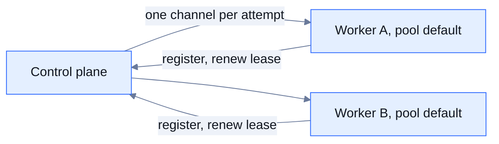

A processor node with `engine.placement` runs on a worker process of a named pool instead of on the server that orchestrates the run. Retries, error routing, timeouts, pause and skip, checkpoints and status work as they do for a local node.

Remote workers are an optional part of the build and are off by default.

## When to use it

Place a node on a worker when it is heavy, must run close to a resource (a private network, a database, a GPU host), or should not compete with the engine for CPU and memory. The server that admits and tracks runs is called the control plane. It still sees every message of a placed node, so placement moves the work, not the data path.

## How it works



- Workers connect out to the control plane over a persistent connection, so a worker needs no inbound port.
- A worker registers with a shared token, its id, its pools, the plugin types it may run and its capacity.
- A registration or a lease renewal keeps the worker listed for `yukta.workers.lease` (default `15s`). A worker that misses it is dropped. Workers renew every third of the lease.
- For each attempt at a node, the control plane opens one channel to a chosen worker. The node's input messages go down it and the output comes back, with back-pressure in both directions. A cancel on the control plane cancels the attempt on the worker.
- The worker runs the real plugin and sends heartbeats while it works, which restart the node's idle clock.

## Selection rule

For each attempt the control plane picks a worker that:

1. Is connected and not draining.
2. Serves the node's pool.
3. Lists the node's plugin type in its `yukta.workers.plugin-types`.
4. Has a free slot: its capacity minus the larger of the slots it reports and the attempts the control plane has already sent it.

Among those, the worker with the most free slots wins. If none qualifies, the attempt fails at once with an error such as "No connected worker in pool 'builders' can run HTTP_REQUEST right now". The error is retryable, so the node's `retry` policy applies.

## Placing a node

Add `placement` to the node's `engine` object. A placement without `pool` uses the pool `default`.

This workflow node calls an internal service and runs on a worker in the `private-net` pool, with up to three attempts:

```json
{
  "nodeId": "fetch-inventory",
  "type": "HTTP_REQUEST",
  "config": {
    "url": "http://inventory.internal/api/stock",
    "method": "GET",
    "engine": {
      "placement": { "pool": "private-net" },
      "retry": { "maxAttempts": 3, "backoffMs": 500 },
      "onError": "ROUTE"
    }
  }
}
```

### What can be placed

| Node kind | Placeable |
|---|---|
| Processors such as `PROCESS_EXECUTOR`, `HTTP_REQUEST`, `SQL_QUERY`, `LLM_CALL`, `MCP_TOOL_CALL`, `MAPPER` | Yes, when a worker lists the plugin type |
| `SESSION_MEMORY`, `KV_STORE`, `WAIT_FOR_SIGNAL`, `SUB_WORKFLOW` | No. They keep state on the control plane, and a placement is refused |
| Triggers and terminals | No. `engine.placement` is for processors only. They always run locally |
| Processors that keep state in memory, such as `ANOMALY` and `DEDUPE` windows | Allowed, but the state lives on whichever worker ran the attempt |

A workflow that places a node needs a control plane built with the workers switch. Without it, preparing the workflow fails with an error that names the switch.

## Failure and retry

- A worker that disappears in the middle of an attempt fails that attempt with an error that names the worker. The engine's retry can land on another worker.
- Delivery is at-least-once. If a worker dies after the effect and before the attempt completes, the effect can happen twice. Make placed plugins idempotent on the message id. See [Checkpoints and resume](/operations/checkpoints-and-resume).
- A worker that reports bad input keeps that meaning and is not retried. Every other error class arrives as a generic execution error that carries the class name in its text, so `retryOn` and `noRetryOn` rules that match on the original class do not see it.
- Messages cross as plain JSON values. Types that exist only inside the worker are not preserved.
- Run budgets and rate limits (for example for `LLM_CALL`) are counted inside each worker process, not for the run as a whole.
- Live log lines written by the plugin on the worker do not reach the execution's log stream.

## Drain on stop

A worker that stops first tells the control plane that it is draining, so it receives no new attempts. It then waits up to `yukta.workers.drain-timeout` (default `30s`) for the attempts it is running. Anything still running after that fails when the connection closes, and the engine retries it on another worker. A rolling restart of workers therefore does not cut off attempts that finish within the timeout.

If a worker loses the control plane, it reconnects with a pause that grows from 1 second to 30 seconds and does not give up.

## Security

- **Token.** Every worker presents the shared `yukta.workers.token`. The control plane compares it in constant time and refuses a wrong one.
- **Mutual TLS.** Without TLS the connection is plain TCP. To encrypt it and authenticate both sides, give the control plane a certificate and require a client certificate, and give each worker its own:

```properties
# control plane
yukta.workers.token=<long random token>
spring.rsocket.server.port=7000
spring.rsocket.server.ssl.bundle=server
spring.rsocket.server.ssl.client-auth=need
spring.ssl.bundle.jks.server.keystore.location=file:/etc/yukta/server.p12
spring.ssl.bundle.jks.server.keystore.password=<password>
spring.ssl.bundle.jks.server.keystore.type=PKCS12
spring.ssl.bundle.jks.server.truststore.location=file:/etc/yukta/client-trust.p12
spring.ssl.bundle.jks.server.truststore.password=<password>
spring.ssl.bundle.jks.server.truststore.type=PKCS12
```

```properties
# worker
yukta.workers.control-plane=cp1.internal:7000,cp2.internal:7000
yukta.workers.token=<long random token>
yukta.workers.id=worker-a
yukta.workers.pools=private-net
yukta.workers.plugin-types=HTTP_REQUEST,SQL_QUERY
yukta.workers.capacity=8
yukta.workers.ssl-bundle=client
spring.ssl.bundle.jks.client.keystore.location=file:/etc/yukta/worker.p12
spring.ssl.bundle.jks.client.keystore.password=<password>
spring.ssl.bundle.jks.client.keystore.type=PKCS12
spring.ssl.bundle.jks.client.truststore.location=file:/etc/yukta/server-trust.p12
spring.ssl.bundle.jks.client.truststore.password=<password>
spring.ssl.bundle.jks.client.truststore.type=PKCS12
```

- **The worker verifies the control plane's host name** against its certificate.
- **A worker runs only the plugin types it lists.** A worker with an empty `yukta.workers.plugin-types` runs nothing. A compromised control plane cannot make a worker run a type it was not started with.
- **The plugin runs inside the worker process.** The worker's own settings and environment apply: the process allow-list, the LLM and MCP filters, the variable allow-list and the secret environment variables. Configure each worker as carefully as the control plane. See [Security](/operations/security).
- Run the same build on the control plane and on workers. The messages between them carry no version.

## Roles and build switches

The same executable is a control plane or a worker, chosen by settings:

| Role | Condition |
|---|---|
| Control plane | `yukta.workers.token` is set and `yukta.workers.control-plane` is not |
| Worker | `yukta.workers.control-plane` is set. It also needs `yukta.workers.token` and `yukta.workers.id` |

A worker is a full Yukta process. When you run several on one machine, give each its own `server.port`.

| Build switch | Effect |
|---|---|
| `-Pyukta.workers=true` | Include the workers module in the build |
| `-Pyukta.workers.native=control-plane` or `worker` | For a native binary: the role it is built as, because a native binary fixes the role at build time |

```bash
./gradlew bootJar -Pyukta.workers=true
```

The worker's build must include the plugins it lists in `yukta.workers.plugin-types`. See [Deployment](/operations/deployment).

## Settings

| Setting | Side | Default | Meaning |
|---|---|---|---|
| `yukta.workers.token` | both | none | Shared secret |
| `yukta.workers.lease` | both | `15s` | How long a renewal keeps a worker listed |
| `spring.rsocket.server.port` | control plane | none | Port workers connect to |
| `spring.rsocket.server.ssl.bundle` | control plane | none | TLS bundle |
| `spring.rsocket.server.ssl.client-auth` | control plane | none | `need` requires a client certificate |
| `yukta.workers.control-plane` | worker | none | `host:port`, comma separated for several control planes |
| `yukta.workers.id` | worker | none (required) | Worker name in the registry |
| `yukta.workers.pools` | worker | `default` | Pools served |
| `yukta.workers.plugin-types` | worker | empty | Plugin types it may run |
| `yukta.workers.capacity` | worker | `4` | Attempts at once |
| `yukta.workers.drain-timeout` | worker | `30s` | Longest wait for running attempts at stop |
| `yukta.workers.ssl-bundle` | worker | none | TLS bundle for the connection |

## Observing workers

```http
GET /api/workers
```

The response lists each live worker with its id, pools, plugin types, capacity, used slots, whether it is draining, when it registered and when its lease ends.

The gauges `yukta.workers` (connected workers) and `yukta.worker.slots` (free slots across them) show capacity. Alert when free slots stay at zero while nodes fail with "No connected worker".

With [high availability](/operations/high-availability), list every control plane in each worker. A standby refuses registration with "this server is not the leader", and the worker ends up on the leader.

## Limits and defaults

| Item | Value |
|---|---|
| Lease | 15 s, renewed every third of it |
| Capacity | 4 attempts per worker |
| Pools | `default` |
| Plugin types | none, so a worker runs nothing until you list some |
| Drain timeout | 30 s |
| Reconnect pause | 1 s growing to 30 s, no limit on tries |
| Message size | No limit set by Yukta |

## Related

- [Failure handling](/concepts/failure-handling)
- [Security](/operations/security)
- [High availability](/operations/high-availability)
- [Configuration](/operations/configuration)
