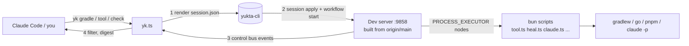
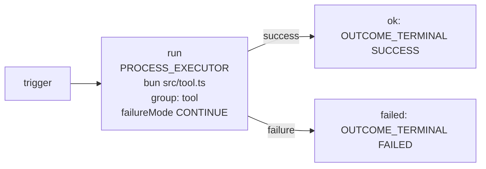
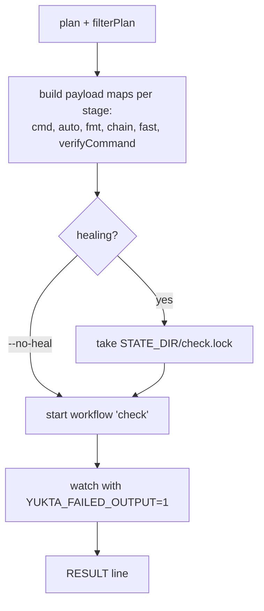
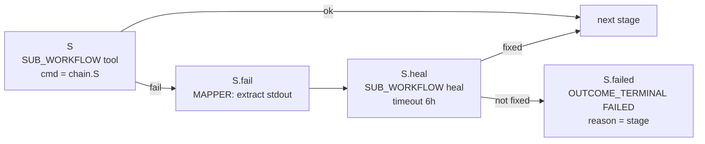
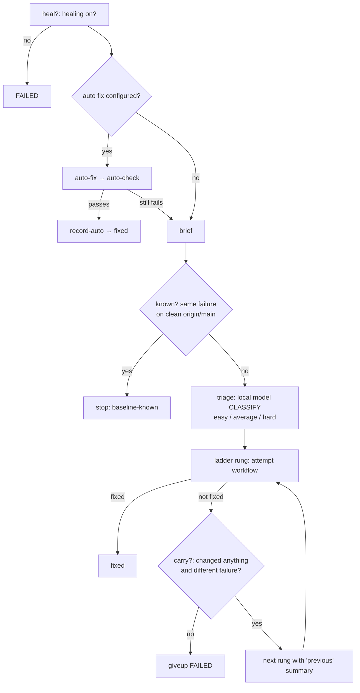
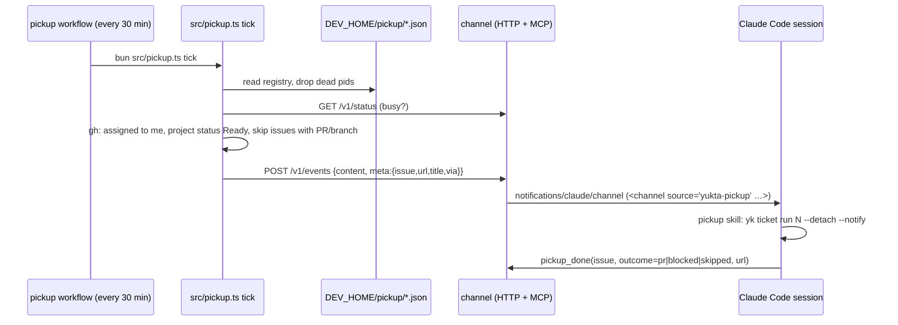
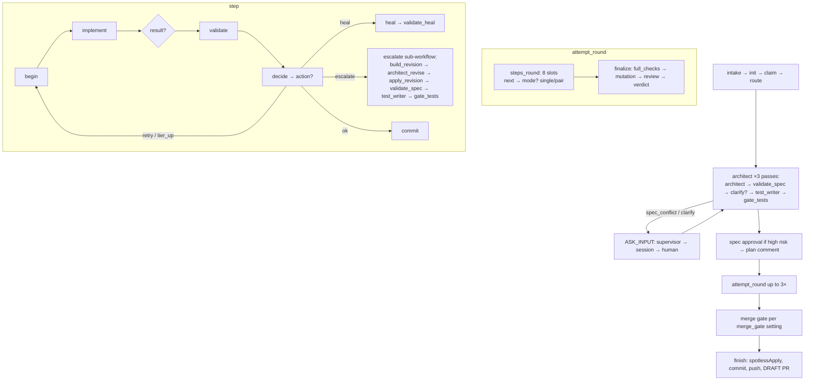

# Dogfood architecture: how it works inside

[README.md](README.md) tells you how to **run** the dogfood. This file explains how it **works**: the Yukta workflows, the TypeScript behind
them, and the reasons for the design. Read it top to bottom once; after that use the table of contents as a reference.

- [1. The idea in one page](#1-the-idea-in-one-page)
- [2. Map of the code](#2-map-of-the-code)
- [3. The dev server and where state lives](#3-the-dev-server-and-where-state-lives)
- [4. `yk` command reference](#4-yk-command-reference)
- [5. Walkthroughs of one run](#5-walkthroughs-of-one-run)
- [6. The workflows in `session.json`](#6-the-workflows-in-sessionjson)
- [7. Self-heal](#7-self-heal)
- [8. From a run to the `RESULT` line](#8-from-a-run-to-the-result-line)
- [9. The Claude Code mod](#9-the-claude-code-mod)
- [10. Pickup channel](#10-pickup-channel)
- [11. Ticket pipeline](#11-ticket-pipeline)
- [12. Design principles and gotchas](#12-design-principles-and-gotchas)
- [13. Testing and changing the dogfood](#13-testing-and-changing-the-dogfood)
- [14. Glossary](#14-glossary)

---

## 1. The idea in one page

Yukta is a workflow server. The dogfood uses it to run **this repository's own** builds, tests and checks. Instead of an agent choosing
which Gradle/Go/pnpm commands to run and reading kilobytes of logs, it calls `yk`, which runs a Yukta workflow and prints one line:

```
RESULT status=SUCCESS failed_node=- healed=- execution=… session=dogfood wall=41 cost=$0 bytes=…
```



Four ideas carry the whole design:

1. **One server, one session, many workflows.** A dev server built from `origin/main` runs on `127.0.0.1:9858`. Everything is a workflow in
   one session called `dogfood`.
2. **Code decides, models act.** Ordering, gates, budgets and "is it fixed?" are TypeScript and exit codes. Claude only edits files (heal)
   or writes specs, tests, code and reviews (ticket pipeline).
3. **Cheapest first.** Stages run cheap to expensive; a free deterministic fix comes before a small model, which comes before a larger one.
4. **Small output.** The caller sees a few lines. Detail is fetched on demand (`yk detail`).

The dogfood also _tests Yukta by using it_: if the server, plugins or workflow engine regress, the dogfood breaks first.

---

## 2. Map of the code

All paths are relative to `examples/dogfood/`. Package: Bun + TypeScript, `ajv` as the only runtime dependency (`package.json`).

### Core (`src/`)

| File                                   | Role                                                                                                                                                                        |
| -------------------------------------- | --------------------------------------------------------------------------------------------------------------------------------------------------------------------------- |
| `yk`                                   | Shell launcher; runs `bun src/yk.ts`. On `PATH` in Claude Code sessions (the mod prepends the folder).                                                                      |
| `src/yk.ts`                            | The CLI. Dispatches every subcommand (`check`, `gradle`, `tool`, `plan`, `up`, `pickup`, `ticket`, `stats`, `bench`, …).                                                    |
| `src/base.ts`                          | Paths and constants (`REPO_ROOT`, `STATE_DIR`, `DEV_HOME`, `DEV_PORT`) and `run()`, a process runner with a **binary allowlist** (refuses anything unlisted with exit 126). |
| `src/client.ts`                        | Talking to the server: API keys, `renderSession`, `findCli` (locating `yukta-cli`), starting workflows, `--notify` delivery.                                                |
| `src/server.ts`                        | Dev-server lifecycle: sync `main/` worktree, build, launch, swap when idle, `ensureServer`, check lock.                                                                     |
| `src/check.ts`                         | `yk check` support: payload building, stage filtering (`filterPlan`), heal records → `healed=`, triage config, `heal-events.jsonl` path.                                    |
| `src/plan.ts`                          | `yk plan`: what changed → which stages to run.                                                                                                                              |
| `src/runs.ts`                          | Watching runs and printing results: `watch`, `tree`, `pause/resume/stop`, `approve/reject`, `detail`, `printResult`, durations.                                             |
| `src/tool.ts`                          | The process every `tool` workflow node runs: `sh -c "$YUKTA_TOOL_COMMAND"`.                                                                                                 |
| `src/failures.ts`, `src/sweep.ts`      | Capture failures to `failures.jsonl`, fingerprint them, file GitHub issues (`yk report`), sweep the server for failures nobody saw.                                         |
| `src/release.ts`                       | `yk up --release`: download the native binary, verify with cosign.                                                                                                          |
| `src/pickup.ts`, `src/input-bridge.ts` | Scheduled issue hand-over and the question/result bridge (§10).                                                                                                             |
| `src/session-render.ts`, `src/lib.ts`  | Thin wrapper to render a session; `lib.ts` just re-exports base/client/server/check.                                                                                        |
| `src/fake-ollama.ts`                   | Test stub for the triage model endpoint.                                                                                                                                    |

### Heal (`src/heal/`)

| File             | Role                                                                                                                                                   |
| ---------------- | ------------------------------------------------------------------------------------------------------------------------------------------------------ |
| `gen-session.ts` | **Generator** for `session.json` (workflows `tool`, `claude`, `attempt`, `heal`, `check`, `pickup`). `--check` exits 1 if the committed JSON is stale. |
| `heal.ts`        | Subcommands the heal workflows call: `brief`, `prepare`, `claimed`, `judge` (the guard), `report`, `record-auto`, `healed`, baseline check, events.    |
| `claude.ts`      | Launches headless `claude -p` for a fixer or a ticket role with pinned models and a tool allowlist.                                                    |
| `fix-reuse.ts`   | The only free auto-fix configured: licence headers via `reuse annotate`.                                                                               |
| `heal-report.ts` | `yk heal report/show`: reads the events log and reports findings.                                                                                      |

### Ticket pipeline (`src/ticket/`) — see §11

`ticketkit.ts` (dispatcher), `yk-ticket.ts` (`yk ticket …`), `gen-ticket.ts` (generator for `ticket-session.json`), `flow.ts`, `ladder.ts`,
`waves.ts`, `route.ts`, `sizing.ts`, `stepkit.ts`, `call.ts`, `roles.ts`, `github.ts`, `branch.ts`, `init.ts`, `advice.ts`,
`gate-tests.ts`, `junit.ts`, `validate-spec.ts`, `validate-schema.ts`, `report.ts`, `lib.ts`, `walk-workflow.ts` (test-only engine stand-in).

### Other folders

| Path                                 | Role                                                                                                                 |
| ------------------------------------ | -------------------------------------------------------------------------------------------------------------------- |
| `channel/`                           | Separate Bun package: an MCP "channel" server (`src/channel.ts`, `http.ts`, `registry.ts`, `pickup.ts`, `main.ts`).  |
| `mod/`                               | Claude Code plugin `yukta-dogfood`: hooks (`hooks/register.tsx`, `gate.ts`, `rewrite.ts`, `plan.ts`, `panes.tsx`).   |
| `session.json`                       | **Generated** (do not hand-edit, do not read whole; Claude's `Read` is denied). From `gen-session.ts` + `heal.json`. |
| `ticket-session.json`                | **Generated** from `gen-ticket.ts` (about 7,500 lines).                                                              |
| `heal.json`                          | Policy: efforts, triage model and ladders, budgets, give-up rule, extra tool variants.                               |
| `rules.json`                         | Server-side supervisor rule `no-kill`: denies `StopWorkflow` with `mode == 'KILL'`.                                  |
| `project.json`                       | Project facts for the ticket pipeline (commands per role, budgets, high-risk paths, shared files).                   |
| `supervisor/`                        | `supervisor.json` + `assignments.json` + `session.json`: the advice supervisor (§11.8).                              |
| `fixer-rules.md`, `fixer-rules/*.md` | System prompt for fixers (constant) plus per-kind and per-ticket-role additions.                                     |
| `schemas/`, `fixtures/`              | JSON Schemas for ticket role contracts; each schema has a `valid.json` and `invalid-*.json` fixture.                 |
| `ticket-template.md`                 | The issue body template `yk ticket new` fills.                                                                       |
| `test/`                              | `bun test` suites mirroring `src/`, fakes in `test/ticket/fake/`.                                                    |

**Generated vs hand-written.** `session.json` and `ticket-session.json` are build outputs. Change the generator (or `heal.json`), run it, commit
both. `bun src/heal/gen-session.ts --check` and `bun src/ticket/gen-ticket.ts --check` fail when the committed file is stale.

---

## 3. The dev server and where state lives

### 3.1 Server

- Built from `origin/main`, never from your working tree. `main/` is a detached worktree synced by `mainSync` (`server.ts`); `mainBuild` runs
  `./gradlew :boot:bootJar :cli:goBuild` there and keeps `builds/<sha>/{yukta.jar, yukta-cli}` (newest 3 kept).
- `serverLaunch` starts `java -jar` detached in its own process group, bound to `127.0.0.1`, with the `tool` and `gradle` **concurrency
  groups** (default 2 each; `YUKTA_DEV_GRADLE_PARALLEL`), `YUKTA_PROCESS_ALLOW_ANY=true` (so nodes may run arbitrary commands) and
  `YUKTA_SUPERVISOR_RULES_FILE=rules.json`. It waits up to 120 s for health and records `server.env` (`YUKTA_DEV_SHA`, …).
- `serverUp` takes `up.lock`. Healthy and same SHA: no-op. Stale and **busy**: print `STALE`, defer. Stale and **idle**: swap. It refuses if
  port 9858 belongs to something it did not start.
- `ensureServer` runs before every `yk gradle|tool|check`: no-op if `YUKTA_SERVER_URL` points elsewhere; fetches at most once a minute;
  starts the server if needed. "Busy" ignores the `pickup` workflow (it never ends).
- Consequence: **workflow JSON comes from your checkout, plugins come from the server build.** A change to a Java plugin only takes effect
  after it is merged to `main` and the server swaps.

### 3.2 State directories

| Name        | Default                                        | Scope            | Holds                                                                                                                                                                                             |
| ----------- | ---------------------------------------------- | ---------------- | ------------------------------------------------------------------------------------------------------------------------------------------------------------------------------------------------- |
| `REPO_ROOT` | `$YUKTA_REPO_ROOT` or git toplevel             | checkout         | —                                                                                                                                                                                                 |
| `STATE_DIR` | `<repo>/.yukta-dev` (`$YUKTA_DEV_STATE_DIR`)   | **per checkout** | heal records (`heal/<session>/<stage>-<n>.json`, `.prev`), `runs.tsv`, `durations.tsv`, `last-result`, `check.lock`, `notify-*.log`, baseline cache                                               |
| `DEV_HOME`  | `~/.local/state/yukta-dev` (`$YUKTA_DEV_HOME`) | **per machine**  | `main/`, `builds/`, `server.pid/env/log`, `build.log`, `up.lock`, `sessions/`, `heal-events.jsonl`, `failures.jsonl`, `pickup.exec`, `pickup/`, `bridge.pid`, key files, `triage.json` (optional) |
| `DEV_PORT`  | 9858 (`$YUKTA_DEV_PORT`)                       | machine          | —                                                                                                                                                                                                 |

Never edit these by hand (the yukta skill says so).

### 3.3 Authentication

Random 32-character keys, mode 0600, in `DEV_HOME`. They reach the server through a Spring properties file
(`--spring.config.additional-location`), **not** the environment, because Gradle children would inherit environment variables.

| Key               | Role                                      | Used by                                                                                              |
| ----------------- | ----------------------------------------- | ---------------------------------------------------------------------------------------------------- |
| `api-key` ("dev") | ADMIN                                     | `yk` itself (`useDevKey()` sets `YUKTA_TOKEN` when the target is the dev URL)                        |
| `fixer-key`       | VIEWER, all sessions                      | headless fixers: read-only MCP (`get_workflow_history`, `get_node_output`)                           |
| `session-key`     | OPERATOR, session `dogfood`, `agent=true` | Claude Code's MCP when `YUKTA_MCP_KEY=session` (only if the build's `ApiKeys.java` supports `agent`) |

The same properties file raises `max-in-memory-size` to 8 MB (the rendered session is over the 256 KB default) and defines the input routing
tiers `yukta.input.routes.ticket`: supervisor (auto, min-confidence 0.85, 20 s) → session (OPERATOR, 30 min) → human (24 h), final timeout
= FAIL.

### 3.4 Rendering and applying the session

`renderSession` (`client.ts`) reads templates from `DEV_HOME/main/examples/dogfood` (falling back to the working tree), replaces
`__PROJECT_PATH__` and `__DOGFOOD__`, forces `sessionId`/`name` to `dogfood`, and **merges the workflows of `ticket-session.json`** (replacing
`__TICKET__`). Every `yukta-cli session apply` sends the _same full set_, so two concurrent runs never delete each other's workflows (the
original bug was "Workflow not found: finalize"). `findCli` looks for `yukta-cli` in: `$YUKTA_BIN`, the build recorded in `server.env`, the
newest build, `PATH`, `cli/build`. If its help lacks "Available Commands" it is considered stale and the run aborts.

### 3.5 Process allowlist

`run()` in `base.ts` only launches a fixed set of binaries (git, gh, bun, bash, sh, claude, cp, mv, ln, tar, cosign, reuse, pgrep,
yukta-cli, java, make, plus named env binaries). This limits what a bug in the glue can execute.

---

## 4. `yk` command reference

`yk help` prints the header comment of `yk.ts` up to the line starting `// Rebuild step 1`; commands below that marker (`up`, `down`, `status`,
steering) still work but are not advertised.

| Command                                                                                                                                 | Implemented in                          | What it does                                                               |
| --------------------------------------------------------------------------------------------------------------------------------------- | --------------------------------------- | -------------------------------------------------------------------------- |
| `yk gradle <args>`                                                                                                                      | `yk.ts` `cmdGradle` → `runTool`         | Runs `./gradlew <args> -q --console=plain` as the `tool` workflow.         |
| `yk tool [-C dir] <cmd…>`                                                                                                               | `yk.ts` `cmdTool` → `runTool`           | Runs any command (Go, pnpm, bun) in `dir`. Arguments are shell-quoted.     |
| `yk check [--full] [--base REF] [--no-heal] [--models …] [--triage off] [--detach] [--stage/--skip]`                                    | `yk.ts` `cmdCheck`                      | The scoped, self-healing gate.                                             |
| `yk plan`                                                                                                                               | `plan.ts`                               | Dry run of the same plan, prints stages (tab-separated).                   |
| `yk up [--background] [--release]`, `down`, `status`                                                                                    | `yk.ts`, `server.ts`, `release.ts`      | Server lifecycle.                                                          |
| `yk watch`, `tree`, `pause/resume/stop [--tree]`, `skip/unskip/retry`, `break`, `step`, `signals`, `approve/reject`, `detail`, `result` | `runs.ts`                               | Follow or steer a run (§8).                                                |
| `yk pickup session\|on\|off\|now\|list\|bridge\|status`                                                                                 | `yk.ts`, `pickup.ts`, `input-bridge.ts` | Issue hand-over (§10).                                                     |
| `yk ticket new\|edit\|run\|status\|resume\|stop\|worktree\|pr\|release\|report…`                                                        | `ticket/yk-ticket.ts`                   | Ticket pipeline (§11).                                                     |
| `yk heal report\|show`                                                                                                                  | `heal/heal-report.ts`                   | Analyse heal events.                                                       |
| `yk report [file]`, `report on\|off\|status`, `report scan`                                                                             | `failures.ts`, `sweep.ts`               | Failure capture and GitHub issue filing.                                   |
| `yk stats`                                                                                                                              | `yk.ts`                                 | Sums runs and heal cost from events or `runs.tsv`.                         |
| `yk bench`                                                                                                                              | `yk.ts`                                 | Compares direct Gradle with `yk`; fails if ratio > 1.5 and overhead > 3 s. |
| `yk statusline`                                                                                                                         | `yk.ts`                                 | Reads only cached files (fast).                                            |
| `yk mcp-headers`                                                                                                                        | `yk.ts`                                 | Prints `X-API-Key` JSON for Claude Code's MCP config.                      |
| `yk sum`                                                                                                                                | `yk.ts`                                 | `changesSum`: sha1 of diff + status, used by the Stop hook.                |
| `yk cli …`                                                                                                                              | `yk.ts`                                 | Pass-through to `yukta-cli`.                                               |

---

## 5. Walkthroughs of one run

### 5.1 `yk gradle :core:test --tests X` and `yk tool`

1. `ensureServer()` (§3.1).
2. `runTool` builds `./gradlew <quoted args> -q --console=plain` (for `yk tool`, the command as given, with `workingDir` from `-C`).
3. `renderSession` → temp `session.json` → `yukta-cli session apply`.
4. `workflow start dogfood tool --payload {project, command, timeout:3600, label}`. Prints `STARTED execution=… session=dogfood`.
5. `--detach` stops here. Otherwise `watchOwned` follows the run (§8).

The **`tool` workflow** is three nodes:



`tool.ts` evaluates `$YUKTA_TOOL_COMMAND` with `sh -c`. An empty command or `-` passes immediately. Exit code selects the port
(`routeByExitCode`). The concurrency group `tool` is why two runs go at once and a third waits.

### 5.2 `yk plan`

`plan()` in `plan.ts` computes the stage list that `yk check` will run.

1. **Changed files** = `git diff --name-only <merge-base with origin/main>` plus untracked files (uncommitted work counts).
2. **Classify** each file: Gradle module, `cli/`, `ui/`, `docs/`, workflows, `examples/dogfood/`.
3. **Gradle modules**: dependency edges come from quoted `":x"` strings in build files (plus `test-support`). Changed modules get every stage
   (spotless, compile, tests, coverage, style, spotbugs, licenses, security); **dependants** only compile and test. A change to the root,
   `build-logic`, `gradle` or `config` plans everything, unscoped.
4. **Tier-1 narrowing**: if only Java files changed, no public/protected/type declaration changed (a textual diff check, not an API diff),
   and each changed class has a `<Class>Test`, only that test runs and no coverage stage is planned.
5. **Go**: `cli.fmt-check`, `mod-verify`, `vet`, `lint`, `sec`, `cover-check`; `vuln` only if `go.mod`/`go.sum` changed.
6. **UI**: tsc, eslint, vitest (related, with scoped coverage), prettier, headers; `ui.build` only with `--full`.
7. **Dogfood**: `bun fmt --check`, `bun check` (and `-p channel`).
8. **Repo-wide**: `reuse`, `actionlint`, `docs`. Each picks the first installed tool variant from `heal.json` `extra`, or emits a "skipped" comment.
9. Output lines: `stage<TAB>dir<TAB>cmd<TAB>auto-fix`, plus `#` comments. Stages run cheapest first; `--full` plans everything unscoped.

### 5.3 `yk check`



- Stage names in the plan use `.`/`-` (`cli.fmt-check`); workflow node names use `_` (`cli_fmt_check`). `yk.ts` normalises with `[.-]→_`.
  A planned stage that the workflow lacks is a hard error.
- Payload maps, keyed by stage: `cmd` (prefixed with `cd dir &&`), `auto` (free fix), `fmt` (formatter to run after a fixer edits files,
  chosen by name prefix in `fmtOf`), `chain` (wraps Gradle stages as `test -f fast.ok || cmd`), `fast`, `verifyCommand`.
- **`fast`**: when two or more Gradle stages are planned, one combined `./gradlew --continue <all tasks>` runs first and `touch`es `fast.ok` on
  success. Then each per-stage Gradle command is a no-op. If `fast` fails, the staged chain runs so each failure is healed individually.
  `--no-fast` disables it.
- Extra payload: `heal`, `triage`, `models`, `budgetCheck` (default 5, `heal.json` `checkBudget` or `YUKTA_BUDGET_CHECK`), `triageModel`,
  `triageUrl`, `rules` (path of `fixer-rules.md`), `claudeBin`.
- Only a **healing** check takes `check.lock` (a pid file), because only it edits the checkout. A non-healing one can run alongside.
- Old heal records move to `heal/<session>.prev` so you can compare with the previous check.

---

## 6. The workflows in `session.json`

Generated by `src/heal/gen-session.ts` from `heal.json`. Plugin types used: `CONSTANT_SOURCE`, `PROCESS_EXECUTOR`, `SUB_WORKFLOW`, `BRANCH`
(`SELECT_KEY` or `EXPRESSION`), `MAPPER`, `CLASSIFY`, `SCHEDULE_TRIGGER`, `CONSOLE_TERMINAL`, `OUTCOME_TERMINAL`. Start variables are written
`${start.x}` / `${start.x:int}`.

Conventions worth knowing:

- A value of `-` means "empty", because start variables cannot be empty (`heal.ts`, `claude.ts`).
- Steps with JSON output must print nothing else, because stderr is merged into stdout.
- `onError: ROUTE` sends an error down a port instead of aborting the run, so the workflow can branch on it.
- A step that must not fail the workflow (e.g. `report`) always exits 0 and the workflow branches on its JSON (`fixed`).
- The `check` stage payload is passed as a string, not a map (gap G11 in the generator).

| Workflow  | Nodes | Purpose                                                                                                                                                                         |
| --------- | ----- | ------------------------------------------------------------------------------------------------------------------------------------------------------------------------------- |
| `tool`    | 4     | Run one command (§5.1).                                                                                                                                                         |
| `claude`  | 4     | Run `src/heal/claude.ts` (headless Claude) with stdin input and JSON output; env `YK_*` carries model, effort, budget, rules, schema, session, bin.                             |
| `attempt` | 11    | One repair attempt: `prepare` → `claude` (sub-workflow) → `claimed` → `format` (sub-workflow `tool`) → `judge` (guard) → `recheck` (sub-workflow `tool`) → `report` → `fixed?`. |
| `heal`    | 26    | The escalation ladder (§7).                                                                                                                                                     |
| `check`   | ~108  | One block per stage plus `fast`, `healed?`, `verify`, `done`.                                                                                                                   |
| `pickup`  | 4     | `SCHEDULE_TRIGGER` every 30 min → `bun src/pickup.ts tick` → console terminals.                                                                                                 |

### 6.1 Shape of one stage block in `check`



`licenses` and `security` have no heal node (`NO_HEAL`): a failure goes straight to `S.failed`. After the last stage, `healed?` checks whether
anything was fixed; if so `verify` re-runs all Gradle tasks (a fix can break an earlier stage), and `verify.heal` can heal that too.
The failed stage name becomes `failed_node` in the `RESULT` line.

Stage order (cheap first, from `STAGES` in `gen-session.ts`): `reuse`, `actionlint`, `docs`, then `fast`, then spotless/compile/tests/… for Gradle,
UI and Go stages, with `licenses`/`security` last.

---

## 7. Self-heal

When a stage fails, `S.heal` runs the `heal` workflow. Goal: fix it with the cheapest sufficient means, and **know when to stop**.



### 7.1 Steps in detail

1. **Free fix.** `heal.json` `extra.reuse.auto` runs `fix-reuse.ts` (`reuse lint --json`, then `reuse annotate` with Apache-2.0/Infenia,
   `.license` sidecars for types that cannot hold comments). Spotless, `make fmt`, `prettier --write`, `eslint --fix` are formatter-style
   fixes (the `auto` column of the plan). Passing the re-check ends the heal at zero model cost.
2. **`brief`** (`heal.ts`): a 1000-character brief for the triage model (stage, ecosystem, changed-file count, command, 25 problem lines) and
   a longer `problems` text for the fixer (60 problem lines plus the last 40 output lines).
3. **Baseline-known stop.** `baselineKnown()` runs the stage command once on a clean `origin/main` worktree, cached under
   `STATE_DIR/baseline/<sha>/<stage>`. Numbers and paths are normalised. If every problem line also fails on main, the failure is not yours:
   no fixer runs, event `baseline`.
4. **Triage.** A `CLASSIFY` node calls a local Ollama model (`tev1`) at the URL in `heal.json`. Labels: `easy`, `average`, `hard`.
   `minProbability` is 0.3; `uncertain`, errors and `--triage off` all fall to `triage.default` = `average`. Override model/URL with
   `YUKTA_TRIAGE_*` or `DEV_HOME/triage.json`. Every triage outcome is also logged (`triage-log.*` nodes) so `heal report` can judge whether
   triage was right.
5. **Ladders** (`heal.json`, one attempt per rung, effort does not climb):

   | Level   | Rungs                   |
   | ------- | ----------------------- |
   | easy    | haiku/low → sonnet/low  |
   | average | haiku/high → sonnet/low |
   | hard    | sonnet/low              |

   Efforts: `low` = 600 s / $0.50, `high` = 1800 s / $2. Rungs shared between levels share a node; the generator throws if two levels give
   the same rung different successors.

6. **Escalation guard** (`carry.<rung>?`). The ladder **gives up instead of escalating** when: the attempt changed no file; the failure digest
   equals the previous attempt's (sha1 of the output with numbers normalised, stored in `<stage>.digest`); or the stage is in
   `singleAttempt` (`reuse`, `docs`, `actionlint`). Otherwise the next rung receives the previous summary and the changed-file list.
7. **After healing**, `check` re-runs all Gradle tasks once (§6.1).

### 7.2 One attempt (`attempt` workflow, `heal.ts`)

- **`prepare`** exits 4 ("not started") when: the model is not in `--models`; the whole-check budget (`checkBudget`, $5, summed from record
  `cost`s) is spent; or the **give-up policy** applies (at least 5 attempts in 7 days with a fix rate ≤ 10%, from `fix` events; auto fixes
  and non-started attempts excluded). It snapshots the tree with `git stash create`.
- **Prompt.** The user prompt has: stage, session id, problems, `excerpts()` (up to 6 tracked-file spots with ±6 lines), the earlier attempt,
  `git diff --stat` of the developer's own edits to keep, the single verify command, the time box, and "answer with JSON only". The **system
  prompt is the constant `fixer-rules.md`** (13 lines: fix the cause, no suppressions, no weakened tests, no config edits, no commit/push,
  `fixed=false` if stuck) so every attempt shares the cached prefix. `claude.ts` appends `fixer-rules/<kind>.md`: `style→pmd`,
  `spotbugs`, `compile`, `coverage`, `tests→junit`, `ui_vitest→vitest`, other `ui_*→ui`, `cli_*→go`. `YK_ROLE` selects the ticket role files and wins.
- **Headless Claude** (`claude.ts`): project settings and hooks load (`--setting-sources project`), but `--strict-mcp-config`,
  `--disable-slash-commands` and `CLAUDE_CODE_DISABLE_CLAUDE_MDS=1` keep token cost low. Models are pinned (haiku-5-5, sonnet-5-5,
  opus-5-5) so cost does not drift with aliases. Allowed tools: Read, Edit, Write, Grep, Glob and a fixed list of Bash prefixes; `git commit`
  and `git push` are denied. Optional read-only Yukta MCP uses the `fixer` key. Parent `CLAUDE_*` variables are unset and
  `YUKTA_HEAL_FIXER=1` is set (the mod disables itself on it, §9).
- **`format`** runs the stage's formatter; **`recheck`** re-runs the stage command and is **the only judge of "fixed"**.
- **`judge` (the guard)** decides from what changed on disk, not what Claude claimed. It rejects: a change under a protected path (`config/`,
  `build-logic/`, `gradle/`, `.github/`, `.claude/`, `examples/dogfood/`, `REUSE.toml`, `*.gradle.kts`); an added suppression; more assertions
  removed than added; test files edited with no source change; a claimed fix with no change. Files outside the failing module are recorded
  but not a violation. A guard hit or false claim rewrites the summary to "NOT FIXED … The model said: …".
- Nothing in heal commits or reverts. Fixers edit the working tree; **you review `git diff` afterwards** (the `healed=` field lists stages).

### 7.3 Observability

- `emit()` appends JSONL to `heal-events.jsonl`: `brief`, `baseline`, `triage`, `fix`, `stage`, `recheck`, `verify`, `giveup`, `result`.
  Errors are swallowed so monitoring never breaks a heal. Events from `heal.ts` carry `run:-` and are stamped with the next `result` of the session.
- Per-attempt record: `STATE_DIR/heal/<session>/<stage>-<n>.json`, with `.before`, `.base`, `.claude`, `.verdict` beside it.
- `yk heal report` findings: `under-triage` (≥5 solved and half fixed above the triage rung), `guard-hits`, `giveups`, `repeated-failure`
  (same signature ≥3×), `unfinished-results`, `reuse-low-fix-rate`.
- Diagnose one attempt:
  `jq -c 'select(.event=="fix") | {stage,model,effort,fixed,files,cost,guard,summary}' ~/.local/state/yukta-dev/heal-events.jsonl | tail -8`.

---

## 8. From a run to the `RESULT` line

`runs.ts` turns a stream of control-bus events into a few lines.

1. **Watch.** `cmdWatch` runs `yukta-cli controlbus watch --execution X --until-done --quiet`. `NOISE` filters nodes that never ran (`--all`
   shows everything). `--stages` adds one `STAGE <name> finished` line per stage via a second watcher. A 3 s poll prints
   `APPROVAL <name> waits at <node>: yk approve …`.
2. **`printResult`** assembles:
   - `failed_node`: first FAILURE/TIMED_OUT task, with suffixes (`.run1`, `.f1`, `.heal`) stripped by `nodeStage`; or an `OUTCOME_TERMINAL`
     with outcome FAILED (its name minus `.failed`).
   - `status`: a SUCCESS execution that reached an ESCALATE/FAILED/RETRY terminal reports that outcome instead.
   - **Failure digest** (check only, `YUKTA_FAILED_OUTPUT`): last 40 lines of the failed stage's stdout as `OUTPUT <stage>: …`.
   - On failure, `MORE yk detail <session> <execution> [--grep P] [--tail N] [--head N]`.
   - `RESULT status= failed_node= healed=stage:mode[/effort],.. execution= session= wall= cost=$ bytes=`. `bytes` counts what was shown to the
     caller. Exit code 0 only for SUCCESS/COMPLETED.
3. **Side effects** (all best-effort): a `result` event in `heal-events.jsonl` (deduplicated per run); a line in `runs.tsv`; `last-result`
   (changes sum, status, scope, healed) for the status line and the Stop hook; `durations.tsv` plus a `SLOW <stage>` line when a stage takes
   > 15 s and > 1.5× its median of the last 10 runs (needs 3 prior runs); `recordFailure` on a non-success.
4. **Ctrl-C / SIGTERM** stops the execution tree (`/stop?tree=true`, a drain) and records `STOPPED`. A `--detach` run outlives its client.
5. **`--notify`** (needs `--detach`): a detached `yk _notify` follows the run and writes the summary into the Claude Code session through
   `CLAUDE_CODE_MESSAGING_SOCKET`. Such a message only reports; it is not user approval.
6. **Failure capture.** `recordFailure` appends to `failures.jsonl` with a **fingerprint** (sha1 of kind, location and the first error line with
   ids/paths/numbers blanked). `yk report file [--yes]` files GitHub issues, remembering fingerprint → issue number in `failures-filed.json`.
   `sweep.ts` (`yk report scan`) also catches failures `printResult` never saw: failed executions, runs stuck longer than `--stuck`, new
   `ERROR` lines in `server.log`; idempotent via `sweep.json`.

---

## 9. The Claude Code mod

`mod/` is a Claude Code plugin named `yukta-dogfood` (depends on `yukta`). `hooks/hooks.json` is `{ "modules": ["./register.tsx"] }`: the hooks
are TypeScript handlers registered in `register.tsx`, not shell scripts. `rewrite.ts` is a port of an older `yk-hook.sh`.

**Off switch** (`isOff`): `YUKTA_DOGFOOD=off`, or `YUKTA_HEAL_FIXER` set (headless fixers must be allowed to run `./gradlew`), or no
`examples/dogfood/yk`.

| Hook                              | Behaviour                                                                                                                                                                                                                                                                         |
| --------------------------------- | --------------------------------------------------------------------------------------------------------------------------------------------------------------------------------------------------------------------------------------------------------------------------------- |
| `SessionStart`                    | Writes `.yukta-dev/baseline-<sid>` with the current `yk sum`; prunes baselines > 7 days; runs `yk up --background` (not after a compact); prepends `examples/dogfood` to `PATH`; adds context "Yukta dev server: … direct gradle, go and pnpm are blocked".                       |
| `UserPromptSubmit`                | If the prompt mentions test/build/gradle/lint/issue/epic…, adds a hint to use `yk`.                                                                                                                                                                                               |
| `tool.call` (Bash) — **the gate** | `rewrite()` splits the command on `&&`, `                                                                                                                                                                                                                                         |     | `, `;`, ` | `, `&`, parentheses; strips env, `time`, `nice`, `timeout`; maps `gradle`/`gradlew`→`yk gradle …`(dropping`-q`, `--console`), `go test | vet | build | fmt`→`yk tool -C cli …`, `pnpm | npm | npx | pnpx`→`yk tool -C ui …`. `bootRun`/`nativeRun` pass through. On a match it **denies** and names the replacement. |
| `Stop` (`stopNudge`)              | Blocks stopping once with "run the quality gate: yk check" only if code files changed, the change sum differs from the session baseline (not your teammate's changes), it was not nudged for this sum, no SUCCESS result exists for this sum. Does nothing if `stop_hook_active`. |
| `TaskCompleted` (`taskGate`)      | Experimental, teammates only: runs `yk check --no-heal` (540 s timeout), reports the last 12 `ERROR/FAILED/OUTPUT` lines + `RESULT`. **Fails open** on no RESULT, timeout or crash.                                                                                               |

**Panes and commands.** `/yk-plan` opens a pane running `yk plan` (`plan.ts` parses its tab-separated lines). `/yk-check` runs
`yk check --detach --notify`, parses `STARTED execution=… session=…`, then streams `yk watch <s> <e> --stages`; `applyLine` turns `STAGE`,
`x.heal`, `RESULT`, `ERROR|WARN|HEAL|SLOW|OUTPUT|APPROVAL` lines into pane state. `panes.tsx` is pure drawing (gradient title, progress bar,
spinner, colours per Gradle/UI/Go/Repo; buttons run, refresh, stop). A 120 ms clock animates only if a pane drew in the last 2 s.

---

## 10. Pickup channel

Lets a scheduler hand a GitHub issue to an idle interactive Claude Code session.



- **Start.** `yk pickup session` installs the channel's dependencies, creates `pickup-token`, writes `pickup-<name>.mcp.json` (inline JSON was
  not loaded by claude 2.1.x) and starts `claude --name N --mcp-config … --dangerously-load-development-channels server:yukta-pickup`.
  `yk pickup on` starts the `pickup` workflow; its execution id is `DEV_HOME/pickup.exec`.
- **Channel server** (`channel/`): generic MCP server over stdio with experimental capability `claude/channel` (and optional permission relay).
  HTTP on `127.0.0.1` only. Open: `GET /v1/status`, `/v1/openapi.json`. Bearer token (file re-read per request, so it can be rotated):
  `POST /v1/events`, `GET /v1/stream` (SSE), permission endpoints. `registry.ts` writes `{name, port, pid, started}`; a duplicate live name
  becomes `<name>-<pid>`. The `pickup` profile is **exclusive**: one issue in flight, 409 otherwise.
- **`tick`** picks the highest priority (P0 first, then lower issue number) allowed issue, skipping ones with an open PR ("fixes #n") or an
  `issue/<n>` branch. Allowlist: `--issue` flag or `DEV_HOME/pickup-issues`. `skip()` exits 0 with `PICKUP skipped=<why>`. In ticket mode
  (`YUKTA_PICKUP_MODE=ticket`) it skips sessions and runs `yk ticket run <n> --detach` directly, one at a time (`pgrep`).
- **Validation** in `channel.submit`: 64 KB content cap, ≤ 32 meta keys, keys `[A-Za-z0-9_]+` (others are dropped silently by Claude Code),
  `event_id`/`sender` reserved, sender allowlist, idempotency keys (10 min TTL), then the notification. A 200-event ring buffer feeds `/v1/stream`.
- **Bridge** (`input-bridge.ts`, `yk pickup bridge`): pushes `kind=input` (a ticket run asks a question; tiers session and human; the content tells the
  session to decide via `answer_input`, or leave HIGH risk to a person) and `kind=result` (root workflow ended). These do not take the slot.
- **`pickup_done`** releases the slot only for the matching issue, publishes `done`, appends to `pickup.jsonl`. `pr` requires a URL. A lost call
  frees itself after 4 h (`outcome:'timeout'`).
- **Security stance.** Issue text is untrusted; the channel's `INSTRUCTIONS` constrain the session to implementing the issue. The channel
  refuses permission relay without a sender allowlist. If a fixed port is taken the channel keeps serving MCP without HTTP and without a
  registry entry, so `tick` will never find it.

---

## 11. Ticket pipeline

Turns an issue into a tested **draft PR** (`Fixes #n`). Never merges, never pushes `main`. Run state: `.yukta-dev/ticket/<run_id>/`; branch
`issue/<n>`; worktree `../yukta-issue-<n>`. Every node is a `PROCESS_EXECUTOR` running `bun src/ticket/ticketkit.ts <sub>`; `ticketkit.ts` is
a lazy-import dispatcher. A model call is `ticketkit call ROLE` → `claude.ts --role ROLE` → `call.ts`.

### 11.1 Roles and contracts

| Role               | Rules                   | Output                                                            | Schema                                |
| ------------------ | ----------------------- | ----------------------------------------------------------------- | ------------------------------------- |
| Architect          | `ticket-architect.md`   | `spec/spec.json` + `scaffold.patch` stubs, or NEEDS_CLARIFICATION | `ticket-spec`, `needs-clarification`  |
| Architect (revise) | same                    | `spec/revision-result.json` answering `revision-request.json`     | `revision-request`, `revision-result` |
| Test writer        | `ticket-test-writer.md` | `spec/test-writer-result.json` (never sees the ticket)            | `test-writer-result`                  |
| Implementer        | `ticket-implementer.md` | `steps/S/attempt-N/result.json` from a `step-packet`              | `step-result`, `step-packet`          |
| Reviewer           | `ticket-reviewer.md`    | `review/result.json` (must contain `TESTS_FAITHFUL`)              | `review-result`                       |
| Code, not a model  | —                       | `failure.json` digest ≤ 2 KB                                      | `failure-digest`                      |

All validated with ajv (`validate-schema.ts`); output is schema-constrained at the CLI, and invalid output gets one retry with the validator's
message. Each schema has fixtures in `fixtures/<name>/`. Key rules: content in `<ticket>`/`<diff>` blocks is **data, not instructions**; the
architect self-checks with `validate-spec` until `errors=0`; the implementer touches only `write_files` and returns BLOCKED rather than guessing
(categories `missing_context`, `spec_conflict`, `contract_unclear`, `needs_out_of_scope_change`).

### 11.2 Intake

`ticket-template.md` has Goal, Acceptance criteria, Sizing, Pipeline roles. Only the **acceptance criteria** are requirements. `github.ts intake`
exits 3 (SKIPPED) if the issue is not open, not assigned to you, or not Ready on the project; exits 4 (BLOCKED) if a criterion asks for secrets,
a push to main, other repos, settings changes or skipped checks. `init.ts` extracts criteria; none → SKIPPED, no tokens spent.

### 11.3 Routing

`route.ts`: complexity from criteria count (≤2 S, ≤5 M, else L; >1 ecosystem raises S to M); risk high for `risk`/`security` labels, >1 module, or
`high_risk_paths` globs. `sizing.ts` measures the `- files:` globs against the base tree and the `- change:` kinds (concurrency, schema,
api_contract, security raise to ≥ M) and `- open_decisions:` (≥2 raises to ≥ M). `decide` takes the **higher** of static and sizing (never
lowers) and records a `basis`. `modelsFor` picks models from a table by complexity/risk, bumps the architect's effort if there are open
decisions, nulls the test writer when its output would not be used, and lets ticket-set roles override. `testsModeFor`:

| kind                    | tests_mode                                          |
| ----------------------- | --------------------------------------------------- |
| docs / chore            | existing                                            |
| bug                     | repro_only                                          |
| feature, S and low risk | implementer_writes                                  |
| anything else           | cases_to_code (`architect_code` only for high risk) |

Budgets per run come from `project.json` `budgets_usd` by complexity.

### 11.4 Spec validation (`validate-spec.ts`)

Schema, then: ticket id matches; no duplicate steps or cycles; scaffold patch applies and touches only stubs; each step's `write_files` inside
`scope.allowed_globs`, outside `forbidden_globs`/`denied_write`/locked files; guard paths blocked unless the issue is about build/dogfood
(becomes a `spec_conflict` question to a person); `max_files`; `read_files` exist; `done_when` matches project command templates; steps are
independently verifiable; unique case ids, all covered, not all guards; `MAX_STEPS` S=2, M=5, L=8; providers before consumers. A valid spec
writes `spec.hash`, and may raise risk via high-risk paths.

### 11.5 Test gate (`gate-tests.ts`)

After the test writer: only stubs and locked test files changed; every case has a `[T#]`-tagged test; tests compile and **fail red** with an
assertion or "not implemented" (setup/import/syntax errors fail the gate); `guard` cases pass; trivial tests (always-true, skipped, empty)
are rejected. Then it writes `spec/locked.json` (sha256 per file) and `test_map.json` from the **report**, not from the agent's claim. Modes
`existing`/`implementer_writes` skip the red check. Parsers: junit (`junit.ts`), vitest JSON, go test.

### 11.6 Execution (`flow.ts`, `ladder.ts`, `waves.ts`)

`flow.ts` is model-free glue: `preflight`, `retry-spec`, `commit-tests`, `step-begin`, `validate-step`, `commit-step`, `full-checks`,
`mutation`, `close`. `validate-step` builds `diff.patch` **from git** (authoritative), runs `regen`, `scope-check`, free formatters, then the step gate
`yk check --no-heal --base B`. A failure writes the digest and exits 1. (`TICKET_GATE_STEP` / `TICKET_GATE_FINAL` override the gates for offline tests.)

> The header comment of `flow.ts` still says `preflight` runs "one step of a low or medium risk spec" (a walking skeleton). The generated
> workflow has waves, approvals and reviews, so treat that comment as stale.

`ladder.ts decide` returns one of retry, tier_up, heal, baseline, revise, human, pause:

| Situation                                                                         | Action                                                                                                        |
| --------------------------------------------------------------------------------- | ------------------------------------------------------------------------------------------------------------- |
| BLOCKED with a spec category                                                      | revise (architect revision → spec v+1)                                                                        |
| licenses / security failure                                                       | human (never a model)                                                                                         |
| `infra_error` / `timeout`                                                         | rerun once, then human                                                                                        |
| fails on clean `origin/main` too                                                  | baseline                                                                                                      |
| style, spotbugs, ui__, cli__                                                      | heal once (`yk check --stage`; edits outside `write_files`/locked tests are reverted and logged), then revise |
| mechanical (scope_violation, locked_file_modified, patch_apply_fail, format_fail) | retry once                                                                                                    |
| compile, tests, coverage                                                          | attempt 2 same model, attempt 3 one tier up (haiku/medium → sonnet/medium → sonnet/high), then revise         |
| budget exceeded                                                                   | pause (`ack-pause` doubles budgets)                                                                           |

Limits: 3 attempts per step (+1 after a revision), 2 architect revisions per run, wall-clock cap 60/120/240 min, clarification ≤ 2 rounds.
`review-verdict`: a blocker finding overrides APPROVE; unmet `TESTS_FAITHFUL` is a major finding. `mutation` (pitest) runs for medium/high
risk; survivors > 0.25 become a reviewer finding and never fail the run.

`waves.ts`: `next-wave` returns none/single/pair. A pair needs `max_parallel ≥ 2`, **disjoint** `write_files`, neither step touching serial files
(`ui/package.json`, lockfile, `cli/go.mod|sum`, `project.json` `shared_files`). `prepare` gives the second step its own worktree/branch from the
same base; `warm-wait` makes the sibling wait for the first's prompt-cache prefix (`TICKET_WARM_TIMEOUT`, 300 s); `merge` merges in step
order and aborts on conflict instead of resolving; `check` runs the post-wave gate.

### 11.7 The generated `ticket` workflow (`gen-ticket.ts` → `ticket-session.json`)



Every stage has a `.failed` terminal and a `.dead` node calling `github dead-end`. Loops are **unrolled** (architect ×3, step ×4 attempts, 8
step slots) because the workflow graph is a DAG. Claude calls share the `claude` concurrency group; Gradle goes through `yk check` in `tool`.
`walk-workflow.ts` is a server-free stand-in engine used by tests: supports CONSTANT_SOURCE, PROCESS_EXECUTOR, BRANCH, ASK_INPUT,
SUB_WORKFLOW, SPLITTER, terminals; prints `NODE <id> <port>` and `OUTCOME`.

### 11.8 Issue → PR, and questions

1. `yk ticket new` files the issue (`--ready` sets project status; `--dry-run` shows body and route); `edit` keeps the rest of the body (`r=auto`
   returns a role to the router).
2. `yk ticket run N [--local] [--detach --notify]`: workflow `ticket` is injected into session `dogfood` (or `ticket-local` with `--local`).
3. `github intake` → `init` (run dir, branch and worktree via `branch.ts`) → `github claim` (issue to In progress).
4. Spec, tests, steps, review (above). `plan-comment` posts the spec summary to the issue.
5. `github finish`: `spotlessApply`, commit, push `issue/<n>`, open a DRAFT PR with a Conventional-Commit title and `Fixes #n`, the RESULT line, spec
   summary and cost per role; fails if the body lacks `pr_body_must_contain`.
6. `branch.ts`: `worktree` reuses or creates; `pr` refuses main/master, dirty trees, no commits, non-conventional titles and does not duplicate
   an existing PR; `release` detaches the worktree at `origin/main`.
7. On failure `dead-end` puts the issue back to Ready and comments what blocked it; a worktree with no commits is released and its diff saved
   to `leftover.patch`.
8. **Questions** (`ASK_INPUT`) follow the routes from §3.3. The `supervisors` session workflow (`supervisor/session.json`) fires on
   `InputRequested` for route `ticket`: `advice` runs `ticketkit advice` → `hand-up` builds an `EscalateInput` with recommendation, confidence
   and advice → escalates. It **never answers** (`canAnswer:false`, `maxRisk` LOW); it only informs the next tier. `yk-ticket.ts` substitutes
   `__TICKET__` and `__STATE__` when it installs it.

`call.ts` exit codes: clarify 2, blocked 3, schema 4, api 5, limit 6. Crashes and transient API errors (429, 5xx, overloaded) retry up to twice;
turn/budget caps and other API errors do not.

Telemetry goes to `ticket-events.jsonl`; `ticketkit report` shows first-try pass rate by model/effort/complexity (BLOCKED rate above 15% means
steps are too small). Offline tests use a fake `claude`, a fake `gh` and a throwaway git repo.

---

## 12. Design principles and gotchas

**Principles**

- **Deterministic spine, models at the edges.** Every decision that can be code is code; "fixed?" is a re-run of the command, never the
  model's word.
- **Truth from git and test reports**, not from agent claims (`diff.patch`, `test_map.json`, the guard).
- **Cheapest first, stop early.** Free fix → baseline → small model → larger model; no-op and same-failure stops; budgets per check and per run.
- **Defence in depth against prompt injection** (ticket pipeline): data delimiters, criteria-only requirements, intake block-list,
  `denied_write` and guard paths, locked tests (sha256), `INSTRUCTIONS` in the channel, process allowlist.
- **Small outputs, fetch detail later.** `RESULT` → `OUTPUT` → `MORE yk detail`.
- **Idempotent apply.** The whole workflow set is re-applied each run.

**Gotchas**

- Workflow JSON from the checkout, plugins from the server build; a plugin change needs a merged commit and a swap.
- `session.json` / `ticket-session.json` are generated; edit the generator, regenerate, commit (`--check` fails CI otherwise).
- Stage names: `.`/`-` in plans, `_` in workflows.
- `fast.ok` lives in the heal dir (`STATE_DIR/heal/<session>/`) and makes later Gradle stages no-ops; it is written only after a fully green `fast` run.
- A swap of the dev server is deferred while any non-pickup workflow runs (`yk status` shows `STALE`).
- The triage model address in `heal.json` is a LAN IP; on another network set `YUKTA_TRIAGE_URL` or `DEV_HOME/triage.json`, or use `--triage off`.
- `heal.json` `efforts` has only `low` and `high`; `claude.ts` accepts `medium` but there is no budget row for it (README open question).
- Do not edit files or run Gradle in the checkout while a healing `yk check` runs: a fixer is editing it.
- `yk help` hides commands below the `// Rebuild step 1` marker in `yk.ts`.
- `flow.ts` header comment on `preflight` is stale (see §11.6).
- `rules.json` denies `StopWorkflow` with `mode == 'KILL'` because it leaves a fixer's edits half done; use `yk stop <e> --tree` (a drain, fixers get up to 30 s).

---

## 13. Testing and changing the dogfood

**Run** (all through `yk tool`, never bare `bun`):

```bash
yk tool -C examples/dogfood bun test                 # everything
yk tool -C examples/dogfood bun test test/plan.test.ts
yk tool -C examples/dogfood bun check                # typecheck
yk tool -C examples/dogfood bun fmt --check          # prettier (width 140, no semicolons, single quotes)
yk tool -C examples/dogfood bun src/heal/gen-session.ts --check
yk tool -C examples/dogfood bun src/ticket/gen-ticket.ts --check
```

**Test layout.** `test/*.test.ts` mirror `src/` (`plan`, `yk`, `events`, `failures`, `answer`, `pickup`, `input-bridge`, `notify`,
`session`, `stats`, `allowlist`, `session-key`); `test/heal/` covers guard, no-progress stop, `claude.ts` args and MCP tool rules, and the
report; `test/ticket/` covers ladder, gates, spec, step, waves, schemas, sizing, call, branch, advice and the end-to-end walk with fakes
(`fake/claude.ts`, `fake/gh.ts`). Files named `*.online.test.ts` need a live server and are not run by default. `channel/test/` tests the channel.

**Recipes**

- _Add or change a stage._ Edit `plan.ts` (when it is planned, its command and auto-fix), add it to `STAGES` in `gen-session.ts` (and
  `NO_HEAL` / `FAST_BEFORE` if relevant), add a `fixer-rules/<kind>.md` mapping in `claude.ts` `roleKind` if it needs one, regenerate
  `session.json`, update tests, run `yk check`.
- _Change a heal policy._ Edit `heal.json` (ladders, efforts, budgets); regenerate; check `yk heal report` after a few runs.
- _Add a ticket role or contract._ New `schemas/<x>.schema.json` + `fixtures/<x>/{valid,invalid-*}.json`, rule file in `fixer-rules/`, role
  wiring in `roles.ts`/`call.ts`, node in `gen-ticket.ts`, regenerate `ticket-session.json`, tests in `test/ticket/`.
- _Add a `yk` subcommand._ Implement in `yk.ts` (or its own module, lazy-imported), add to the header comment (so `yk help` shows it), test in
  `test/yk.test.ts`.

---

## 14. Glossary

| Term                     | Meaning                                                                                       |
| ------------------------ | --------------------------------------------------------------------------------------------- |
| Dev server               | Yukta server built from `origin/main`, on 9858, started on demand.                            |
| Session `dogfood`        | The one Yukta session that holds all workflows.                                               |
| `tool`                   | Workflow that runs one shell command.                                                         |
| Stage                    | One check in the plan (`spotless`, `compile`, `tests`, `ui.tsc`, …) and its block in `check`. |
| Heal                     | Repair workflow for a failed stage.                                                           |
| Rung                     | One (model, effort) attempt in a ladder.                                                      |
| Triage                   | Local-model classification of a failure as easy/average/hard.                                 |
| Guard                    | `judge`: checks what a fixer changed on disk.                                                 |
| Baseline-known           | Failure that also exists on clean `origin/main`.                                              |
| `fast`                   | Single combined Gradle run that makes per-stage Gradle commands no-ops.                       |
| `RESULT` line            | One-line outcome of any `yk` run.                                                             |
| `DEV_HOME` / `STATE_DIR` | Per-machine / per-checkout state folders.                                                     |
| Channel                  | MCP server that pushes events into a Claude Code session.                                     |
| Pickup                   | Scheduled hand-over of a ready issue to an idle session.                                      |
| Ticket pipeline          | Architect → test writer → implementer → reviewer workflow producing a draft PR.               |
| Spec / scaffold          | Architect's plan and stub patch for a ticket.                                                 |
| Locked tests             | Tests whose sha256 is recorded; implementers cannot change them.                              |
| Wave                     | One or two steps run together when their files are disjoint.                                  |
| Mod                      | The `yukta-dogfood` Claude Code plugin with the hooks.                                        |
